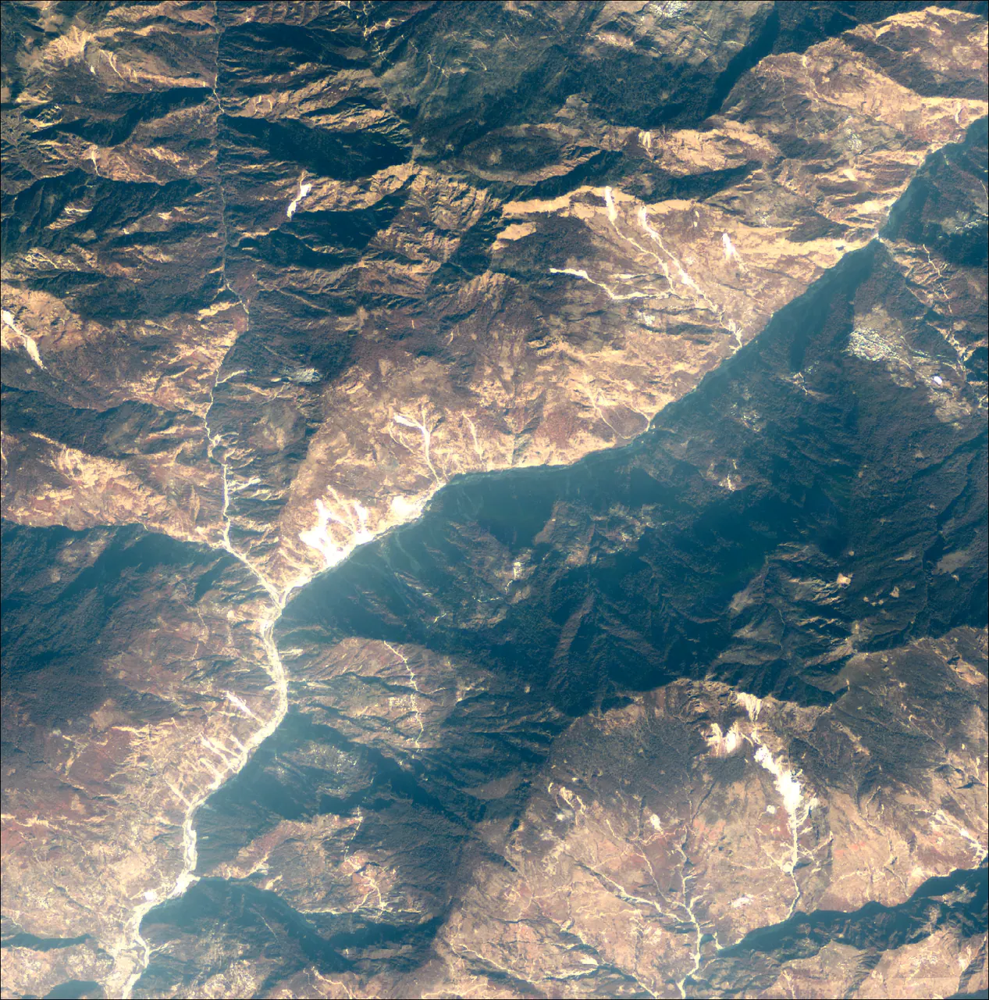
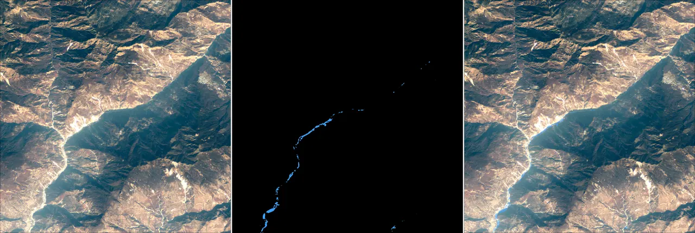

# `seg.reservoir`

> 干旱核心：水域面积萎缩监测；需 14 波段输入

| | |
|---|---|
| 模块 | `perception` · `src/dora/tools/perception.py:451`（13 行） |
| 相关性 | ★★★ |
| 可迁移性 | C（14 波段归一化） |
| 依赖 | 模型 WeTr 14ch |
| 异常处理 | 函数内 `try/except`：异常转成 `{"error": ...}` 返回 |

## 源码中的原话

> Segment reservoirs from multi-modal data: multi-spectral optical + DEM + slope. Spatial resolution: 10m. IMPORTANT: The input image MUST have exactly 14 bands (12-band multi-spectral + DEM: 1 band + Slope: 1 band). If your data has separate multi-spectral, DEM, and slope files, use ras.concat to merge them first.

## 这个工具做什么

从多光谱影像里认出水库、湖泊的水面轮廓，用来比较不同时期的水域面积，看是否萎缩。

## 输入

| 参数 | 类型 | 必填 | 默认 | 说明 |
|---|---|:-:|---|---|
| `post_image_path` | str | 是 | — | 灾后影像路径 |

## 输出

| 字段 | 类型 | 说明 |
|---|---|---|
| `mask_path` | str | Path to the saved binary reservoir mask |
| `classes` | dict | Mapping of class values to semantic labels |

**落盘产物**：`mask_path`（位于 `--temp_dir` 下，文件名带 6 位哈希）

## 依赖与运行

- 依赖：模型 WeTr 14ch
- 硬件：需 15 MB 权重；CPU 可跑，一景 2.66 MP 约 6 s
- 输入：栅格 GeoTIFF/PNG；矢量 GeoJSON

## 调用

```python
from dora.tools.perception import seg_reservoir
import json

res = json.loads(seg_reservoir(post_image_path="post.tif"))
print(res)
```

```json
{
  "name": "seg.reservoir",
  "arguments": {
    "post_image_path": "post.tif"
  }
}
```

## 示例

> 下面这组是**真跑出来的**：输入取自 DORA 数据根里的真实影像，输出是工具原样返回。路径用 `<DORA_DATA>` / `<temp_dir>` 占位，换机器照抄即可。

### 示例输入

数据：14 波段日本山区影像（ras.concat 产物）——本例场景里没有水库，只看接口

```json
{
  "post_image_path": "<work>/fixtures/geo14.tif"
}
```

[](../../examples/10-水体与淹没/seg.reservoir/in.webp)

### 示例输出

```json
{
  "tool": "seg.reservoir",
  "mask_path": "<temp_dir>/seg_reservoir_mask_a825ef.tif",
  "classes": {
    "0": "background",
    "255": "reservoir"
  },
  "_meta": {
    "forward_ms": 3745.62
  }
}
```

[](../../examples/10-水体与淹没/seg.reservoir/out.webp)

*影像｜水库水面｜叠加*（点击图片看原图）

> 只出水面范围；库容要靠「水面面积 × 水位—面积曲线」另外算。

耗时 4.75 s（本机 8 核 CPU，无 GPU）。

## 适用边界

- **相关性**：★★★ —— 干旱核心：水域面积萎缩监测；需 14 波段输入
- **可迁移性**：C（14 波段归一化）
- 必须 **14 波段且顺序固定**（B1–B12 + 坡度 + DEM），并带 Landslide4Sense 的归一化常量；换 GF 系列需重标定或重训。

## 已知坑与建议

- **坑**：波段对调**不报错**：DEM 与坡度互换后，同一景面积从 0.815 km² 变成 1.476 km²。

## 相关工具

- [`ras.concat`](../40-栅格分析/ras.concat.md)
- [`ras.resample`](../40-栅格分析/ras.resample.md)
- [`ras.area`](../40-栅格分析/ras.area.md)

---

[← 返回 10-水体与淹没](README.md)　·　[工具总表](../../index/INDEX.md)
