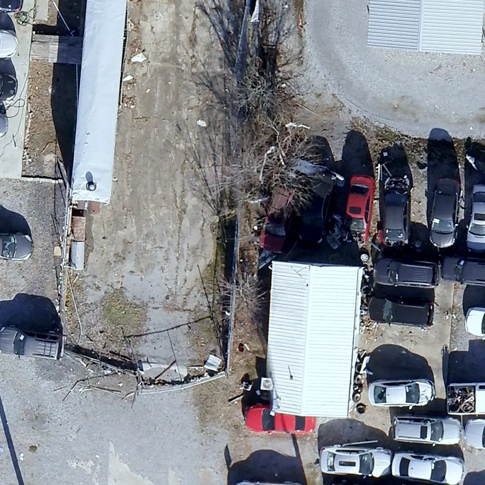

# `seg.water_aerial`

> 应急航拍精细淹没边界

| | |
|---|---|
| 模块 | `perception` · `src/dora/tools/perception.py:952`（2 行） |
| 相关性 | ★★★ |
| 可迁移性 | C（0.03 m 航拍） |
| 依赖 | 模型 DPT-aerial |
| 异常处理 | **无统一包装**：异常会直接抛出（MCP 层表现为 tool error） |

## 源码中的原话

> Segment water areas from post-disaster optical airborne image. Spatial resolution: 0.03m.

## 这个工具做什么

在无人机航拍图上精细勾出水体边界。范围小，但边界比卫星清楚得多。

## 输入

| 参数 | 类型 | 必填 | 默认 | 说明 |
|---|---|:-:|---|---|
| `post_image_path` | str | 是 | — | 灾后影像路径 |

## 输出

| 字段 | 类型 | 说明 |
|---|---|---|
| `mask_path` | str | Path to water mask (255 = water) |
| `classes` | dict | {11: "water"} |

**落盘产物**：`mask_path`（位于 `--temp_dir` 下，文件名带 6 位哈希）

## 依赖与运行

- 依赖：模型 DPT-aerial
- 硬件：需模型权重；CPU 可跑但慢（秒级/MP），建议 GPU（未实测）
- 输入：栅格 GeoTIFF/PNG；矢量 GeoJSON

## 调用

```python
from dora.tools.perception import seg_water_aerial
import json

res = json.loads(seg_water_aerial(post_image_path="post.tif"))
print(res)
```

```json
{
  "name": "seg.water_aerial",
  "arguments": {
    "post_image_path": "post.tif"
  }
}
```

## 示例

> 下面这组是**真跑出来的**：输入取自 DORA 数据根里的真实影像，输出是工具原样返回。路径用 `<DORA_DATA>` / `<temp_dir>` 占位，换机器照抄即可。

### 示例输入

数据：mayfield 无人机影像 0.03 m（裁 1024²）

```json
{
  "post_image_path": "<work>/fixtures/aerial.tif"
}
```

[](../../examples/10-水体与淹没/seg.water_aerial/in.webp)

### 示例输出

```json
{
  "mask_path": "<temp_dir>/seg_water_aerial_mask_30d718.png",
  "classes": {
    "11": "water"
  },
  "mask_value": 255,
  "_meta": {
    "forward_ms": 17959.98
  },
  "tool": "seg.water_aerial"
}
```

[](../../examples/10-水体与淹没/seg.water_aerial/out.webp)

*影像｜航拍水体｜叠加*（点击图片看原图）

> 只认 0.03 m 无人机视角；喂卫星影像（0.5 m 以上）会大面积误判。

耗时 22.03 s（本机 8 核 CPU，无 GPU）。

## 适用边界

- **相关性**：★★★ —— 应急航拍精细淹没边界
- **可迁移性**：C（0.03 m 航拍）
- 0.03 m 航拍专用，星载影像上目标尺度不符。有航次时它是最精细的边界来源。

## 相关工具

- [`vis.overlay_mask`](../70-制图与报告/vis.overlay_mask.md)
- [`ras.area`](../40-栅格分析/ras.area.md)

---

[← 返回 10-水体与淹没](README.md)　·　[工具总表](../../index/INDEX.md)
