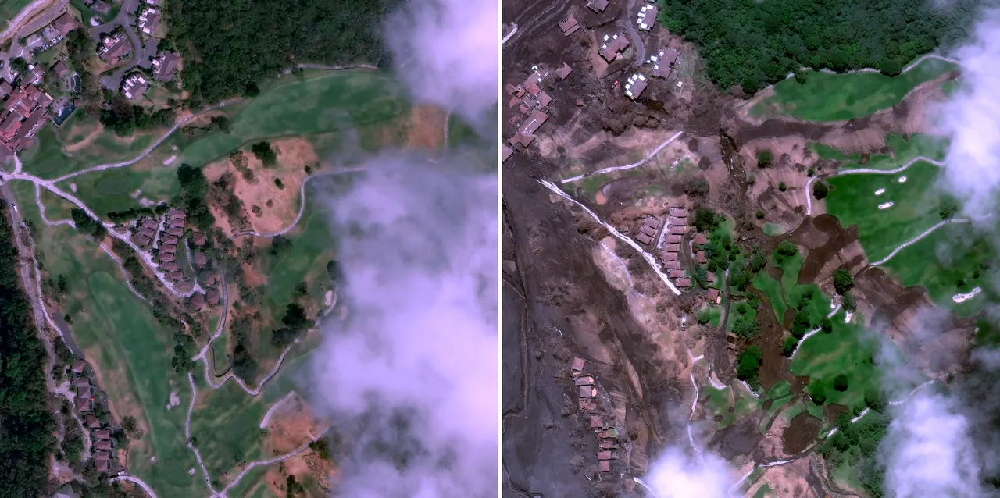
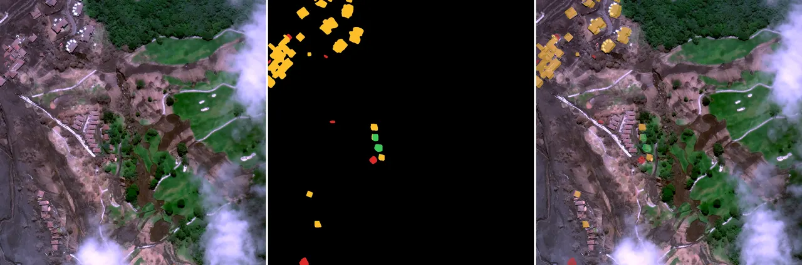

# `seg.building_damage`

> 淹没区房屋灾损统计

| | |
|---|---|
| 模块 | `perception` · `src/dora/tools/perception.py:256`（14 行） |
| 相关性 | ★★★ |
| 可迁移性 | B（≤1.6 m） |
| 依赖 | 模型 BitemporalDPT 6ch |
| 异常处理 | 函数内 `try/except`：异常转成 `{"error": ...}` 返回 |

## 源码中的原话

> Segment building damage from pre/post disaster optical satellite images. Uses difference-based detection to classify buildings into damage levels. Spatial resolution: 0.8m. The input pre and post image requires 3-bands.

## 这个工具做什么

对比灾前灾后两张影像，把每栋建筑判成三档：完好、部分损坏、完全损毁。

## 输入

| 参数 | 类型 | 必填 | 默认 | 说明 |
|---|---|:-:|---|---|
| `pre_image_path` | str | 是 | — | 灾前影像路径 |
| `post_image_path` | str | 是 | — | 灾后影像路径 |

## 输出

| 字段 | 类型 | 说明 |
|---|---|---|
| `mask_path` | str | Path to the saved damage mask image |
| `classes` | dict | Mapping of class values to damage levels |

**落盘产物**：`mask_path`（位于 `--temp_dir` 下，文件名带 6 位哈希）

## 依赖与运行

- 依赖：模型 BitemporalDPT 6ch
- 硬件：20.9 s/MP（实测）；一景 12.8 km² 约 5.8 min
- 输入：栅格 GeoTIFF/PNG；矢量 GeoJSON

## 调用

```python
from dora.tools.perception import seg_building_damage
import json

res = json.loads(seg_building_damage(pre_image_path="pre.tif", post_image_path="post.tif"))
print(res)
```

```json
{
  "name": "seg.building_damage",
  "arguments": {
    "pre_image_path": "pre.tif",
    "post_image_path": "post.tif"
  }
}
```

## 示例

> 下面这组是**真跑出来的**：输入取自 DORA 数据根里的真实影像，输出是工具原样返回。路径用 `<DORA_DATA>` / `<temp_dir>` 占位，换机器照抄即可。

### 示例输入

数据：xbd/guatemala_volcano_00000004_pre.png（0.8 m，1024²）；…_post.png

```json
{
  "pre_image_path": "<DORA_DATA>/images/xbd_agent_benchv1/pre/guatemala_volcano_00000004_pre.png",
  "post_image_path": "<DORA_DATA>/images/xbd_agent_benchv1/post/guatemala_volcano_00000004_post.png"
}
```

[](../../examples/20-承灾体/seg.building_damage/in.webp)

### 示例输出

```json
{
  "tool": "seg.building_damage",
  "mask_path": "<temp_dir>/seg_building_damage_mask_5e08c1.png",
  "classes": {
    "1": "intact",
    "2": "partially damaged",
    "3": "totally destroyed"
  },
  "_meta": {
    "forward_ms": 31293.67
  }
}
```

[](../../examples/20-承灾体/seg.building_damage/out.webp)

*上排：灾前｜灾后；下排：灾后影像｜损毁分级（绿=完好、黄=部分、红=完全）｜叠加*（点击图片看原图）

> 只判「已建成建筑」的损毁等级；两期必须已配准，错位会直接变成假损毁。

耗时 36.94 s（本机 8 核 CPU，无 GPU）。

## 适用边界

- **相关性**：★★★ —— 淹没区房屋灾损统计
- **可迁移性**：B（≤1.6 m）
- 训练于 0.8 m；1.6 m 逐类 IoU 0.43–0.52、2.0 m 只能出「是否损毁」总量、3.2 m 中间档塌陷。

## 已知坑与建议

- **坑**：**16 位值域直接喂入会整幅全背景**（5 景中 4 景全空、1 景剩 281 px），且不报错。输入必须先拉回 0–255。
- **建议**：输出 0=背景、1=完好、2=部分损毁、3=完全损毁。大图会走 out-of-core；16 MP 以上建议自己先切片。

## 相关工具

- [`seg.road_damage`](seg.road_damage.md)
- [`ras.resample`](../40-栅格分析/ras.resample.md)
- [`vec.intersect`](../50-矢量与空间关系/vec.intersect.md)

---

[← 返回 20-承灾体](README.md)　·　[工具总表](../../index/INDEX.md)
