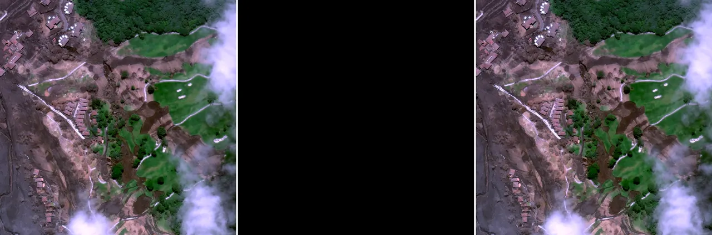

# `seg.reconstruction_building`

> 灾后恢复进度监测

| | |
|---|---|
| 模块 | `perception` · `src/dora/tools/perception.py:354`（16 行） |
| 相关性 | ★★ |
| 可迁移性 | B（未实测） |
| 依赖 | 模型 BitemporalDPT 6ch |
| 异常处理 | 函数内 `try/except`：异常转成 `{"error": ...}` 返回 |

## 源码中的原话

> Segment buildings under reconstruction from a pre-disaster optical image and a post-disaster recovery-phase optical image (bi-temporal change detection). Spatial resolution: 0.8m. The input pre and post image requires 3-bands.

## 这个工具做什么

对比灾前和重建期的影像，看哪些房子重新盖起来了，用来跟踪恢复进度。

## 输入

| 参数 | 类型 | 必填 | 默认 | 说明 |
|---|---|:-:|---|---|
| `pre_image_path` | str | 是 | — | 灾前影像路径 |
| `post_image_path` | str | 是 | — | 灾后影像路径 |

## 输出

| 字段 | 类型 | 说明 |
|---|---|---|
| `mask_path` | str | Path to the saved building-under-reconstruction mask image |
| `classes` | dict | Mapping of class values |

**落盘产物**：`mask_path`（位于 `--temp_dir` 下，文件名带 6 位哈希）

## 依赖与运行

- 依赖：模型 BitemporalDPT 6ch
- 硬件：需模型权重；CPU 可跑但慢（秒级/MP），建议 GPU（未实测）
- 输入：栅格 GeoTIFF/PNG；矢量 GeoJSON

## 调用

```python
from dora.tools.perception import seg_reconstruction_building
import json

res = json.loads(seg_reconstruction_building(pre_image_path="pre.tif", post_image_path="post.tif"))
print(res)
```

```json
{
  "name": "seg.reconstruction_building",
  "arguments": {
    "pre_image_path": "pre.tif",
    "post_image_path": "post.tif"
  }
}
```

## 示例

> 下面这组是**真跑出来的**：输入取自 DORA 数据根里的真实影像，输出是工具原样返回。路径用 `<DORA_DATA>` / `<temp_dir>` 占位，换机器照抄即可。

### 示例输入

数据：同地点灾前影像；xbd guatemala_volcano_00000004 灾后影像（0.8 m，1024²，RGB）

```json
{
  "pre_image_path": "<DORA_DATA>/images/xbd_agent_benchv1/pre/guatemala_volcano_00000004_pre.png",
  "post_image_path": "<DORA_DATA>/images/xbd_agent_benchv1/post/guatemala_volcano_00000004_post.png"
}
```

[](../../examples/20-承灾体/seg.reconstruction_building/in.webp)

### 示例输出

```json
{
  "tool": "seg.reconstruction_building",
  "mask_path": "<temp_dir>/guatemala_volcano_00000004_post_reconstruction_building_mask.png",
  "classes": {
    "0": "not_under_reconstruction",
    "255": "building_under_reconstruction"
  },
  "_meta": {
    "forward_ms": 30874.82
  }
}
```

[](../../examples/20-承灾体/seg.reconstruction_building/out.webp)

*示例输出*（点击图片看原图）

耗时 37.14 s（本机 8 核 CPU，无 GPU）。

## 适用边界

- **相关性**：★★ —— 灾后恢复进度监测
- **可迁移性**：B（未实测）
- 有权重、域内可用，但必须守住三条红线；本件未做专项实测，接入前请目视复核 10–20 景。
- 本域统一的输入口径（分辨率 / 时相 / 是否实测）见 [README 的「实测口径」表](README.md#实测口径)

---

[← 返回 20-承灾体](README.md)　·　[工具总表](../../index/INDEX.md)
