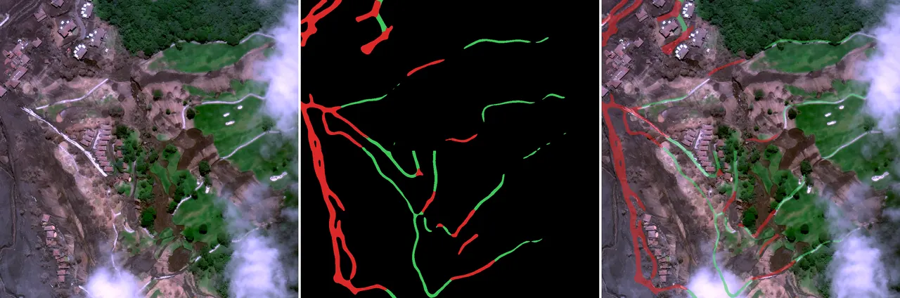

# `seg.road_damage`

> 淹没路段 → 通行阻断、抢险路径

| | |
|---|---|
| 模块 | `perception` · `src/dora/tools/perception.py:483`（13 行） |
| 相关性 | ★★★ |
| 可迁移性 | B（≤1.6 m） |
| 依赖 | 模型 BitemporalDPT 6ch |
| 异常处理 | 函数内 `try/except`：异常转成 `{"error": ...}` 返回 |

## 源码中的原话

> Segment road damage from pre/post disaster optical satellite images. Detects flooded and blocked road segments. Spatial resolution: 0.5m-1.0m.

## 这个工具做什么

对比两期影像，把道路判成三种状态：正常、被水淹、被堵断。

## 输入

| 参数 | 类型 | 必填 | 默认 | 说明 |
|---|---|:-:|---|---|
| `pre_image_path` | str | 是 | — | 灾前影像路径 |
| `post_image_path` | str | 是 | — | 灾后影像路径 |

## 输出

| 字段 | 类型 | 说明 |
|---|---|---|
| `mask_path` | str | Path to the saved road damage mask |
| `classes` | dict | Mapping of class values to road conditions |

**落盘产物**：`mask_path`（位于 `--temp_dir` 下，文件名带 6 位哈希）

## 依赖与运行

- 依赖：模型 BitemporalDPT 6ch
- 硬件：BitemporalDPT；1024² 约 30–100 s（实测）
- 输入：栅格 GeoTIFF/PNG；矢量 GeoJSON

## 调用

```python
from dora.tools.perception import seg_road_damage
import json

res = json.loads(seg_road_damage(pre_image_path="pre.tif", post_image_path="post.tif"))
print(res)
```

```json
{
  "name": "seg.road_damage",
  "arguments": {
    "pre_image_path": "pre.tif",
    "post_image_path": "post.tif"
  }
}
```

## 示例

> 下面这组是**真跑出来的**：输入取自 DORA 数据根里的真实影像，输出是工具原样返回。路径用 `<DORA_DATA>` / `<temp_dir>` 占位，换机器照抄即可。

### 示例输入

数据：同地点灾前影像；xbd guatemala_volcano_00000004 灾后影像（0.8 m，1024²，RGB）

```json
{
  "pre_image_path": "<DORA_DATA>/images/xbd_agent_benchv1/pre/guatemala_volcano_00000004_pre.png",
  "post_image_path": "<DORA_DATA>/images/xbd_agent_benchv1/post/guatemala_volcano_00000004_post.png"
}
```

[](../../examples/20-承灾体/seg.road_damage/in.webp)

### 示例输出

```json
{
  "tool": "seg.road_damage",
  "mask_path": "<temp_dir>/seg_road_damage_mask_5e08c1.png",
  "classes": {
    "1": "intact",
    "2": "flooded",
    "3": "debris blocked"
  },
  "_meta": {
    "forward_ms": 31409.21
  }
}
```

[](../../examples/20-承灾体/seg.road_damage/out.webp)

*示例输出*（点击图片看原图）

耗时 37.25 s（本机 8 核 CPU，无 GPU）。

## 适用边界

- **相关性**：★★★ —— 淹没路段 → 通行阻断、抢险路径
- **可迁移性**：B（≤1.6 m）
- 0.5–1 m 训练。2.0 m 时「阻断」面积只剩 0.23、逐类 IoU 0.193，**阻断结论不可用**；建议 ≤1.6 m 并人工复核。

## 相关工具

- [`vec.road_centerline_extraction`](../50-矢量与空间关系/vec.road_centerline_extraction.md)
- [`vec.build_graph`](../50-矢量与空间关系/vec.build_graph.md)

---

[← 返回 20-承灾体](README.md)　·　[工具总表](../../index/INDEX.md)
