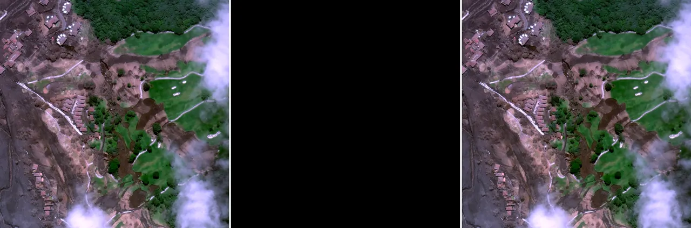

# `seg.storage_tank`

> 洪水次生风险源（危化品）

| | |
|---|---|
| 模块 | `perception` · `src/dora/tools/perception.py:576`（2 行） |
| 相关性 | ★ |
| 可迁移性 | B（0.5–1 m） |
| 依赖 | 模型 DPT-isaid |
| 异常处理 | **无统一包装**：异常会直接抛出（MCP 层表现为 tool error） |

## 源码中的原话

> Segment storage tanks from post-disaster optical satellite image. Spatial resolution: 0.5m-1.0m.

## 输入

| 参数 | 类型 | 必填 | 默认 | 说明 |
|---|---|:-:|---|---|
| `post_image_path` | str | 是 | — | 灾后影像路径 |

## 输出

| 字段 | 类型 | 说明 |
|---|---|---|
| `mask_path` | str | Path to binary storage tank mask (255 = storage_tank) |
| `classes` | dict | {12: storage_tank} |

**落盘产物**：`mask_path`（位于 `--temp_dir` 下，文件名带 6 位哈希）

## 依赖与运行

- 依赖：模型 DPT-isaid
- 硬件：需模型权重；CPU 可跑但慢（秒级/MP），建议 GPU（未实测）
- 输入：栅格 GeoTIFF/PNG；矢量 GeoJSON

## 调用

```python
from dora.tools.perception import seg_storage_tank
import json

res = json.loads(seg_storage_tank(post_image_path="post.tif"))
print(res)
```

```json
{
  "name": "seg.storage_tank",
  "arguments": {
    "post_image_path": "post.tif"
  }
}
```

## 示例

> 下面这组是**真跑出来的**：输入取自 DORA 数据根里的真实影像，输出是工具原样返回。路径用 `<DORA_DATA>` / `<temp_dir>` 占位，换机器照抄即可。

### 示例输入

数据：xbd guatemala_volcano_00000004 灾后影像（0.8 m，1024²，RGB）

```json
{
  "post_image_path": "<DORA_DATA>/images/xbd_agent_benchv1/post/guatemala_volcano_00000004_post.png"
}
```

[](../../examples/20-承灾体/seg.storage_tank/in.webp)

### 示例输出

```json
{
  "mask_path": "<temp_dir>/seg_storage_tank_mask_31b032.png",
  "mask_value": 255,
  "_meta": {
    "forward_ms": 18082.7
  },
  "tool": "seg.storage_tank"
}
```

[](../../examples/20-承灾体/seg.storage_tank/out.webp)

*示例输出*（点击图片看原图）

耗时 23.9 s（本机 8 核 CPU，无 GPU）。

## 适用边界

- **相关性**：★ —— 洪水次生风险源（危化品）
- **可迁移性**：B（0.5–1 m）
- 有权重、域内可用，但必须守住三条红线；本件未做专项实测，接入前请目视复核 10–20 景。
- 本域统一的输入口径（分辨率 / 时相 / 是否实测）见 [README 的「实测口径」表](README.md#实测口径)

---

[← 返回 20-承灾体](README.md)　·　[工具总表](../../index/INDEX.md)
