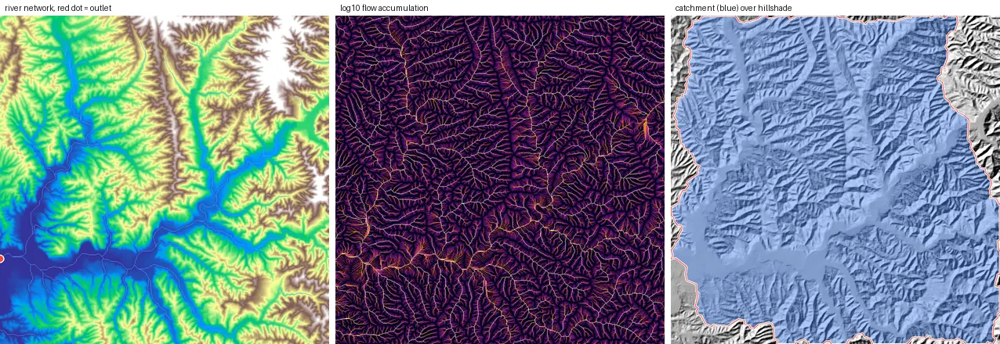

# `ras.catchment`

> ★ **本地扩展**：本件不在上游 DORA 的 108 件之内，由本仓库新增（`src/dora/tools/terrain.py`），实现依据见页末「已知坑」。

> 给定出水口反查上游汇水区，洪水预报的单元划分

| | |
|---|---|
| 模块 | `terrain` · `src/dora/tools/terrain.py:595`（283 行） |
| 相关性 | ★★★ |
| 可迁移性 | A |
| 依赖 | numpy / shapely |
| 异常处理 | 函数内 `try/except`：异常转成 `{"error": ...}` 返回 |

## 源码中的原话

> Delineate the catchment (watershed / contributing area) upstream of one or more pour points. Reuses the same depression filling, D8 routing and flow accumulation as ras.flow, then walks the flow graph backwards from each outlet. Each cell is assigned to the first outlet it reaches on its way downstream, so several pour points split the tile into disjoint sub-catchments whose areas add up; with a single outlet that is simply its watershed. Pour points can be given in the DEM's own CRS ("same", the default), as WGS84 lon/lat ("wgs84", reprojected to the DEM CRS), or as 0-based pixel ("pixel", wr

## 这个工具做什么

回答「这片地方下的雨，最后都从哪儿流出去」。给一个出水口（下游的桥、堤防缺口、水库入口都行），它把上游所有会往这里汇水的地面圈出来，并算出面积。洪水预报要按流域算「下了多少雨、会涨多少水」，第一步就是这件事。

## 输入

| 参数 | 类型 | 必填 | 默认 | 说明 |
|---|---|:-:|---|---|
| `dem_path` | str | 是 | — | DEM 路径 |
| `pour_points` | str? | 否 | `None` | 出水口坐标，`x,y` 或 `x,y;x,y`；省略则自动取边界最低格 |
| `pour_crs` | str | 否 | `'same'` | 坐标口径：`same`（与 DEM 同 CRS）/ `wgs84`（经纬度）/ `pixel`（列,行） |
| `snap_radius_m` | float | 否 | `0.0` | 在半径内把出水口吸附到汇流量最大的格（0 = 不吸附） |
| `min_area_cells` | int | 否 | `1` | Drop catchments smaller than this and report them (default 1) |
| `simplify_m` | float | 否 | `0.0` | 线简化容差（米）。5–15 可抹掉栅格锯齿，几何更干净、长度略短 |
| `out_dir` | str? | 否 | `None` | Output directory; defaults to the session temp directory |
| `out_geojson` | str? | 否 | `None` | GeoJSON path for the polygons |

## 输出

| 字段 | 类型 | 说明 |
|---|---|---|
| `outlets` | list | per outlet - pixel, cells, area_km2, elevation range, border contact |
| `paths` | dict | catchment label raster (1..n) and the GeoJSON polygons |
| `truncation` | dict | how much of the catchment touches the tile edge, and what that implies |
| `warnings` | list | pour points that control almost no area, etc. |

## 依赖与运行

- 依赖：numpy / shapely
- 硬件：纯算法，CPU 毫秒级；无需 GPU
- 输入：栅格 GeoTIFF/PNG；矢量 GeoJSON

## 调用

```python
from dora.tools.terrain import ras_catchment
import json

res = json.loads(ras_catchment(dem_path="dem.tif"))
print(res)
```

```json
{
  "name": "ras.catchment",
  "arguments": {
    "dem_path": "dem.tif"
  }
}
```

## 示例

> 下面这组是**真跑出来的**：输入取自 DORA 数据根里的真实影像，输出是工具原样返回。路径用 `<DORA_DATA>` / `<temp_dir>` 占位，换机器照抄即可。

### 示例输入

数据：同一块 900×900 子区（EPSG:32654，像元 12 m）；出水口取汇流面的最大值格

```json
{
  "dem_path": "<temp_dir>/dem_flow_crop.tif",
  "pour_points": "574995.17,4734193.91",
  "pour_crs": "same",
  "simplify_m": 30.0
}
```

[](../../examples/30-地形与地表变化/ras.catchment/in.webp)

### 示例输出

```json
{
  "tool": "ras.catchment",
  "outlets": [
    {
      "id": 1,
      "pour_point": [
        574995.17,
        4734193.91
      ],
      "pour_crs": "same",
      "pixel": [
        666,
        0
      ],
      "snapped": false,
      "snap_distance_m": 0.0,
      "cells": 699036,
      "area_km2": 100.9496,
      "share_of_tile": 0.863,
      "elevation_range_m": [
        25.0,
        420.0
      ],
      "outlet_accumulation": 699036.0,
      "touches_border": true,
      "border_cells": 847,
      "border_by_side": {
        "top": 307,
        "bottom": 279,
        "left": 31,
        "right": 230
      }
    }
  ],
  "paths": {
    "catchment": "<temp_dir>/catchment.tif",
    "catchment_geojson": "<temp_dir>/catchment.geojson"
  },
  "truncation": {
    "touches_border": true,
    "border_cells": 847,
    "by_side": {
      "top": 307,
      "bottom": 279,
      "left": 31,
      "right": 230
    },
    "outlet_on_border": true,
    "exits_on_border": 1,
    "max_accumulation_on_border": 699036.0,
    "may_be_incomplete": true,
    "note": "847 catchment cell(s) lie on the tile edge (top 307, bottom 279, left 31, right 230). The DEM ends there, so whatever drains in from beyond it is invisible and the reported area is a lower bound. The outlet itself is on the edge, so the downstream part is outside too. The largest accumulation on the edge is 699036 cells - a large value means a channel is severed by the boundary and closing it with the neighbouring tile matters.",
    "how_to_close": "Mosaic the neighbouring tiles, or buffer the DEM by a few km and re-run, if the boundary cut matters for the question."
  },
  "warnings": [],
  "fill": {
    "enabled": true,
    "filled_cells": 45682
  },
  "cell_size_m": {
    "x": 12.017180807112608,
    "y": 12.017180807112608,
    "note": null
  },
  "shape": [
    900,
    900
  ],
  "summary": "1 catchment(s) over 810000 cells"
}
```

[](../../examples/30-地形与地表变化/ras.catchment/out.webp)

*流域 100.9 km²（占图幅 86%），出口在图幅边界；847 格触边*（点击图片看原图）

> 出口坐标由 `ras.flow` 的汇流面给出：累积量最大的一格就是本图主河道最下游，沿河道往上游反查就是流域。这里出口正好落在图幅左边界，所以面积是**下界**——左边界外还有上游未计入。

耗时 6.58 s（本机 8 核 CPU，无 GPU）。

## 适用边界

- **相关性**：★★★ —— 给定出水口反查上游汇水区，洪水预报的单元划分
- **可迁移性**：A
- D8 单流向，出水口必须落在**汇流路径**上：落在山脊或坡面中段只会圈出 1 格，工具会给出警告并建议设 `snap_radius_m`。实测 V 形谷（64×64）单点圈出全部 4096 格、面积 0.4096 km² 与手算一致；真实 12 m DEM（900×900，81 万像元）得 100.9 km²，含填洼共 6.9 s。图幅边界是硬限制：**触边时面积只是下界**。

## 已知坑与建议

- **坑**：触边不等于被截断——分水岭可能恰好压在边界上。所以要读三个数而不是一个布尔值：`border_cells`（多少格贴边）、`max_accumulation_on_border`（边界上最大的汇流量，远大于 1 说明有一条河被切断）、`exits_on_border`（有几处水流出图外）。只有第一个数大、第二个数还是 1，通常是真的没啥可丢。
- **建议**：出水口不用手量：先跑 `ras.flow`，累积量最大的一格就是本图主河道最下游。要给一组子流域就一次给多个点——结果是**互斥分区**：上游点管它以上、下游点管两点之间那段，面积正好相加（实测 2112 + 1984 = 4096），适合按子流域分区统计。要完整的嵌套流域（下游含上游）就单独跑下游那一个点。

## 相关工具

- [`ras.flow`](ras.flow.md)
- [`ras.terrain`](ras.terrain.md)
- [`ras.vectorize`](../40-栅格分析/ras.vectorize.md)
- [`ras.area`](../40-栅格分析/ras.area.md)

---

[← 返回 30-地形与地表变化](README.md)　·　[工具总表](../../index/INDEX.md)
