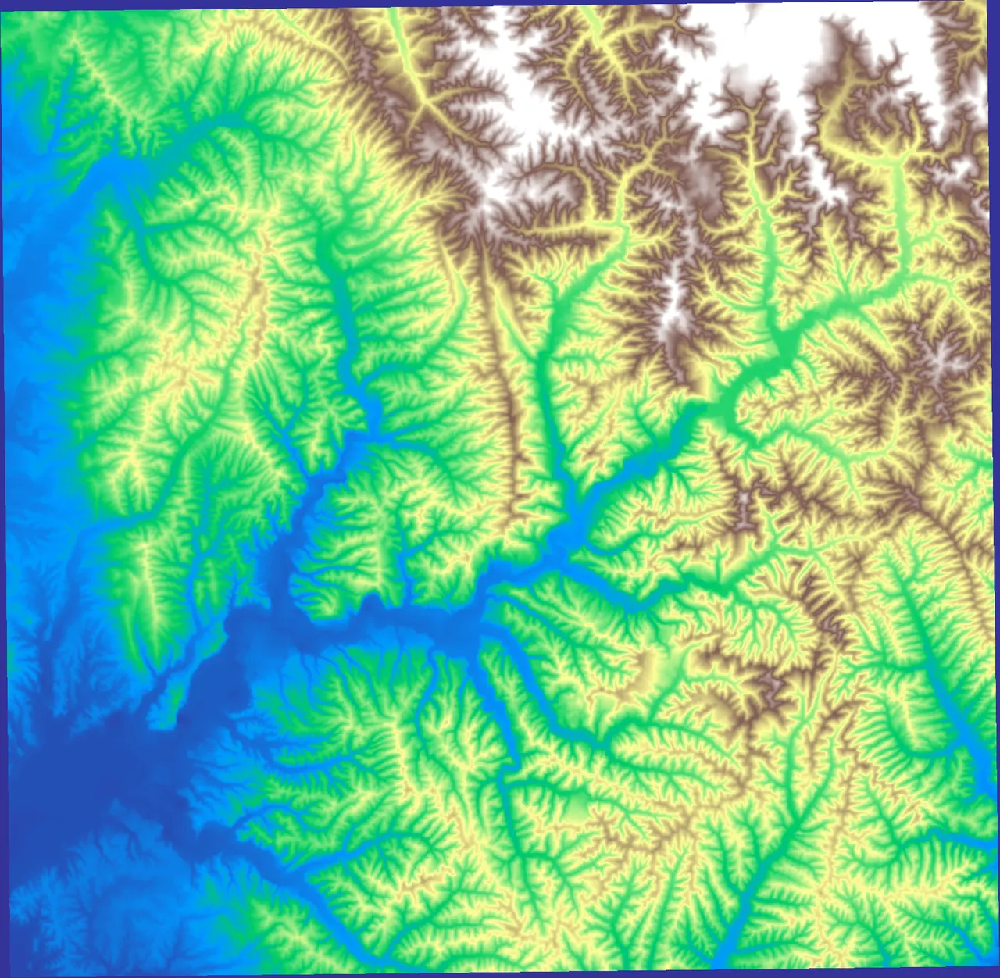
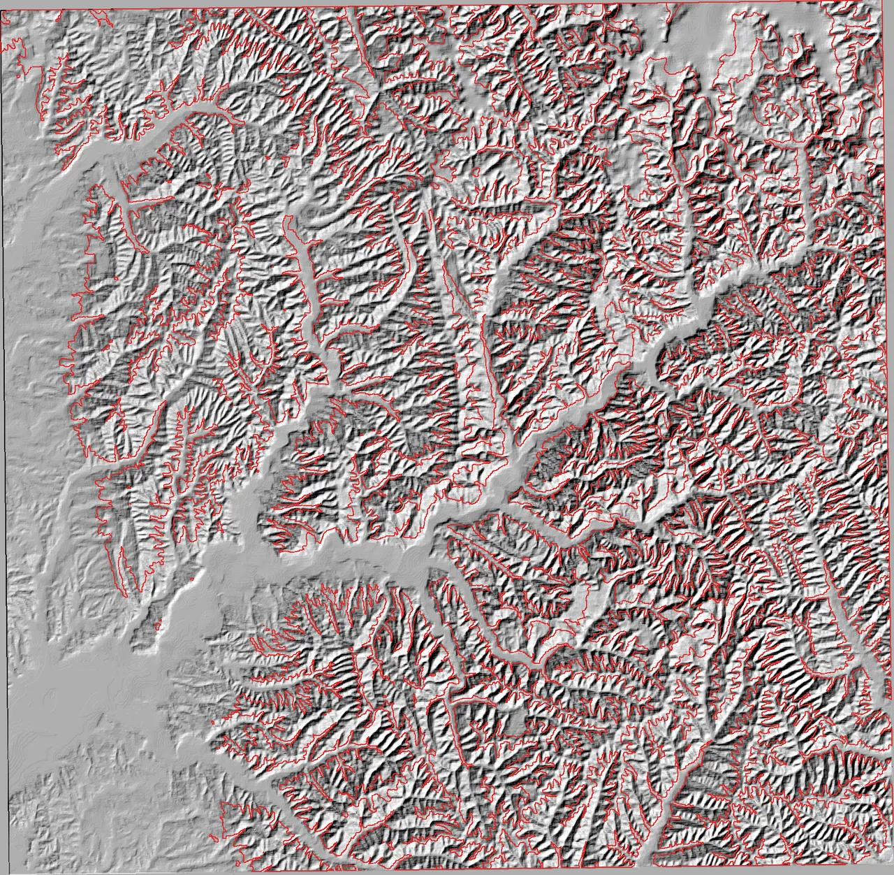

# `ras.contour`

> ★ **本地扩展**：本件不在上游 DORA 的 108 件之内，由本仓库新增（`src/dora/tools/terrain.py`），实现依据见页末「已知坑」。

> 等高线出图、坡度分级底图

| | |
|---|---|
| 模块 | `terrain` · `src/dora/tools/terrain.py:1552`（68 行） |
| 相关性 | ★★ |
| 可迁移性 | A |
| 依赖 | skimage |
| 异常处理 | 函数内 `try/except`：异常转成 `{"error": ...}` 返回 |

## 源码中的原话

> Extract contour lines (isolines) from a DEM at a fixed interval and write them as GeoJSON LineStrings with the elevation as an attribute. Useful for cartography and for slope-class base maps.

## 这个工具做什么

把高程图切成一条条等高线，导出成 GIS 能直接打开的线数据，每条线带自己的高程值。做地形图、坡度分级底图、给非专业读者看「这地方有多陡」时最直观。

## 输入

| 参数 | 类型 | 必填 | 默认 | 说明 |
|---|---|:-:|---|---|
| `dem_path` | str | 是 | — | DEM 路径 |
| `interval` | float | 是 | — | 等高距（与 DEM 同单位，通常为米） |
| `base` | float? | 否 | `None` | First contour level; defaults to the next multiple of interval |
| `min_length` | float | 否 | `0.0` | 丢弃短于该长度的线（米） |
| `out_path` | str? | 否 | `None` | 输出文件路径 |

## 输出

| 字段 | 类型 | 说明 |
|---|---|---|
| `out_path` | str | GeoJSON with one feature per contour line |
| `n_lines` | int | Number of lines written |
| `levels` | list[float | Contour levels present in the output |
| `total_length_m` | float | Summed length of all lines |

**落盘产物**：`out_path`（位于 `--temp_dir` 下，文件名带 6 位哈希）

## 依赖与运行

- 依赖：skimage
- 硬件：纯算法，CPU 毫秒级；无需 GPU
- 输入：栅格 GeoTIFF/PNG；矢量 GeoJSON

## 调用

```python
from dora.tools.terrain import ras_contour
import json

res = json.loads(ras_contour(dem_path="dem.tif", interval="0.0"))
print(res)
```

```json
{
  "name": "ras.contour",
  "arguments": {
    "dem_path": "dem.tif",
    "interval": "0.0"
  }
}
```

## 示例

> 下面这组是**真跑出来的**：输入取自 DORA 数据根里的真实影像，输出是工具原样返回。路径用 `<DORA_DATA>` / `<temp_dir>` 占位，换机器照抄即可。

### 示例输入

数据：UTM DEM（12 m），等高距 100 m

```json
{
  "dem_path": "<temp_dir>/reprojected.tif",
  "interval": 100.0
}
```

[](../../examples/30-地形与地表变化/ras.contour/in.webp)

### 示例输出

```json
{
  "tool": "ras.contour",
  "out_path": "<temp_dir>/contour.geojson",
  "n_lines": 363,
  "levels": [
    100.0,
    200.0,
    300.0,
    "…（共 4 条，此处省略）"
  ],
  "total_length_m": 1579690.7,
  "interval": 100.0,
  "elevation_range": [
    12.0,
    482.0
  ]
}
```

[](../../examples/30-地形与地表变化/ras.contour/out.webp)

*红线为等高线：363 条、总长 1580 km*（点击图片看原图）

> 输出是 GeoJSON，每条线带 `elevation`，可直接进 QGIS/ArcGIS 或叠加到专题图上。

耗时 1.5 s（本机 8 核 CPU，无 GPU）。

## 适用边界

- **相关性**：★★ —— 等高线出图、坡度分级底图
- **可迁移性**：A
- 输出是**等值线矢量**，不做平滑也不做抽稀；地形噪声大时线会很碎，先用 `ras.focal_stats` 平滑。

## 已知坑与建议

- **坑**：`interval` 小于高程噪声时会产生大量闭合小环；DEM 有空洞（NaN）时，空洞边缘会被当作低地，出现假等高线。
- **建议**：出图配 `ras.hillshade` 做底最直观；进 GIS 后按 `elevation` 属性分级设色即可。

## 相关工具

- [`ras.hillshade`](ras.hillshade.md)
- [`ras.terrain`](ras.terrain.md)
- [`ras.vectorize`](../40-栅格分析/ras.vectorize.md)

---

[← 返回 30-地形与地表变化](README.md)　·　[工具总表](../../index/INDEX.md)
