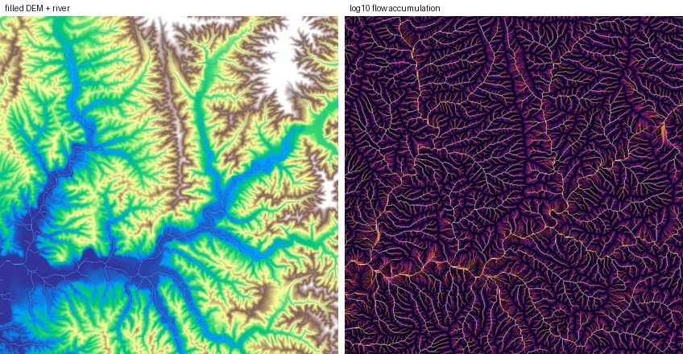

# `ras.flow`

> ★ **本地扩展**：本件不在上游 DORA 的 108 件之内，由本仓库新增（`src/dora/tools/terrain.py`），实现依据见页末「已知坑」。

> 填洼→流向→汇流，流域提取与洪水演进的前置

| | |
|---|---|
| 模块 | `terrain` · `src/dora/tools/terrain.py:501`（45 行） |
| 相关性 | ★★★ |
| 可迁移性 | A |
| 依赖 | numpy |
| 异常处理 | 函数内 `try/except`：异常转成 `{"error": ...}` 返回 |

## 源码中的原话

> Hydrological terrain analysis: fill depressions, compute D8 flow direction and flow accumulation, and optionally extract a river network above an accumulation threshold. This is the physical starting point for catchment and flood-routing work, which the upstream library does not cover.

## 这个工具做什么

模拟水往哪儿流：先把坑坑洼洼填平，再让每一格的水沿着最陡的方向流走，最后数出每个位置汇集了多少上游来水。汇流量大的地方就是河；给定一个出水口，反推回来就是它的流域。洪水预报里「上游下了雨、下游什么时候涨」这条链，从这里开始。

## 输入

| 参数 | 类型 | 必填 | 默认 | 说明 |
|---|---|:-:|---|---|
| `dem_path` | str | 是 | — | DEM 路径 |
| `fill` | bool | 否 | `True` | Fill depressions before routing (default True) |
| `epsilon` | float | 否 | `0.0001` | 填洼时的抬升步长（米），给平地一个微梯度 |
| `river_threshold` | int? | 否 | `None` | 以**格数**给的阈值，会覆盖 `min_area_km2`（与 `ras.flow` 口径一致） |
| `out_dir` | str? | 否 | `None` | Directory for the outputs; defaults to the session temp directory |

## 输出

| 字段 | 类型 | 说明 |
|---|---|---|
| `paths` | dict | filled DEM, flow direction, flow accumulation, optional river raster |
| `stats` | dict | max accumulation, number of outlets, filled cell count |
| `cell_size_m` | dict | Cell size used (degrees are converted to metres) |

## 依赖与运行

- 依赖：numpy
- 硬件：纯算法，CPU 毫秒级；无需 GPU
- 输入：栅格 GeoTIFF/PNG；矢量 GeoJSON

## 调用

```python
from dora.tools.terrain import ras_flow
import json

res = json.loads(ras_flow(dem_path="dem.tif"))
print(res)
```

```json
{
  "name": "ras.flow",
  "arguments": {
    "dem_path": "dem.tif"
  }
}
```

## 示例

> 下面这组是**真跑出来的**：输入取自 DORA 数据根里的真实影像，输出是工具原样返回。路径用 `<DORA_DATA>` / `<temp_dir>` 占位，换机器照抄即可。

### 示例输入

数据：同一 DEM 的 900×900 子区（EPSG:32654）

```json
{
  "dem_path": "<temp_dir>/dem_flow_crop.tif",
  "river_threshold": 800
}
```

[](../../examples/30-地形与地表变化/ras.flow/in.webp)

### 示例输出

```json
{
  "tool": "ras.flow",
  "paths": {
    "filled": "<temp_dir>/flow_filled.tif",
    "flow_direction": "<temp_dir>/flow_direction.tif",
    "flow_accumulation": "<temp_dir>/flow_accumulation.tif",
    "river": "<temp_dir>/flow_river.tif"
  },
  "stats": {
    "max_accumulation": 699036.0,
    "outlet_count": 418,
    "filled_cells": 45682,
    "river_cells": 16593
  },
  "cell_size_m": {
    "x": 12.017180807112608,
    "y": 12.017180807112608,
    "note": null
  },
  "shape": [
    900,
    900
  ]
}
```

[](../../examples/30-地形与地表变化/ras.flow/out.webp)

*左：填洼后的地形，蓝色为汇流量 ≥800 的河段；右：汇流累积（对数）*（点击图片看原图）

> 先填洼再定流向：不填洼的话，每一个小坑都会变成假的水系断点。给定出水口用同样的汇流面反查，就是流域边界。

耗时 8.54 s（本机 8 核 CPU，无 GPU）。

## 适用边界

- **相关性**：★★★ —— 填洼→流向→汇流，流域提取与洪水演进的前置
- **可迁移性**：A
- D8 单流向，**不适用于平坦的灌区、湿地、城市管网**——那些地方需要 D-inf 或水文模型。填洼会把真实洼地（岩溶、采煤沉陷）也填平，做沉降分析时要用 `fill=False`。

## 已知坑与建议

- **坑**：ε 梯度决定平坦区的流向，**结果对 ε 敏感**：同一 DEM 换 ε 只改变平地内部的水路，不影响主河道，但会让「某块地属于哪个流域」在分水线附近摆动。
- **建议**：`river_threshold` 取 500–1000 个像元通常能得到接近实测的河网密度；先看汇流累积图再定阈值，比拍数字可靠。

## 相关工具

- [`ras.terrain`](ras.terrain.md)
- [`ras.contour`](ras.contour.md)
- [`ras.vectorize`](../40-栅格分析/ras.vectorize.md)
- [`vec.raster_stats`](../50-矢量与空间关系/vec.raster_stats.md)

---

[← 返回 30-地形与地表变化](README.md)　·　[工具总表](../../index/INDEX.md)
