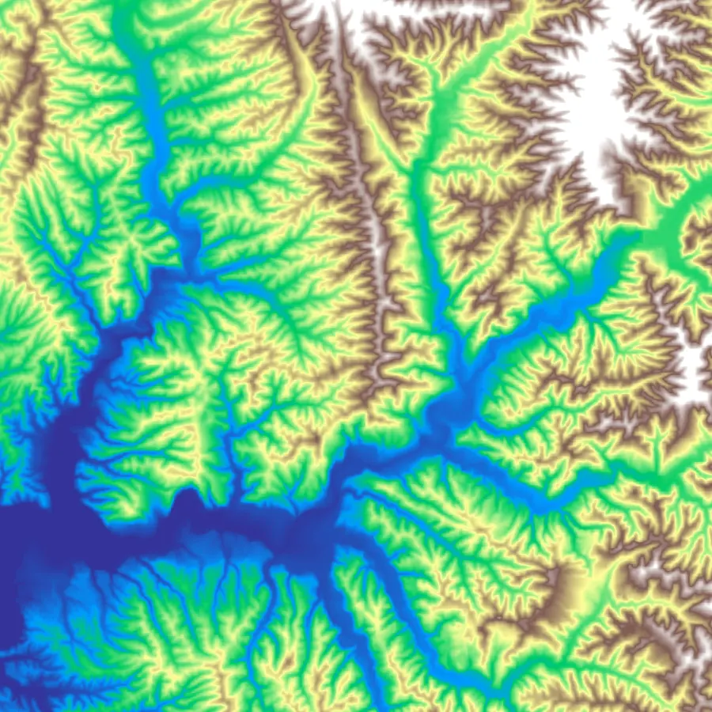
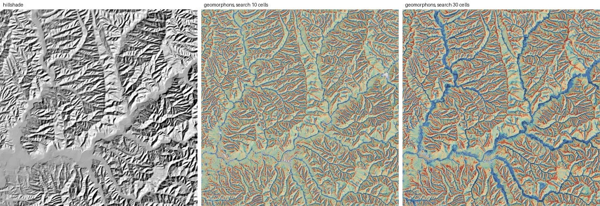

# `ras.geomorphons`

> ★ **本地扩展**：本件不在上游 DORA 的 108 件之内，由本仓库新增（`src/dora/tools/terrain.py`），实现依据见页末「已知坑」。

> 10 类地貌单元分类，地貌分区与易发性解释变量

| | |
|---|---|
| 模块 | `terrain` · `src/dora/tools/terrain.py:306`（64 行） |
| 相关性 | ★★★ |
| 可迁移性 | A |
| 依赖 | numpy |
| 异常处理 | 函数内 `try/except`：异常转成 `{"error": ...}` 返回 |

## 源码中的原话

> Classify every DEM cell into one of the ten common landform units - flat, peak, ridge, shoulder, spur, slope, hollow, footslope, valley, pit - using the geomorphon method of Jasiewicz & Stepinski (2013). Terrain is read as a pattern, not as derivatives: from each cell eight rays are cast and each records whether the visible horizon rises above or falls below it; that 8-symbol pattern names the landform. The result is categorical and scale-explicit: search_distance sets the size of the landform, so a ridge at 100 m is a slope at 2 km.

## 这个工具做什么

把地形分成十种「长相」：山顶、山脊、坡肩、山嘴、坡面、凹槽、坡脚、谷底、坑、平地。它回答的不是「多陡」，而是「这是什么部位」——做地貌分区、给滑坡或洪水模型找解释变量时用得上。注意它看的是局部：换一个观察半径，同一座山会被分成不同的单元。

## 输入

| 参数 | 类型 | 必填 | 默认 | 说明 |
|---|---|:-:|---|---|
| `dem_path` | str | 是 | — | DEM 路径 |
| `search_distance` | int | 否 | `10` | Look-out radius in cells (default 10); sets the landform size |
| `flatness_deg` | float | 否 | `1.0` | Angle in degrees below which a ray counts as level (default 1) |
| `skip_distance` | int | 否 | `0` | Ignore this many cells next to the centre, to suppress noise (default 0) |
| `return_pattern` | bool | 否 | `False` | Also write the ternary pattern code per cell, for diagnosis |
| `out_dir` | str? | 否 | `None` | Directory for the outputs; defaults to the session temp directory |

## 输出

| 字段 | 类型 | 说明 |
|---|---|---|
| `path` | str | Categorical raster, values 1-10 |
| `classes` | dict | code -> name |
| `share` | dict | fraction of valid cells in each class |
| `pattern_path` | str | present only when return_pattern is true |
| `cell_size_m` | dict | Cell size used (degrees are converted to metres) |

**落盘产物**：`pattern_path`（位于 `--temp_dir` 下，文件名带 6 位哈希）

## 依赖与运行

- 依赖：numpy
- 硬件：纯算法，CPU 毫秒级；无需 GPU
- 输入：栅格 GeoTIFF/PNG；矢量 GeoJSON

## 调用

```python
from dora.tools.terrain import ras_geomorphons
import json

res = json.loads(ras_geomorphons(dem_path="dem.tif"))
print(res)
```

```json
{
  "name": "ras.geomorphons",
  "arguments": {
    "dem_path": "dem.tif"
  }
}
```

## 示例

> 下面这组是**真跑出来的**：输入取自 DORA 数据根里的真实影像，输出是工具原样返回。路径用 `<DORA_DATA>` / `<temp_dir>` 占位，换机器照抄即可。

### 示例输入

数据：同一块 900×900 子区（EPSG:32654，像元 12 m），两个搜索半径

```json
{
  "dem_path": "<temp_dir>/dem_flow_crop.tif",
  "search_distance": 10,
  "flatness_deg": 1.0,
  "out_dir": "<temp_dir>/geom10"
}
```

[](../../examples/30-地形与地表变化/ras.geomorphons/in.webp)

### 示例输出

```json
{
  "tool": "ras.geomorphons",
  "path": "<temp_dir>/geom10/geomorphons.tif",
  "paths": {
    "geomorphons": "<temp_dir>/geom10/geomorphons.tif"
  },
  "classes": {
    "1": "flat",
    "2": "peak",
    "3": "ridge",
    "4": "shoulder",
    "5": "spur",
    "6": "slope",
    "7": "hollow",
    "8": "footslope",
    "9": "valley",
    "10": "pit"
  },
  "share": {
    "flat": 0.0,
    "peak": 0.0157,
    "ridge": 0.012,
    "shoulder": 0.1577,
    "spur": 0.1486,
    "slope": 0.3691,
    "hollow": 0.1378,
    "footslope": 0.1251,
    "valley": 0.02,
    "pit": 0.0139
  },
  "counts": {
    "flat": 28,
    "peak": 12725,
    "ridge": 9760,
    "shoulder": 127768,
    "spur": 120404,
    "slope": 298933,
    "hollow": 111642,
    "footslope": 101300,
    "valley": 16167,
    "pit": 11273
  },
  "params": {
    "search_distance": 10,
    "flatness_deg": 1.0,
    "skip_distance": 0
  },
  "cell_size_m": {
    "x": 12.017180807112608,
    "y": 12.017180807112608,
    "note": null
  },
  "shape": [
    900,
    900
  ]
}
```

[](../../examples/30-地形与地表变化/ras.geomorphons/out.webp)

*中：10 格（约 120 m）尺度，坡面 37%、谷 2.0%；右：30 格（约 360 m）尺度，同一地形被归并成更大的单元*（点击图片看原图）

> 地貌分类没有「正确答案」，只有「什么尺度上的答案」：`search_distance` 定多大，被认作脊和谷的东西就多大。这张图里 10 格尺度下前三类是 slope、shoulder、spur；放到 30 格，支沟被合并，坡面比例上升、谷和脊的位置往外移。换个尺度再跑一遍，是这类工具的正确用法。

耗时 1.56 s（本机 8 核 CPU，无 GPU）。

## 适用边界

- **相关性**：★★★ —— 10 类地貌单元分类，地貌分区与易发性解释变量
- **可迁移性**：A
- 结果**显式依赖尺度**：同一地形在 10 格与 30 格搜索半径下，脊和谷的位置会移动、数量会变（实测 900×900 / 81 万像元，search=10 用 1.4 s、search=30 用 2.1 s）。分类也是相对的：「坡」不代表没有起伏，只是八个方向里上坡与下坡各占一半。所以没有「跑一次就定稿」的用法。

## 已知坑与建议

- **坑**：**不要把类别当成绝对地貌类型**。geomorphon 只描述局部八个方向的可见起伏，不含成因——河流阶地、冰碛垄、喀斯特洼地在它看来都只是「坡」或「坑」。做地貌分区时要再叠高程带、坡度带或地质图，别指望它一个顶三个。
- **建议**：两个参数决定结果：`search_distance` 定尺度（想要多大的地貌单元就设多大），`flatness_deg` 定「多平算平」（平原区调到 2–3° 可明显减少碎斑）。拿不准就同一块地跑两个尺度再对比，比调参猜更可靠。

## 相关工具

- [`ras.terrain`](ras.terrain.md)
- [`ras.flow`](ras.flow.md)
- [`ras.catchment`](ras.catchment.md)
- [`seg.landslide_ms`](seg.landslide_ms.md)

---

[← 返回 30-地形与地表变化](README.md)　·　[工具总表](../../index/INDEX.md)
