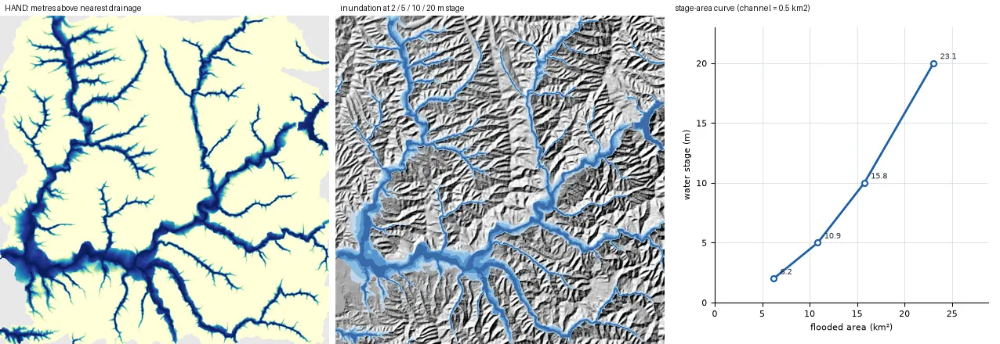

# `ras.hand`

> ★ **本地扩展**：本件不在上游 DORA 的 108 件之内，由本仓库新增（`src/dora/tools/terrain.py`），实现依据见页末「已知坑」。

> 给定水位出淹没范围与水位–面积曲线，零权重的洪水筛查

| | |
|---|---|
| 模块 | `terrain` · `src/dora/tools/terrain.py:1290`（133 行） |
| 相关性 | ★★★ |
| 可迁移性 | A |
| 依赖 | numpy / skimage |
| 异常处理 | 函数内 `try/except`：异常转成 `{"error": ...}` 返回 |

## 源码中的原话

> Height Above Nearest Drainage (HAND): for every cell, how far it stands above the river it actually drains into, and - given one or more water stages - how much of the tile would be flooded. This is the DEM-only route to an inundation map: no hydrograph, no roughness, no calibration. A cell is counted as flooded when its HAND is below the stage AND it is connected to the channel, so a low basin behind a ridge is not flooded just for being low.

## 这个工具做什么

回答「水位涨到 X 米，哪些地方会被淹」。每个格子先算出它比最近那条河高多少，再拿水位一比：比水位低的地方就是水面。只用一张高程图就能出淹没图，不需要流量、糙率、模型率定，适合预警阶段先看范围。

## 输入

| 参数 | 类型 | 必填 | 默认 | 说明 |
|---|---|:-:|---|---|
| `dem_path` | str | 是 | — | DEM 路径 |
| `min_area_km2` | float | 否 | `1.0` | 集水面积下限（km²）：一条沟要汇集这么多水才算河。常用 0.5–2 |
| `river_threshold` | int? | 否 | `None` | 以**格数**给的阈值，会覆盖 `min_area_km2`（与 `ras.flow` 口径一致） |
| `stages` | str? | 否 | `None` | Water stages above the bed, e.g. "2,5,8"; omit for HAND alone |
| `fill` | bool | 否 | `True` | Fill depressions before routing (default True) |
| `out_dir` | str? | 否 | `None` | Directory for the outputs; defaults to the session temp directory |

## 输出

| 字段 | 类型 | 说明 |
|---|---|---|
| `paths` | dict | HAND raster, plus one inundation raster per stage |
| `hand_stats` | dict | percentiles of HAND in metres |
| `stages` | list | per stage - flooded cells, area_km2, share of tile, mean and max depth |
| `curve` | list | [stage, area_km2] pairs, ready to plot as a stage-area curve |

## 依赖与运行

- 依赖：numpy / skimage
- 硬件：纯算法，CPU 毫秒级；无需 GPU
- 输入：栅格 GeoTIFF/PNG；矢量 GeoJSON

## 调用

```python
from dora.tools.terrain import ras_hand
import json

res = json.loads(ras_hand(dem_path="dem.tif"))
print(res)
```

```json
{
  "name": "ras.hand",
  "arguments": {
    "dem_path": "dem.tif"
  }
}
```

## 示例

> 下面这组是**真跑出来的**：输入取自 DORA 数据根里的真实影像，输出是工具原样返回。路径用 `<DORA_DATA>` / `<temp_dir>` 占位，换机器照抄即可。

### 示例输入

数据：同一块 900×900 子区（EPSG:32654，像元 12 m）；河道取汇水面积 0.5 km² 以上

```json
{
  "dem_path": "<temp_dir>/dem_flow_crop.tif",
  "min_area_km2": 0.5,
  "stages": "2,5,10,20"
}
```

[](../../examples/30-地形与地表变化/ras.hand/in.webp)

### 示例输出

```json
{
  "tool": "ras.hand",
  "paths": {
    "hand": "<temp_dir>/hand.tif",
    "inundation_2m": "<temp_dir>/inundation_2m.tif",
    "inundation_5m": "<temp_dir>/inundation_5m.tif",
    "inundation_10m": "<temp_dir>/inundation_10m.tif",
    "inundation_20m": "<temp_dir>/inundation_20m.tif"
  },
  "threshold": {
    "cells": 3462,
    "area_km2": 0.5,
    "set_by": "min_area_km2"
  },
  "channel_cells": 8051,
  "hand_stats": {
    "min": 0.0,
    "p10": 5.0,
    "p50": 58.0,
    "p90": 122.0,
    "p99": 185.0,
    "max": 267.99,
    "mean": 62.38
  },
  "stages": [
    {
      "stage_m": 2.0,
      "cells": 43010,
      "area_km2": 6.2112,
      "share_of_tile": 0.0531,
      "share_of_valid": 0.0571,
      "mean_depth_m": 1.12,
      "max_depth_m": 2.0,
      "dropped_unconnected_cells": 0
    },
    {
      "stage_m": 5.0,
      "cells": 75191,
      "area_km2": 10.8585,
      "share_of_tile": 0.0928,
      "share_of_valid": 0.0998,
      "mean_depth_m": 2.91,
      "max_depth_m": 5.0,
      "dropped_unconnected_cells": 0
    },
    {
      "stage_m": 10.0,
      "cells": 109169,
      "area_km2": 15.7654,
      "share_of_tile": 0.1348,
      "share_of_valid": 0.1448,
      "mean_depth_m": 6.17,
      "max_depth_m": 10.0,
      "dropped_unconnected_cells": 0
    },
    "…（共 4 条，此处省略）"
  ],
  "curve": [
    [
      2.0,
      6.2112
    ],
    [
      5.0,
      10.8585
    ],
    [
      10.0,
      15.7654
    ],
    "…（共 4 条，此处省略）"
  ],
  "cell_size_m": {
    "x": 12.017180807112608,
    "y": 12.017180807112608,
    "note": null
  },
  "shape": [
    900,
    900
  ],
  "warnings": [
    "56251 cell(s) have no channel downstream inside this tile (edge basins below the threshold); they get no HAND value and are left out of the inundation masks"
  ]
}
```

[](../../examples/30-地形与地表变化/ras.hand/out.webp)

*8051 格河道；水位 2 m 淹 6.2 km²（5.3%），20 m 淹 23.1 km²（19.7%）*（点击图片看原图）

> 左图是 HAND——每个格子「高出它最终汇入的那条河道多少米」，所以它天生就是淹没深度：水位涨到 5 m，HAND < 5 的地方就是水面。中图正是这条规则逐级套上去的结果，越靠河道越先淹、淹得越深。这里的水位是**相对河底**的，不是绝对高程；要换成河道水位站读数，把站的水位减去该河段河底高程即可。另有一部分格子没有 HAND 值（涂灰）：它们的水流在图幅外才汇入河道，本图里看不见那条河，只能留空——这也是为什么面积是「至少」而不是「正好」。这套方法是筛查级：静水面、无流速、看不见桥涵和堤防，河漫滩准，平原城区偏大。

耗时 6.17 s（本机 8 核 CPU，无 GPU）。

## 适用边界

- **相关性**：★★★ —— 给定水位出淹没范围与水位–面积曲线，零权重的洪水筛查
- **可迁移性**：A
- 水位是**相对河底**的，不是绝对高程——换成水位站读数要先减去该河段的河底高程。可信区间是谷底：河漫滩误差小，平原城区因为没有堤防、桥涵、泵站，会明显偏大。实测 900×900 / 81 万像元、0.5 km² 阈值，算 4 个水位共 12 s，其中 12 s 是它和`ras.flow` 共用的填洼与汇流，HAND 本身不到 1 s。图幅内 5.6 万格（7%）在图外才汇入河道，没有 HAND 值、也不参与淹没，所以面积是下限。

## 已知坑与建议

- **坑**：淹没必须**连通河道**才算：被高地围住的低洼地即使 HAND 低也不算淹（工具做了 8 连通筛选，并回报被剔除的格数）。另外 HAND 依赖河网阈值：阈值定得粗，参照的河道就远，淹没范围会偏大；换阈值结果会变，这是设计而不是 bug。
- **建议**：`stages` 给一组水位（如 `"2,5,10,20"`）一次算完，返回的 `curve` 就是水位–面积曲线，直接拿去做预警阈值。水位从 HAND 分位数起步：p10 大约淹到主要河漫滩，p90 已经漫上坡面。它还能当「相对河谷高度」单独用——做洪水易发性图层比绝对高程有用。

## 相关工具

- [`ras.river_network`](ras.river_network.md)
- [`ras.flow`](ras.flow.md)
- [`ras.terrain`](ras.terrain.md)
- [`ras.threshold`](../40-栅格分析/ras.threshold.md)

---

[← 返回 30-地形与地表变化](README.md)　·　[工具总表](../../index/INDEX.md)
