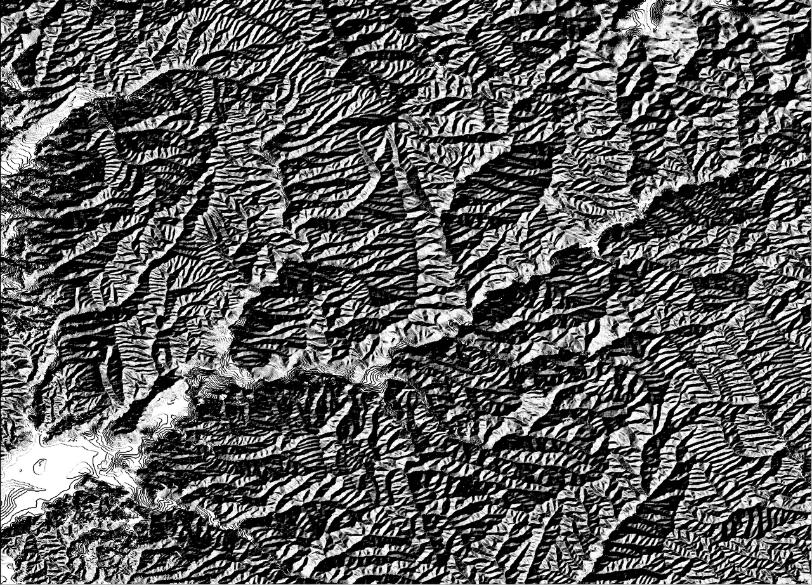

# `ras.hillshade`

> 地形地貌可视化、滑坡/泥石流易发性底图

| | |
|---|---|
| 模块 | `analysis` · `src/dora/tools/analysis.py:3470`（60 行） |
| 相关性 | ★★★ |
| 可迁移性 | A |
| 依赖 | rasterio |
| 异常处理 | 函数内 `try/except`：异常转成 `{"error": ...}` 返回 |

## 源码中的原话

> Compute a hillshade image from a Digital Elevation Model (DEM) raster, revealing terrain relief. Uses the standard Horn (1981) formulation with configurable sun azimuth and altitude angles. Useful for landslide and debris-flow susceptibility mapping.

## 这个工具做什么

用高程数据做出一张带光影的地形图，山脊、沟谷一眼能看出来，常拿来当底图。

## 输入

| 参数 | 类型 | 必填 | 默认 | 说明 |
|---|---|:-:|---|---|
| `dem_path` | str | 是 | — | DEM 路径 |
| `azimuth` | float | 否 | `315.0` | 光源方位角（度） |
| `altitude` | float | 否 | `45.0` | 光源高度角（度） |
| `z_factor` | float | 否 | `1.0` | 高程夸张系数 |
| `out_path` | str? | 否 | `None` | 输出文件路径 |

## 输出

| 字段 | 类型 | 说明 |
|---|---|---|
| `hillshade_path` | str | Path to the generated hillshade image |
| `shape` | list[int | [height, width] of the output |
| `stats` | dict | min, max, mean of hillshade values (0-255) |

**落盘产物**：`hillshade_path`（位于 `--temp_dir` 下，文件名带 6 位哈希）

## 依赖与运行

- 依赖：rasterio
- 硬件：纯算法，CPU 毫秒级；无需 GPU
- 输入：栅格 GeoTIFF/PNG；矢量 GeoJSON

## 调用

```python
from dora.tools.analysis import ras_hillshade
import json

res = json.loads(ras_hillshade(dem_path="dem.tif"))
print(res)
```

```json
{
  "name": "ras.hillshade",
  "arguments": {
    "dem_path": "dem.tif"
  }
}
```

## 示例

> 下面这组是**真跑出来的**：输入取自 DORA 数据根里的真实影像，输出是工具原样返回。路径用 `<DORA_DATA>` / `<temp_dir>` 占位，换机器照抄即可。

### 示例输入

数据：images/landslide4sense/Japan_all_14_dem.tif

```json
{
  "dem_path": "<DORA_DATA>/images/landslide4sense/Japan_all_14_dem.tif",
  "azimuth": 315,
  "altitude": 45
}
```

### 示例输出

```json
{
  "tool": "ras.hillshade",
  "hillshade_path": "<temp_dir>/hillshade.tif",
  "shape": [
    1384,
    1922
  ],
  "stats": {
    "min": 0,
    "max": 180,
    "mean": 63.519059054573454
  }
}
```

[](../../examples/30-地形与地表变化/ras.hillshade/out.webp)

*山体阴影（315° 方位、45° 高度角）*（点击图片看原图）

> 只影响观感，不改变高程；做地形晕渲或叠加专题图时用。

耗时 0.18 s（本机 8 核 CPU，无 GPU）。

## 适用边界

- **相关性**：★★★ —— 地形地貌可视化、滑坡/泥石流易发性底图
- **可迁移性**：A
- 纯算法，无权重；换数据直接可用，结果只取决于输入数值本身。
- 本域统一的输入口径（分辨率 / 时相 / 是否实测）见 [README 的「实测口径」表](README.md#实测口径)

---

[← 返回 30-地形与地表变化](README.md)　·　[工具总表](../../index/INDEX.md)
