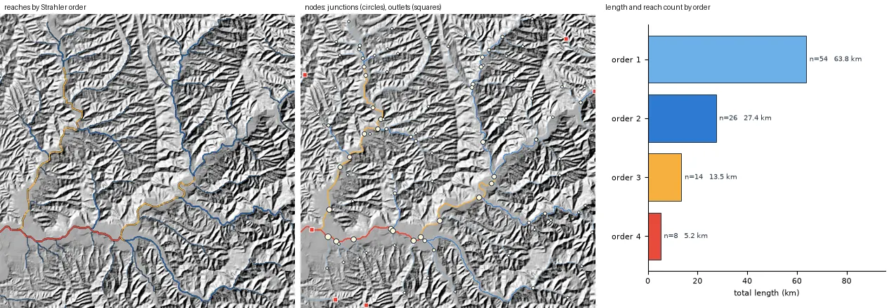

# `ras.river_network`

> ★ **本地扩展**：本件不在上游 DORA 的 108 件之内，由本仓库新增（`src/dora/tools/terrain.py`），实现依据见页末「已知坑」。

> 河网矢量化为河段并做 Strahler 分级，洪水演进与水质的基本单元

| | |
|---|---|
| 模块 | `terrain` · `src/dora/tools/terrain.py:935`（234 行） |
| 相关性 | ★★★ |
| 可迁移性 | A |
| 依赖 | numpy / shapely |
| 异常处理 | 函数内 `try/except`：异常转成 `{"error": ...}` 返回 |

## 源码中的原话

> Vectorise the D8 drainage network into reaches and order them with the Strahler scheme. A reach is the chain of cells between two junctions (or between a source and the first junction); its order is 1 at a source and, at a confluence, the maximum of the incoming orders - raised by one only when every incoming reach shares that order. The result is the unit flood routing and water-quality work is built on: each reach carries its order, length, drop, slope and upstream area, plus a link to the reach below it.

## 这个工具做什么

把地图上的河网从像素抽成一条条「河段」，并给每条编号分级：两条一级沟汇成才算二级，只有两条同级河段汇合才再升一级——所以数字跳得很慢，4 级往往已经是整幅图的主干。洪水演进、水质模型都按河段算，因为不同级数的河段在宽度、坡度、汇水面积上差别很大。

## 输入

| 参数 | 类型 | 必填 | 默认 | 说明 |
|---|---|:-:|---|---|
| `dem_path` | str | 是 | — | DEM 路径 |
| `min_area_km2` | float | 否 | `1.0` | 集水面积下限（km²）：一条沟要汇集这么多水才算河。常用 0.5–2 |
| `river_threshold` | int? | 否 | `None` | 以**格数**给的阈值，会覆盖 `min_area_km2`（与 `ras.flow` 口径一致） |
| `fill` | bool | 否 | `True` | Fill depressions before routing (default True) |
| `simplify_m` | float | 否 | `0.0` | 线简化容差（米）。5–15 可抹掉栅格锯齿，几何更干净、长度略短 |
| `out_dir` | str? | 否 | `None` | Directory for the outputs; defaults to the session temp directory |

## 输出

| 字段 | 类型 | 说明 |
|---|---|---|
| `paths` | dict | reaches (GeoJSON), nodes (GeoJSON), Strahler-order raster |
| `stats` | dict | reach/junction/outlet counts, maximum order, total length |
| `by_order` | dict | reach count and length per Strahler order |

## 依赖与运行

- 依赖：numpy / shapely
- 硬件：纯算法，CPU 毫秒级；无需 GPU
- 输入：栅格 GeoTIFF/PNG；矢量 GeoJSON

## 调用

```python
from dora.tools.terrain import ras_river_network
import json

res = json.loads(ras_river_network(dem_path="dem.tif"))
print(res)
```

```json
{
  "name": "ras.river_network",
  "arguments": {
    "dem_path": "dem.tif"
  }
}
```

## 示例

> 下面这组是**真跑出来的**：输入取自 DORA 数据根里的真实影像，输出是工具原样返回。路径用 `<DORA_DATA>` / `<temp_dir>` 占位，换机器照抄即可。

### 示例输入

数据：同一块 900×900 子区（EPSG:32654，像元 12 m）；阈值 0.5 km² 汇水面积

```json
{
  "dem_path": "<temp_dir>/dem_flow_crop.tif",
  "min_area_km2": 0.5,
  "simplify_m": 5.0
}
```

[](../../examples/30-地形与地表变化/ras.river_network/in.webp)

### 示例输出

```json
{
  "tool": "ras.river_network",
  "paths": {
    "reaches": "<temp_dir>/river_network.geojson",
    "nodes": "<temp_dir>/river_nodes.geojson",
    "strahler": "<temp_dir>/river_strahler.tif"
  },
  "threshold": {
    "cells": 3462,
    "area_km2": 0.5,
    "set_by": "min_area_km2"
  },
  "stats": {
    "reaches": 102,
    "junctions": 48,
    "outlets": 6,
    "headwaters": 54,
    "max_strahler": 4,
    "total_length_km": 109.89,
    "river_cells": 8051,
    "max_upstream_area_km2": 100.95
  },
  "by_order": {
    "1": {
      "reaches": 54,
      "length_km": 63.76
    },
    "2": {
      "reaches": 26,
      "length_km": 27.42
    },
    "3": {
      "reaches": 14,
      "length_km": 13.54
    },
    "4": {
      "reaches": 8,
      "length_km": 5.17
    }
  },
  "cell_size_m": {
    "x": 12.017180807112608,
    "y": 12.017180807112608,
    "note": null
  },
  "shape": [
    900,
    900
  ],
  "warnings": [
    "6 reaches leave the tile: the network is split by the tile edge (or by internal sinks), so orders are local to this DEM"
  ]
}
```

[](../../examples/30-地形与地表变化/ras.river_network/out.webp)

*102 条河段、共 110 km，最高 4 级；48 个汇流点、6 处水流出图*（点击图片看原图）

> 级数不是随便编号：两条一级支流汇成才升到二级，一条一级并入二级仍是二级——只有**两条同级的汇合**才会加一，所以数字跳得很慢，4 级已经代表整幅图的主干。`magnitude` 是另一个口径（Shreve）：数上游有几条源头，出口处为 54，更能反映「汇集了多少条沟」。注意右下方的方块：水从这里流出图幅，边界外的上游没算进来，级数只在图幅内成立。

耗时 9.18 s（本机 8 核 CPU，无 GPU）。

## 适用边界

- **相关性**：★★★ —— 河网矢量化为河段并做 Strahler 分级，洪水演进与水质的基本单元
- **可迁移性**：A
- 级数是**图幅内**的级数：DEM 到边界就断了，出图口之外的河段不参与编号（实测 4–6 处出图，阈值越细越多）。同一块地裁大一点，主干可能从 3 级变 4 级，这不是算错。阈值决定密度：0.5 km² 出 102 段、1 km² 出 62 段、2 km² 只剩 24 段（900×900 / 81 万像元，含填洼 8–9 s）。

## 已知坑与建议

- **坑**：Strahler 不是「大小排名」：一条一级支流并入二级干流，干流仍是二级，不会升到三级——**只有两条同级河段汇合才加一**。要看「汇集了多少条沟」用 `magnitude`（Shreve），出口处等于源头条数。另外 D8 单流向在平坦区会产生大量 1–2 格的短河段（两个汇流点相邻），这是数据分辨率的问题不是 bug，提高阈值或先重采样能缓解。
- **建议**：阈值就是「一条沟集水超过多少平方公里才算河」：常用 0.5–2 km²（1:5 万地形图约 1 km²）。`simplify_m` 给 5–15 m 可把栅格锯齿抹平，几何变干净、长度略短。产物里的 `downstream_reach` 就是拓扑表，可直接拿来建图或做洪水演进。

## 相关工具

- [`ras.flow`](ras.flow.md)
- [`ras.catchment`](ras.catchment.md)
- [`ras.terrain`](ras.terrain.md)
- [`vec.build_graph`](../50-矢量与空间关系/vec.build_graph.md)

---

[← 返回 30-地形与地表变化](README.md)　·　[工具总表](../../index/INDEX.md)
