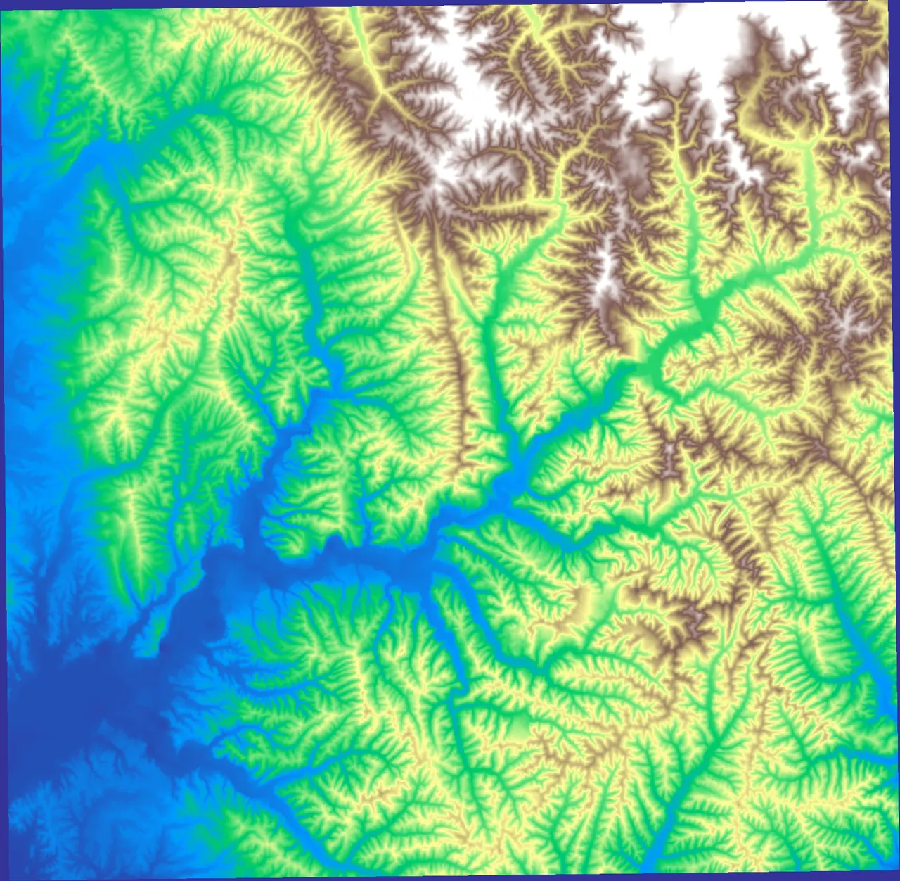
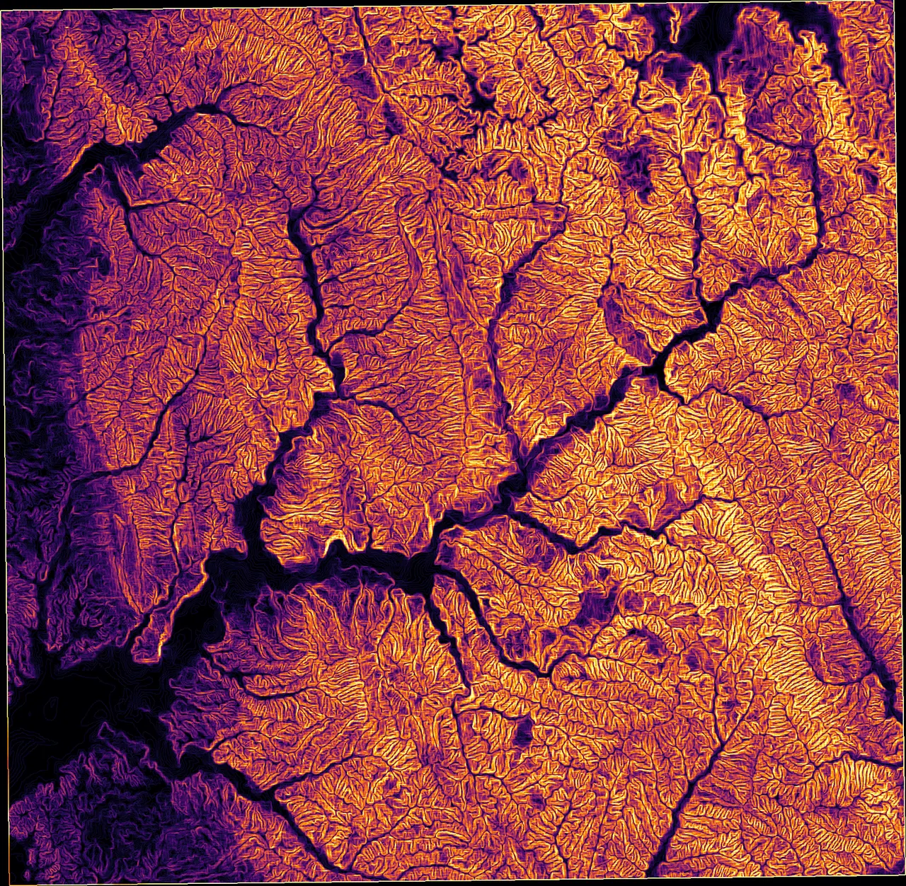

# `ras.slope`

> 坡度是滑坡模型与汇流分析的基础因子

| | |
|---|---|
| 模块 | `analysis` · `src/dora/tools/analysis.py:3548`（51 行） |
| 相关性 | ★★★ |
| 可迁移性 | A |
| 依赖 | rasterio |
| 异常处理 | 函数内 `try/except`：异常转成 `{"error": ...}` 返回 |

## 源码中的原话

> Compute a slope map in degrees from a DEM raster. Slope is derived via the Horn (1981) gradient formulation and converted from radians to degrees. Commonly used as input for landslide susceptibility and terrain stability.

## 这个工具做什么

用高程数据算坡度，回答「哪里陡、哪里平」。滑坡易发区判定、水往哪儿流，都要从这里起步。

## 输入

| 参数 | 类型 | 必填 | 默认 | 说明 |
|---|---|:-:|---|---|
| `dem_path` | str | 是 | — | DEM 路径 |
| `units` | str | 否 | `'degrees'` | 单位：`degrees` 或 `percent` |
| `out_path` | str? | 否 | `None` | 输出文件路径 |

## 输出

| 字段 | 类型 | 说明 |
|---|---|---|
| `slope_path` | str | Path to the generated slope raster |
| `units` | str | Units of the output values |
| `stats` | dict | min, max, mean slope |

**落盘产物**：`slope_path`（位于 `--temp_dir` 下，文件名带 6 位哈希）

## 依赖与运行

- 依赖：rasterio
- 硬件：纯算法，CPU 毫秒级；无需 GPU
- 输入：栅格 GeoTIFF/PNG；矢量 GeoJSON

## 调用

```python
from dora.tools.analysis import ras_slope
import json

res = json.loads(ras_slope(dem_path="dem.tif"))
print(res)
```

```json
{
  "name": "ras.slope",
  "arguments": {
    "dem_path": "dem.tif"
  }
}
```

## 示例

> 下面这组是**真跑出来的**：输入取自 DORA 数据根里的真实影像，输出是工具原样返回。路径用 `<DORA_DATA>` / `<temp_dir>` 占位，换机器照抄即可。

### 示例输入

数据：ras.reproject 输出的 UTM DEM（米制像元 30 m）

```json
{
  "dem_path": "<temp_dir>/reprojected.tif",
  "units": "degrees"
}
```

[](../../examples/30-地形与地表变化/ras.slope/in.webp)

### 示例输出

```json
{
  "tool": "ras.slope",
  "slope_path": "<temp_dir>/slope.tif",
  "units": "degrees",
  "stats": {
    "min": 0.0,
    "max": 88.26181030273438,
    "mean": 19.227169036865234
  }
}
```

[](../../examples/30-地形与地表变化/ras.slope/out.webp)

*上：输入高程；下：坡度（亮=陡，暗=平）*（点击图片看原图）

> **必须先投影到米制坐标系**：直接喂经纬度 DEM，像元边长被当成 0.000129（度），坡度均值会算成 86°，不报错但全错。

耗时 0.13 s（本机 8 核 CPU，无 GPU）。

## 适用边界

- **相关性**：★★★ —— 坡度是滑坡模型与汇流分析的基础因子
- **可迁移性**：A
- 纯算法，无权重；换数据直接可用，结果只取决于输入数值本身。
- 本域统一的输入口径（分辨率 / 时相 / 是否实测）见 [README 的「实测口径」表](README.md#实测口径)

---

[← 返回 30-地形与地表变化](README.md)　·　[工具总表](../../index/INDEX.md)
