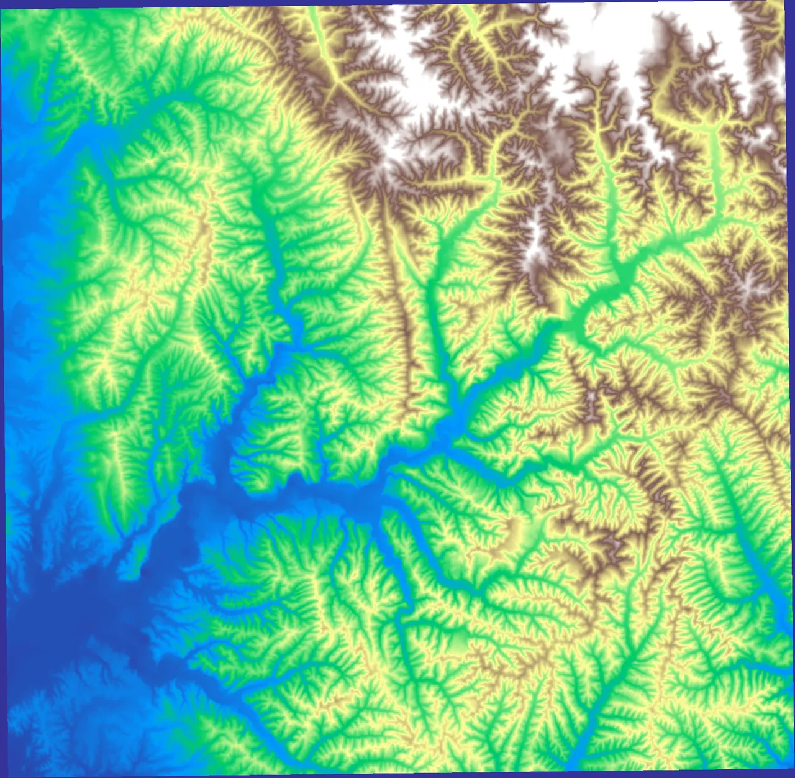
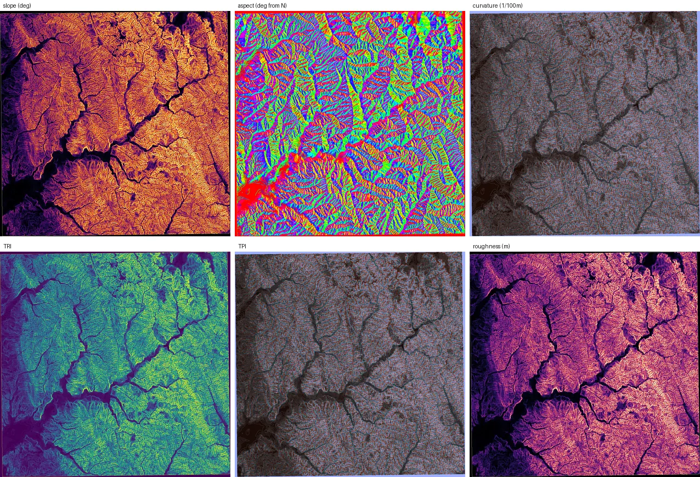

# `ras.terrain`

> ★ **本地扩展**：本件不在上游 DORA 的 108 件之内，由本仓库新增（`src/dora/tools/terrain.py`），实现依据见页末「已知坑」。

> 一次出坡度/坡向/曲率/TRI/TPI/粗糙度，地形地貌分析的地基

| | |
|---|---|
| 模块 | `terrain` · `src/dora/tools/terrain.py:121`（74 行） |
| 相关性 | ★★★ |
| 可迁移性 | A |
| 依赖 | numpy |
| 异常处理 | 函数内 `try/except`：异常转成 `{"error": ...}` 返回 |

## 源码中的原话

> Derive terrain attributes from a DEM in one pass: slope, aspect, curvature, TRI, TPI and roughness. Uses the Horn 3x3 kernel (same as GDAL gdaldem) for slope and aspect, Zevenbergen-Thorne for curvature, Riley et al. for TRI, Weiss for TPI and a 3x3 range for roughness. A geographic CRS is handled by converting degrees to metres at the scene latitude, so the result is not silently wrong on a lat/lon DEM.

## 这个工具做什么

给一张高程图，一次算出六种地形指标：坡有多陡、朝哪个方向、坡面是凹是凸、比周围高还是低、地表有多破碎。滑坡易发性、日照、土壤水分、通行难度都从这几个量出发。和只算坡度的老工具相比，它不会在经纬度坐标上把「度」当成「米」用。

## 输入

| 参数 | 类型 | 必填 | 默认 | 说明 |
|---|---|:-:|---|---|
| `dem_path` | str | 是 | — | DEM 路径 |
| `attributes` | str? | 否 | `None` | Comma-separated subset of slope,aspect,curvature,tri,tpi,roughness |
| `units` | str | 否 | `'degrees'` | 单位：`degrees` 或 `percent` |
| `out_dir` | str? | 否 | `None` | Directory for the outputs; defaults to the session temp directory |

## 输出

| 字段 | 类型 | 说明 |
|---|---|---|
| `paths` | dict | One GeoTIFF path per attribute |
| `stats` | dict | min / max / mean per attribute |
| `cell_size_m` | dict | Cell size actually used, and a note when the CRS was geographic |

## 依赖与运行

- 依赖：numpy
- 硬件：纯算法，CPU 毫秒级；无需 GPU
- 输入：栅格 GeoTIFF/PNG；矢量 GeoJSON

## 调用

```python
from dora.tools.terrain import ras_terrain
import json

res = json.loads(ras_terrain(dem_path="dem.tif"))
print(res)
```

```json
{
  "name": "ras.terrain",
  "arguments": {
    "dem_path": "dem.tif"
  }
}
```

## 示例

> 下面这组是**真跑出来的**：输入取自 DORA 数据根里的真实影像，输出是工具原样返回。路径用 `<DORA_DATA>` / `<temp_dir>` 占位，换机器照抄即可。

### 示例输入

数据：ras.reproject 输出的 UTM DEM（12 m 像元，日本山区整景）

```json
{
  "dem_path": "<temp_dir>/reprojected.tif",
  "attributes": "slope,aspect,curvature,tri,tpi,roughness",
  "units": "degrees"
}
```

[](../../examples/30-地形与地表变化/ras.terrain/in.webp)

### 示例输出

```json
{
  "tool": "ras.terrain",
  "paths": {
    "slope": "<temp_dir>/terrain_slope.tif",
    "aspect": "<temp_dir>/terrain_aspect.tif",
    "curvature": "<temp_dir>/terrain_curvature.tif",
    "tri": "<temp_dir>/terrain_tri.tif",
    "tpi": "<temp_dir>/terrain_tpi.tif",
    "roughness": "<temp_dir>/terrain_roughness.tif"
  },
  "stats": {
    "slope": {
      "min": 0.0,
      "max": 85.76124984176325,
      "mean": 19.28970881783951
    },
    "aspect": {
      "min": 0.0,
      "max": 359.9507425512539,
      "mean": 178.88502825822573
    },
    "curvature": {
      "min": -220.82906115069125,
      "max": 401.6926474215162,
      "mean": -0.01631739309960443
    },
    "tri": {
      "min": 0.0,
      "max": 580.0949349384109,
      "mean": 11.974823920195453
    },
    "tpi": {
      "min": -98.59533283174659,
      "max": 145.02373373460273,
      "mean": -0.008788840453391173
    },
    "roughness": {
      "min": 0.0,
      "max": 297.04746746920546,
      "mean": 11.556356158852871
    }
  },
  "units": "degrees",
  "cell_size_m": {
    "x": 12.017180807112608,
    "y": 12.017180807112608,
    "note": null
  },
  "shape": [
    1675,
    1713
  ]
}
```

[](../../examples/30-地形与地表变化/ras.terrain/out.webp)

*上：输入高程；下：一次算出的 6 个地形因子*（点击图片看原图）

> 与 `ras.slope` 的关键差别：这里按**米**算，并在内部把经纬度的度换算成米；坡度用 Horn 3×3（同 GDAL gdaldem），曲率用 Zevenbergen–Thorne，TRI 用 Riley。

耗时 4.68 s（本机 8 核 CPU，无 GPU）。

## 适用边界

- **相关性**：★★★ —— 一次出坡度/坡向/曲率/TRI/TPI/粗糙度，地形地貌分析的地基
- **可迁移性**：A
- 输入必须是**单波段高程**（米）。经纬度坐标会自动按纬度换算成米，但**投影变形仍在**——跨大范围做定量分析前应先投影到米制坐标系。边缘一行/列按复制填充，坡度会被削半，统计时建议去掉。

## 已知坑与建议

- **坑**：曲率与 TPI 在平地上几乎全是 0，直接线性拉伸会糊成一片灰；出图时要做符号平方根拉伸，并用「零值偏暗」的发散色带。
- **建议**：六个因子一次算完（2.87 M 像元约 3 s）；只要坡度时用 `ras.slope` 更省，但它不校正经纬度像元。

## 相关工具

- [`ras.slope`](ras.slope.md)
- [`ras.hillshade`](ras.hillshade.md)
- [`ras.flow`](ras.flow.md)
- [`ras.diff`](../40-栅格分析/ras.diff.md)

---

[← 返回 30-地形与地表变化](README.md)　·　[工具总表](../../index/INDEX.md)
