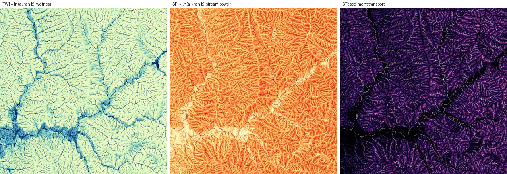

# `ras.wetness`

> ★ **本地扩展**：本件不在上游 DORA 的 108 件之内，由本仓库新增（`src/dora/tools/terrain.py`），实现依据见页末「已知坑」。

> TWI/SPI/STI 地形水文指数：内涝易发、土壤水分、侵蚀解释变量

| | |
|---|---|
| 模块 | `terrain` · `src/dora/tools/terrain.py:1446`（85 行） |
| 相关性 | ★★★ |
| 可迁移性 | A |
| 依赖 | numpy |
| 异常处理 | 函数内 `try/except`：异常转成 `{"error": ...}` 返回 |

## 源码中的原话

> Topographic wetness (TWI), stream-power (SPI) and sediment-transport (STI) indices from one DEM. All three are built on the same two inputs: the specific catchment area a - upslope area per unit contour width, so a = cells x cell size - and the slope beta. TWI = ln(a / tan b) marks where water collects (wet ground, waterlogging, wetland); SPI = ln(a * tan b) marks where flow concentrates and detaches soil; STI = (a/22.13)^0.6 (sin b/0.0896)^1.3 is the RUSLE sediment-transport term. Flats get a slope floor so the logarithms stay finite.

## 这个工具做什么

算三个地形指标：水容易在哪积（TWI）、水在哪冲得最狠（SPI）、泥沙往哪走（STI）。只用一张高程图，常用来圈内涝易发区和土壤水分高的地方，也给滑坡、洪水模型当解释变量。

## 输入

| 参数 | 类型 | 必填 | 默认 | 说明 |
|---|---|:-:|---|---|
| `dem_path` | str | 是 | — | DEM 路径 |
| `indices` | str | 否 | `'twi,spi,sti'` | Comma-separated subset of twi,spi,sti (default all three) |
| `min_slope_deg` | float | 否 | `0.1` | Slope floor in degrees (default 0.1) - keeps ln() finite |
| `fill` | bool | 否 | `True` | Fill depressions before accumulating (default True) |
| `out_dir` | str? | 否 | `None` | Directory for the outputs; defaults to the session temp directory |

## 输出

| 字段 | 类型 | 说明 |
|---|---|---|
| `paths` | dict | One GeoTIFF per index |
| `stats` | dict | percentiles per index |
| `params` | dict | a definition, cell size, and how many cells hit the slope floor |

## 依赖与运行

- 依赖：numpy
- 硬件：纯算法，CPU 毫秒级；无需 GPU
- 输入：栅格 GeoTIFF/PNG；矢量 GeoJSON

## 调用

```python
from dora.tools.terrain import ras_wetness
import json

res = json.loads(ras_wetness(dem_path="dem.tif"))
print(res)
```

```json
{
  "name": "ras.wetness",
  "arguments": {
    "dem_path": "dem.tif"
  }
}
```

## 示例

> 下面这组是**真跑出来的**：输入取自 DORA 数据根里的真实影像，输出是工具原样返回。路径用 `<DORA_DATA>` / `<temp_dir>` 占位，换机器照抄即可。

### 示例输入

数据：同一块 900×900 子区（EPSG:32654，像元 12 m）

```json
{
  "dem_path": "<temp_dir>/dem_flow_crop.tif",
  "indices": "twi,spi,sti",
  "min_slope_deg": 0.1
}
```

[](../../examples/30-地形与地表变化/ras.wetness/in.webp)

### 示例输出

```json
{
  "tool": "ras.wetness",
  "paths": {
    "twi": "<temp_dir>/wetness_twi.tif",
    "spi": "<temp_dir>/wetness_spi.tif",
    "sti": "<temp_dir>/wetness_sti.tif"
  },
  "stats": {
    "twi": {
      "min": 1.927,
      "p5": 3.209,
      "p50": 4.646,
      "p95": 9.655,
      "max": 22.295,
      "mean": 5.221
    },
    "spi": {
      "min": -3.864,
      "p5": 0.124,
      "p50": 2.791,
      "p95": 5.656,
      "max": 13.472,
      "mean": 2.774
    },
    "sti": {
      "min": 0.004,
      "p5": 0.587,
      "p50": 9.093,
      "p95": 41.54,
      "max": 3840.665,
      "mean": 15.297
    }
  },
  "params": {
    "specific_area": "a = cells x cell size (metres)",
    "cell_size_m": 12.017,
    "min_slope_deg": 0.1,
    "cells_at_slope_floor": 11653,
    "filled": true
  },
  "cell_size_m": {
    "x": 12.017180807112608,
    "y": 12.017180807112608,
    "note": null
  },
  "shape": [
    900,
    900
  ],
  "warnings": []
}
```

[](../../examples/30-地形与地表变化/ras.wetness/out.webp)

*TWI 中位 4.6（p95 9.7），SPI 中位 2.8；11653 格触到坡度下限*（点击图片看原图）

> 三个指数共用两个输入：汇流面积 a（每单位等高线宽度的上游面积，单位米）和坡度 β，所以一次算完最省。分工是：**TWI 看「水在哪积」**（蓝色沿沟谷），**SPI 看「水在哪冲」**（红色沿陡沟），**STI 看「泥沙往哪走」**。TWI 是相对量，同一景内可比、跨景不可比——它的绝对值取决于 a 的定义（这里用 a = 格数 × 格宽）。平地会触发 `min_slope_deg` 下限，此时指数由下限而非地形决定，工具会回报触限格数。

耗时 6.27 s（本机 8 核 CPU，无 GPU）。

## 适用边界

- **相关性**：★★★ —— TWI/SPI/STI 地形水文指数：内涝易发、土壤水分、侵蚀解释变量
- **可迁移性**：A
- 三个指数都是**相对量**，同一景内可比、跨景不可比：TWI 的绝对值取决于 a 的定义（这里 a = 格数 × 格宽，单位米），换个实现会整体平移一个常数。平地上坡度趋零，靠 `min_slope_deg` 兜底，此时结果由下限决定而不是地形；工具会回报触限格数。实测这块 900×900 子区有 11 653 格（1.4%）触限，集中在河谷底与填洼后的平地上——这些格的 TWI 是「下限值」而不是地形值，读图时要留意。解析坡面上三个指数与公式误差 < 1e-6。

## 已知坑与建议

- **坑**：坡度用的是**原始 DEM**而不是填洼后的——否则洼地被抹平，TWI 在洼地里反而偏低，正好把最该高的地方压低。另外 D8 单流向在平缓区会出现平行流线伪影（与汇流面同源），TWI 会呈细条纹，属于方法本身的限制，不是 bug。
- **建议**：用法：TWI 取高分位（p90 以上）圈「易积水、湿地」，SPI 取高分位圈「冲刷带」，STI 与 TWI 叠起来能区分「湿但不冲」和「又湿又冲」。三个都适合当滑坡、内涝模型的解释变量。

## 相关工具

- [`ras.flow`](ras.flow.md)
- [`ras.terrain`](ras.terrain.md)
- [`ras.hand`](ras.hand.md)
- [`ras.catchment`](ras.catchment.md)

---

[← 返回 30-地形与地表变化](README.md)　·　[工具总表](../../index/INDEX.md)
