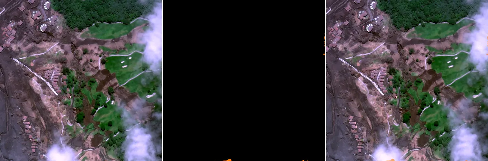

# `seg.landslide_bitemporal`

> 无 DEM 时的替代路径

| | |
|---|---|
| 模块 | `perception` · `src/dora/tools/perception.py:418`（15 行） |
| 相关性 | ★★★ |
| 可迁移性 | B（未实测） |
| 依赖 | 模型 SwinUperNet 6ch |
| 异常处理 | 函数内 `try/except`：异常转成 `{"error": ...}` 返回 |

## 源码中的原话

> Segment landslide from pre/post disaster optical satellite images (bi-temporal change detection). Spatial resolution: 0.59m.

## 这个工具做什么

只靠灾前灾后两张普通影像找出滑坡，不需要高程数据，适合没有地形资料的地区。

## 输入

| 参数 | 类型 | 必填 | 默认 | 说明 |
|---|---|:-:|---|---|
| `pre_image_path` | str | 是 | — | 灾前影像路径 |
| `post_image_path` | str | 是 | — | 灾后影像路径 |

## 输出

| 字段 | 类型 | 说明 |
|---|---|---|
| `mask_path` | str | Path to the saved landslide mask image |
| `classes` | dict | Mapping of class values |

**落盘产物**：`mask_path`（位于 `--temp_dir` 下，文件名带 6 位哈希）

## 依赖与运行

- 依赖：模型 SwinUperNet 6ch
- 硬件：需模型权重；CPU 可跑但慢（秒级/MP），建议 GPU（未实测）
- 输入：栅格 GeoTIFF/PNG；矢量 GeoJSON

## 调用

```python
from dora.tools.perception import seg_landslide_bitemporal
import json

res = json.loads(seg_landslide_bitemporal(pre_image_path="pre.tif", post_image_path="post.tif"))
print(res)
```

```json
{
  "name": "seg.landslide_bitemporal",
  "arguments": {
    "pre_image_path": "pre.tif",
    "post_image_path": "post.tif"
  }
}
```

## 示例

> ⚠️ **示意输入**：工具确实运行了，但输入与本工具的适用场景不完全对应（如用建筑影像演示滑坡双时相模型），结果只说明「接口怎么用」，不代表精度。

### 示例输入

数据：xbd 灾前 / 灾后影像（0.8 m）——本例用建筑场景代替滑坡，只为演示接口

```json
{
  "pre_image_path": "<DORA_DATA>/images/xbd_agent_benchv1/pre/guatemala_volcano_00000004_pre.png",
  "post_image_path": "<DORA_DATA>/images/xbd_agent_benchv1/post/guatemala_volcano_00000004_post.png"
}
```

### 示例输出

```json
{
  "tool": "seg.landslide_bitemporal",
  "mask_path": "<temp_dir>/seg_landslide_bitemporal_mask_5e08c1.png",
  "classes": {
    "0": "non-landslide",
    "255": "landslide"
  },
  "_meta": {
    "forward_ms": 4029.96
  }
}
```

[](../../examples/30-地形与地表变化/seg.landslide_bitemporal/out.webp)

*影像｜双时相滑坡掩膜｜叠加*（点击图片看原图）

> 双时相模型看的是「两期差异」，与本场景语义不符时输出无意义；真实使用需 0.5–1 m 滑坡影像对。

耗时 5.08 s（本机 8 核 CPU，无 GPU）。

## 适用边界

- **相关性**：★★★ —— 无 DEM 时的替代路径
- **可迁移性**：B（未实测）
- 0.59 m、双时相、3 波段，**不需要 DEM**——是没有 DEM 数据时的替代路径。精度未实测。

## 相关工具

- [`seg.landslide_ms`](seg.landslide_ms.md)
- [`ras.diff`](../40-栅格分析/ras.diff.md)

---

[← 返回 30-地形与地表变化](README.md)　·　[工具总表](../../index/INDEX.md)
