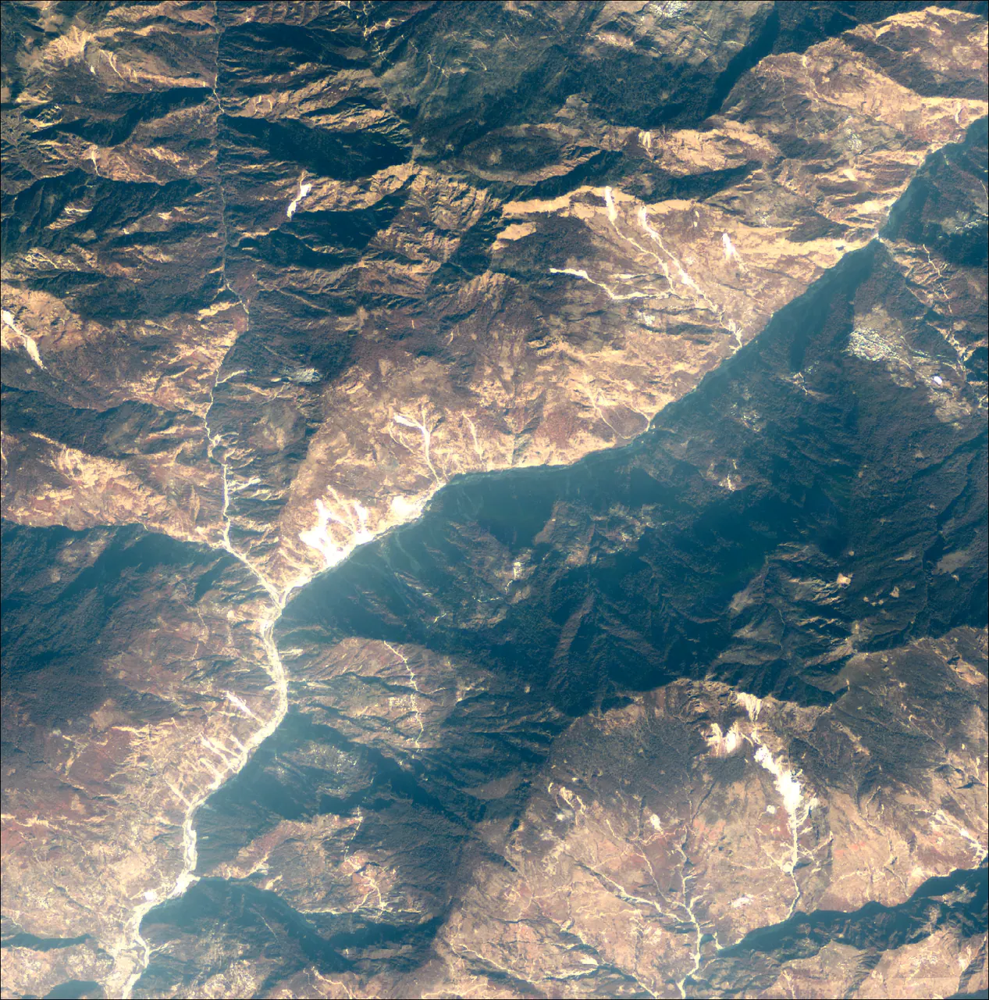
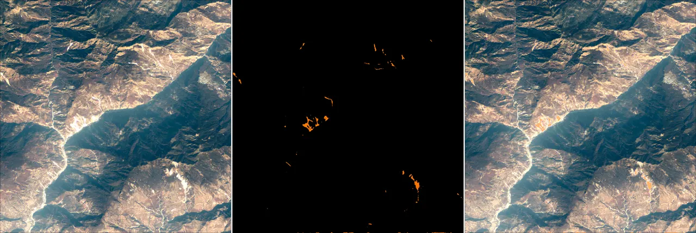

# `seg.landslide_ms`

> 地形地貌变化主力；必须 14 波段

| | |
|---|---|
| 模块 | `perception` · `src/dora/tools/perception.py:388`（13 行） |
| 相关性 | ★★★ |
| 可迁移性 | C（14 波段归一化） |
| 依赖 | 模型 WeTr 14ch |
| 异常处理 | 函数内 `try/except`：异常转成 `{"error": ...}` 返回 |

## 源码中的原话

> Segment landslide from post-disaster multi-modal data: multi-spectral optical + DEM + slope. Spatial resolution: 10m. IMPORTANT: The input image MUST have exactly 14 bands (12-band multi-spectral + DEM: 1 band + Slope: 1 band). If your data has separate multi-spectral, DEM, and slope files, use ras.concat to merge them first.

## 这个工具做什么

用多光谱加上高程、坡度，找出影像里哪些地方发生了滑坡。

## 输入

| 参数 | 类型 | 必填 | 默认 | 说明 |
|---|---|:-:|---|---|
| `post_image_path` | str | 是 | — | 灾后影像路径 |

## 输出

| 字段 | 类型 | 说明 |
|---|---|---|
| `mask_path` | str | Path to the saved landslide mask image |
| `classes` | dict | Mapping of class values |

**落盘产物**：`mask_path`（位于 `--temp_dir` 下，文件名带 6 位哈希）

## 依赖与运行

- 依赖：模型 WeTr 14ch
- 硬件：2.7 s/MP（实测）；一景 12.8 km² 约 0.75 min
- 输入：栅格 GeoTIFF/PNG；矢量 GeoJSON

## 调用

```python
from dora.tools.perception import seg_landslide_ms
import json

res = json.loads(seg_landslide_ms(post_image_path="post.tif"))
print(res)
```

```json
{
  "name": "seg.landslide_ms",
  "arguments": {
    "post_image_path": "post.tif"
  }
}
```

## 示例

> 下面这组是**真跑出来的**：输入取自 DORA 数据根里的真实影像，输出是工具原样返回。路径用 `<DORA_DATA>` / `<temp_dir>` 占位，换机器照抄即可。

### 示例输入

数据：14 波段影像（ras.concat 的产物，日本山区 1922×1384，10 m）

```json
{
  "post_image_path": "<work>/fixtures/geo14.tif"
}
```

[](../../examples/30-地形与地表变化/seg.landslide_ms/in.webp)

### 示例输出

```json
{
  "tool": "seg.landslide_ms",
  "mask_path": "<temp_dir>/seg_landslide_ms_mask_a825ef.tif",
  "classes": {
    "0": "non-landslide",
    "255": "landslide"
  },
  "_meta": {
    "forward_ms": 3750.88
  }
}
```

[](../../examples/30-地形与地表变化/seg.landslide_ms/out.webp)

*上：输入影像（假彩色拉伸）；下列：影像｜掩膜｜叠加（橙色为滑坡）*（点击图片看原图）

> 检出的是裸土/扰动像元，不含体积与危险性；10 m 下小于 30×30 m 的滑坡基本漏检。

耗时 4.83 s（本机 8 核 CPU，无 GPU）。

## 适用边界

- **相关性**：★★★ —— 地形地貌变化主力；必须 14 波段
- **可迁移性**：C（14 波段归一化）
- 域内 IoU 0.262（Landslide4Sense 就是它的训练域），**这是上界不是泛化**。10 m 输入、14 波段。

## 已知坑与建议

- **坑**：波段数不对会**抛错**（这是好事）；但 DEM 与坡度对调不报错，只会悄悄变差。

## 相关工具

- [`ras.concat`](../40-栅格分析/ras.concat.md)
- [`ras.slope`](ras.slope.md)
- [`ras.diff`](../40-栅格分析/ras.diff.md)

---

[← 返回 30-地形与地表变化](README.md)　·　[工具总表](../../index/INDEX.md)
