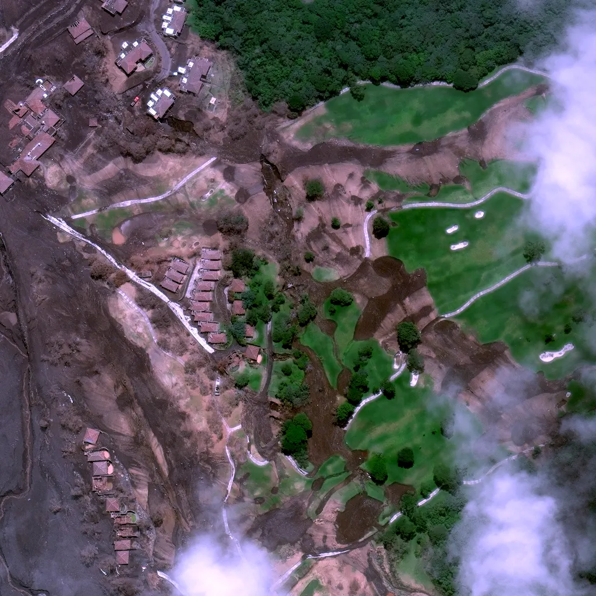
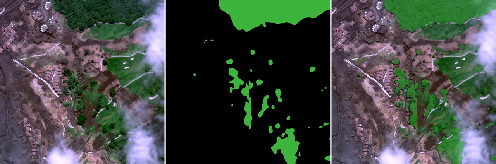

# `seg.vegetation`

> 旱情：植被覆盖变化、受旱耕地识别

| | |
|---|---|
| 模块 | `perception` · `src/dora/tools/perception.py:700`（18 行） |
| 相关性 | ★★★ |
| 可迁移性 | B（仅单期） |
| 依赖 | 模型 DPT-landcover |
| 异常处理 | 函数内 `try/except`：异常转成 `{"error": ...}` 返回 |

## 源码中的原话

> Segment vegetation areas from single temporal optical satellite image. Detects trees, shrub and agriculture land. Spatial resolution: 0.5m-1.0m.

## 这个工具做什么

认出一张影像里的林地、农田等植被覆盖区，用来比较植被是密了还是稀了。

## 输入

| 参数 | 类型 | 必填 | 默认 | 说明 |
|---|---|:-:|---|---|
| `image_path` | str | 是 | — | 输入栅格路径（GeoTIFF / PNG；PNG 无地理参考） |

## 输出

| 字段 | 类型 | 说明 |
|---|---|---|
| `mask_path` | str | Path to binary vegetation mask (255 = vegetation) |

**落盘产物**：`mask_path`（位于 `--temp_dir` 下，文件名带 6 位哈希）

## 依赖与运行

- 依赖：模型 DPT-landcover
- 硬件：12.2 s/MP（实测）；一景 12.8 km² 约 3.4 min
- 输入：栅格 GeoTIFF/PNG；矢量 GeoJSON

## 调用

```python
from dora.tools.perception import seg_vegetation
import json

res = json.loads(seg_vegetation(image_path="input.tif"))
print(res)
```

```json
{
  "name": "seg.vegetation",
  "arguments": {
    "image_path": "input.tif"
  }
}
```

## 示例

> 下面这组是**真跑出来的**：输入取自 DORA 数据根里的真实影像，输出是工具原样返回。路径用 `<DORA_DATA>` / `<temp_dir>` 占位，换机器照抄即可。

### 示例输入

数据：xbd 灾后影像（3 波段，0–255）

```json
{
  "image_path": "<DORA_DATA>/images/xbd_agent_benchv1/post/guatemala_volcano_00000004_post.png"
}
```

[](../../examples/30-地形与地表变化/seg.vegetation/in.webp)

### 示例输出

```json
{
  "tool": "seg.vegetation",
  "mask_path": "<temp_dir>/vegetation_map_586cfc.png",
  "classes": {
    "5": "forest",
    "6": "agriculture"
  },
  "mask_value": 255,
  "_meta": {
    "forward_ms": 17923.26
  }
}
```

[](../../examples/30-地形与地表变化/seg.vegetation/out.webp)

*影像｜植被掩膜｜叠加（文档说输出 5/6 类，实际是 0/255）*（点击图片看原图）

> **文档与实现不一致**：工具返回 `classes: {5, 6}`，实际掩膜只有 0 和 255；统计请按 `>0`。

耗时 23.56 s（本机 8 核 CPU，无 GPU）。

## 适用边界

- **相关性**：★★★ —— 旱情：植被覆盖变化、受旱耕地识别
- **可迁移性**：B（仅单期）
- **只做单期**。两期相减的平均面积变化 37.4%、一致率低至 0.63，会把模型漂移当成灾损变化。

## 已知坑与建议

- **坑**：文档说取第 5/6 类，实际输出是 **0/255 二值掩膜**（`_binary_mask` 的合并结果），统计时按「>0」计数。

## 相关工具

- [`ras.area`](../40-栅格分析/ras.area.md)
- [`vis.temporal_panel`](../70-制图与报告/vis.temporal_panel.md)

---

[← 返回 30-地形与地表变化](README.md)　·　[工具总表](../../index/INDEX.md)
