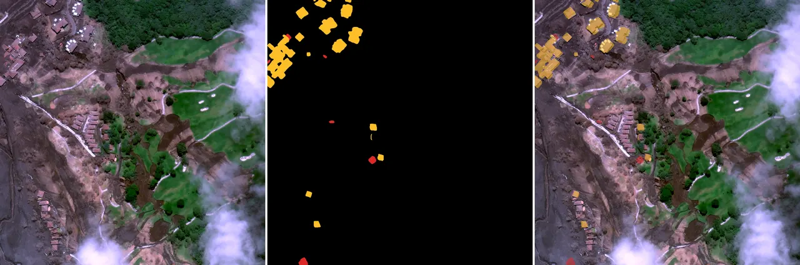

# `mask.compose_multiclass`

> 把「常水体/新增水体/退水」合成一张图

| | |
|---|---|
| 模块 | `analysis` · `src/dora/tools/analysis.py:1556`（11 行） |
| 相关性 | ★★ |
| 可迁移性 | A |
| 依赖 | rasterio |
| 异常处理 | 有 `_tool_guard`：输入文件缺失时返回空结果，其他异常转成 `{"error": ...}` 返回 |

## 源码中的原话

> Compose multiple binary masks into a single multiclass raster mask. Each input mask contributes one class value, and any positive pixel in a mask is assigned to that class in the output raster.

## 这个工具做什么

把几张黑白范围图合成一张分色的图。比如把「常年有水」「新增淹没」「退水后露出的滩地」各给一种颜色，合成一张便于区分。

## 输入

| 参数 | 类型 | 必填 | 默认 | 说明 |
|---|---|:-:|---|---|
| `mask_paths` | list[str] | 是 | — | Paths to binary mask rasters |
| `class_values` | list[int] | 是 | — | 类别值到名称的映射 |

## 输出

| 字段 | 类型 | 说明 |
|---|---|---|
| `mask_path` | str | Path to the composed multiclass raster |
| `class_values` | list[int | Class ids written into the output |
| `classes` | dict | Class label mapping for the output mask |

**落盘产物**：`mask_path`（位于 `--temp_dir` 下，文件名带 6 位哈希）

## 依赖与运行

- 依赖：rasterio
- 硬件：纯算法，CPU 毫秒级；无需 GPU
- 输入：栅格 GeoTIFF/PNG；矢量 GeoJSON

## 调用

```python
from dora.tools.analysis import mask_compose_multiclass_tool
import json

res = json.loads(mask_compose_multiclass_tool(mask_paths="mask.png", class_values="input.tif"))
print(res)
```

```json
{
  "name": "mask.compose_multiclass",
  "arguments": {
    "mask_paths": "mask.png",
    "class_values": "input.tif"
  }
}
```

## 示例

> 下面这组是**真跑出来的**：输入取自 DORA 数据根里的真实影像，输出是工具原样返回。路径用 `<DORA_DATA>` / `<temp_dir>` 占位，换机器照抄即可。

### 示例输入

数据：类别 2、3 各自的二值掩膜（由损毁掩膜拆出）

```json
{
  "mask_paths": [
    "<work>/fixtures/mask_c2.tif",
    "<work>/fixtures/mask_c3.tif"
  ],
  "class_values": [
    2,
    3
  ]
}
```

### 示例输出

```json
{
  "tool": "mask.compose_multiclass",
  "mask_path": "<temp_dir>/compose_multiclass_mask_c2_mask_c3_2_3_45d9ac.tif",
  "class_values": [
    2,
    3
  ],
  "classes": {
    "0": "background",
    "2": "building_damage",
    "3": "building_total_damage"
  }
}
```

[](../../examples/40-栅格分析/mask.compose_multiclass/out.webp)

*两张二值掩膜合成一张多类掩膜*（点击图片看原图）

> 多模型各自只出二值时用它合并；类别值要预先约定好，别两处不一致。

耗时 0.05 s（本机 8 核 CPU，无 GPU）。

## 适用边界

- **相关性**：★★ —— 把「常水体/新增水体/退水」合成一张图
- **可迁移性**：A
- 纯算法，无权重；换数据直接可用，结果只取决于输入数值本身。

---

[← 返回 40-栅格分析](README.md)　·　[工具总表](../../index/INDEX.md)
