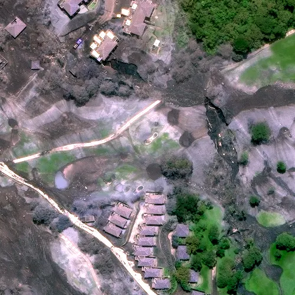

# `ras.clip`

> 按流域/行政区裁切

| | |
|---|---|
| 模块 | `analysis` · `src/dora/tools/analysis.py:1673`（88 行） |
| 相关性 | ★★ |
| 可迁移性 | A |
| 依赖 | rasterio |
| 异常处理 | 函数内 `try/except`：异常转成 `{"error": ...}` 返回 |

## 源码中的原话

> Clip a raster by a pixel window [x1:x2, y1:y2], where x is row (top→bottom) and y is column (left→right). Preserves georeferencing if the input has it (GeoTIFF/COG/etc.).

## 这个工具做什么

按一块矩形范围裁图，只留下关心的那一块，后面的计算就不用管全图。

## 输入

| 参数 | 类型 | 必填 | 默认 | 说明 |
|---|---|:-:|---|---|
| `image_path` | str | 是 | — | 输入栅格路径（GeoTIFF / PNG；PNG 无地理参考） |
| `x1` | int | 是 | — | 右下角列号 |
| `x2` | int | 是 | — | — |
| `y1` | int | 是 | — | 右下角行号 |
| `y2` | int | 是 | — | — |

## 输出

| 字段 | 类型 | 说明 |
|---|---|---|
| `output_path` | str | Path to clipped raster in TEMP_DIR |
| `window` | dict | {x1, x2, y1, y2} actually used |
| `out_shape` | list[int,int | [height, width] |
| `clamped` | bool | whether input window was clamped to image bounds |

**落盘产物**：`output_path`（位于 `--temp_dir` 下，文件名带 6 位哈希）

## 依赖与运行

- 依赖：rasterio
- 硬件：纯算法，CPU 毫秒级；无需 GPU
- 输入：栅格 GeoTIFF/PNG；矢量 GeoJSON

## 调用

```python
from dora.tools.analysis import ras_clip
import json

res = json.loads(ras_clip(image_path="input.tif", x1="1", x2="1", y1="1", y2="1"))
print(res)
```

```json
{
  "name": "ras.clip",
  "arguments": {
    "image_path": "input.tif",
    "x1": "1",
    "x2": "1",
    "y1": "1",
    "y2": "1"
  }
}
```

## 示例

> 下面这组是**真跑出来的**：输入取自 DORA 数据根里的真实影像，输出是工具原样返回。路径用 `<DORA_DATA>` / `<temp_dir>` 占位，换机器照抄即可。

### 示例输入

数据：xbd guatemala_volcano_00000004 灾后影像（0.8 m，1024²，RGB）

```json
{
  "image_path": "<DORA_DATA>/images/xbd_agent_benchv1/post/guatemala_volcano_00000004_post.png",
  "x1": 100,
  "x2": 600,
  "y1": 100,
  "y2": 600
}
```

[](../../examples/40-栅格分析/ras.clip/in.webp)

### 示例输出

```json
{
  "tool": "ras.clip",
  "output_path": "<temp_dir>/clip_guatemala_volcano_00000004_post_6c64ba.tif",
  "window": {
    "x1": 100,
    "x2": 600,
    "y1": 100,
    "y2": 600
  },
  "out_shape": [
    500,
    500
  ],
  "bands": 4,
  "dtype": "uint8",
  "crs": null,
  "transform": [
    1.0,
    0.0,
    100.0,
    "…（共 9 条，此处省略）"
  ],
  "clamped": false
}
```

[](../../examples/40-栅格分析/ras.clip/out.webp)

*上：输入影像；下：处理结果*（点击图片看原图）

耗时 0.06 s（本机 8 核 CPU，无 GPU）。

## 适用边界

- **相关性**：★★ —— 按流域/行政区裁切
- **可迁移性**：A
- 纯算法，无权重；换数据直接可用，结果只取决于输入数值本身。

---

[← 返回 40-栅格分析](README.md)　·　[工具总表](../../index/INDEX.md)
