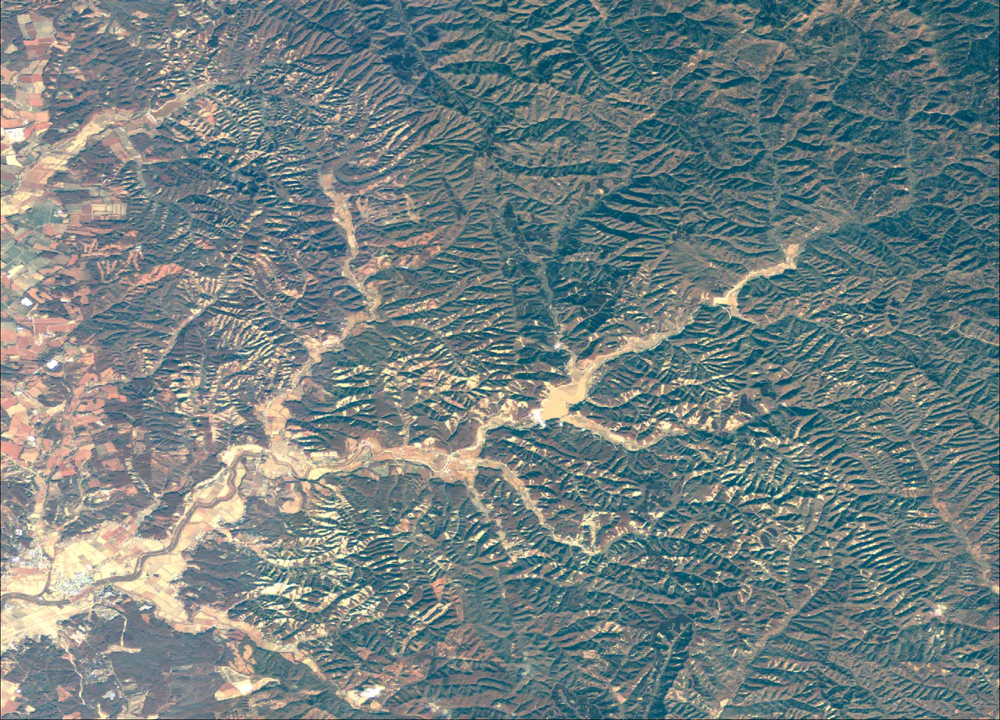

# `ras.concat`

> 构造 14 波段输入（多光谱 + DEM + 坡度）的必经步骤

| | |
|---|---|
| 模块 | `analysis` · `src/dora/tools/analysis.py:1781`（105 行） |
| 相关性 | ★★★ |
| 可迁移性 | A |
| 依赖 | rasterio |
| 异常处理 | 函数内 `try/except`：异常转成 `{"error": ...}` 返回 |

## 源码中的原话

> Concatenate multiple rasters along the band/channel dimension into a single GeoTIFF. All inputs must have identical height/width and, if present, the same CRS and transform.

## 这个工具做什么

把几张不同来源的图按波段叠成一张多层图。有些模型要求一次吃十几个波段（可见光 + 高程 + 坡度），只能靠它拼出来。

## 输入

| 参数 | 类型 | 必填 | 默认 | 说明 |
|---|---|:-:|---|---|
| `image_path_list` | list[str] | 是 | — | list of raster paths (GeoTIFF/COG/…) |
| `dim` | str | 否 | `'bands'` | only "bands" or "channels" is supported for now |

## 输出

| 字段 | 类型 | 说明 |
|---|---|---|
| `output_path` | str | Path to the concatenated GeoTIFF in TEMP_DIR |
| `bands` | int | total bands in the output |
| `band_map` | list[dict | [{path, in_bands, out_start_band, out_end_band}] |

**落盘产物**：`output_path`（位于 `--temp_dir` 下，文件名带 6 位哈希）

## 依赖与运行

- 依赖：rasterio
- 硬件：纯算法，CPU 毫秒级；无需 GPU
- 输入：栅格 GeoTIFF/PNG；矢量 GeoJSON

## 调用

```python
from dora.tools.analysis import ras_concat
import json

res = json.loads(ras_concat(image_path_list="input.tif"))
print(res)
```

```json
{
  "name": "ras.concat",
  "arguments": {
    "image_path_list": "input.tif"
  }
}
```

## 示例

> 下面这组是**真跑出来的**：输入取自 DORA 数据根里的真实影像，输出是工具原样返回。路径用 `<DORA_DATA>` / `<temp_dir>` 占位，换机器照抄即可。

### 示例输入

数据：images/landslide4sense/Japan_all_14_sentinel.tif（12 波段）；…_slope.tif（坡度）；…_dem.tif（高程）

```json
{
  "image_path_list": [
    "<DORA_DATA>/images/landslide4sense/Japan_all_14_sentinel.tif",
    "<DORA_DATA>/images/landslide4sense/Japan_all_14_slope.tif",
    "<DORA_DATA>/images/landslide4sense/Japan_all_14_dem.tif"
  ]
}
```

### 示例输出

```json
{
  "tool": "ras.concat",
  "output_path": "<temp_dir>/Japan_all_14_sentinel_concat_dde727.tif",
  "height": 1384,
  "width": 1922,
  "bands": 14,
  "dtype": "uint16",
  "crs": "EPSG:4326",
  "transform": [
    0.00012944888281104716,
    0.0,
    141.85923696581426,
    "…（共 9 条，此处省略）"
  ],
  "band_map": [
    {
      "path": "<DORA_DATA>/images/landslide4sense/Japan_all_14_sentinel.tif",
      "in_bands": 12,
      "out_start_band": 1,
      "out_end_band": 12
    },
    {
      "path": "<DORA_DATA>/images/landslide4sense/Japan_all_14_slope.tif",
      "in_bands": 1,
      "out_start_band": 13,
      "out_end_band": 13
    },
    {
      "path": "<DORA_DATA>/images/landslide4sense/Japan_all_14_dem.tif",
      "in_bands": 1,
      "out_start_band": 14,
      "out_end_band": 14
    }
  ],
  "note": "Concatenated along bands; inputs must share size & georeferencing."
}
```

[](../../examples/40-栅格分析/ras.concat/out.webp)

*拼接后的 14 波段结果（预览取 B4/B3/B2）*（点击图片看原图）

> 三者的尺寸与地理参考必须完全一致；波段顺序按列表顺序落位，13、14 分别是坡度和高程。

耗时 1.75 s（本机 8 核 CPU，无 GPU）。

## 适用边界

- **相关性**：★★★ —— 构造 14 波段输入（多光谱 + DEM + 坡度）的必经步骤
- **可迁移性**：A
- 纯算法，无权重；换数据直接可用，结果只取决于输入数值本身。

## 已知坑与建议

- **建议**：构造 14 波段输入的**唯一途径**。顺序必须是 B1–B12、坡度、DEM，错序不报错但结果偏移。

## 相关工具

- [`seg.landslide_ms`](../30-地形与地表变化/seg.landslide_ms.md)
- [`seg.reservoir`](../10-水体与淹没/seg.reservoir.md)

---

[← 返回 40-栅格分析](README.md)　·　[工具总表](../../index/INDEX.md)
