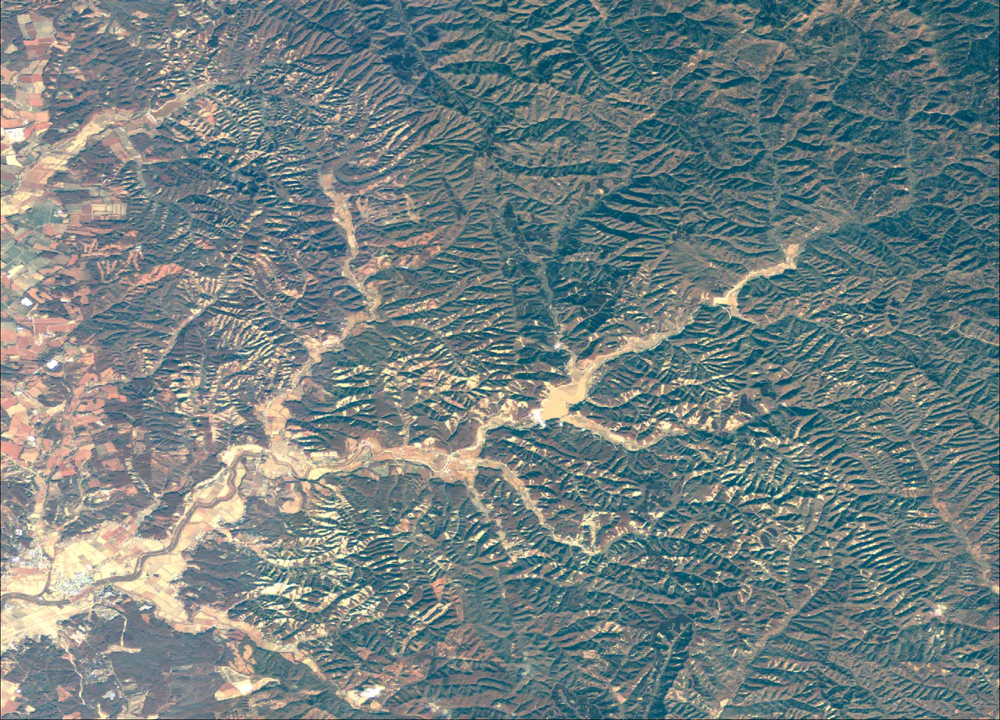

# `ras.diff`

> 多期差值、DSM−DEM 求相对高度

| | |
|---|---|
| 模块 | `analysis` · `src/dora/tools/analysis.py:1423`（64 行） |
| 相关性 | ★★★ |
| 可迁移性 | A |
| 依赖 | rasterio |
| 异常处理 | 有 `_tool_guard`：输入文件缺失时返回空结果，其他异常转成 `{"error": ...}` 返回 |

## 源码中的原话

> Subtract raster B from raster A band by band and save the difference raster. Useful for deriving relative height such as DSM - DEM.

## 这个工具做什么

把两张同一位置的图逐点相减，得到变化量。两期高程相减就是填挖或淤积的厚度，两期影像相减就是地表变没变。它只会减，不会除。

## 输入

| 参数 | 类型 | 必填 | 默认 | 说明 |
|---|---|:-:|---|---|
| `image_a_path` | str | 是 | — | 栅格 A 路径 |
| `image_b_path` | str | 是 | — | 栅格 B 路径 |
| `band_a` | int | 否 | `1` | A 使用的波段号 |
| `band_b` | int | 否 | `1` | B 使用的波段号 |

## 输出

| 字段 | 类型 | 说明 |
|---|---|---|
| `output_path` | str | Path to the difference raster in TEMP_DIR |
| `min` | float|None | Minimum valid difference |
| `max` | float|None | Maximum valid difference |
| `mean` | float|None | Mean valid difference |
| `valid_pixels` | int | Number of valid pixels used |

**落盘产物**：`output_path`（位于 `--temp_dir` 下，文件名带 6 位哈希）

## 依赖与运行

- 依赖：rasterio
- 硬件：纯算法，CPU 毫秒级；无需 GPU
- 输入：栅格 GeoTIFF/PNG；矢量 GeoJSON

## 调用

```python
from dora.tools.analysis import ras_diff
import json

res = json.loads(ras_diff(image_a_path="input.tif", image_b_path="input.tif"))
print(res)
```

```json
{
  "name": "ras.diff",
  "arguments": {
    "image_a_path": "input.tif",
    "image_b_path": "input.tif"
  }
}
```

## 示例

> 下面这组是**真跑出来的**：输入取自 DORA 数据根里的真实影像，输出是工具原样返回。路径用 `<DORA_DATA>` / `<temp_dir>` 占位，换机器照抄即可。

### 示例输入

数据：images/landslide4sense/Japan_all_14_sentinel.tif（12 波段，EPSG:4326）

```json
{
  "image_a_path": "<DORA_DATA>/images/landslide4sense/Japan_all_14_sentinel.tif",
  "image_b_path": "<DORA_DATA>/images/landslide4sense/Japan_all_14_sentinel.tif"
}
```

### 示例输出

```json
{
  "tool": "ras.diff",
  "image_a_path": "<DORA_DATA>/images/landslide4sense/Japan_all_14_sentinel.tif",
  "image_b_path": "<DORA_DATA>/images/landslide4sense/Japan_all_14_sentinel.tif",
  "output_path": "<temp_dir>/Japan_all_14_sentinel_minus_Japan_all_1_b77f31.tif",
  "band_a": 1,
  "band_b": 1,
  "nodata": -9999.0,
  "min": 0.0,
  "max": 0.0,
  "mean": 0.0,
  "valid_pixels": 2655360
}
```

[](../../examples/40-栅格分析/ras.diff/out.webp)

*示例输出*（点击图片看原图）

耗时 0.26 s（本机 8 核 CPU，无 GPU）。

## 适用边界

- **相关性**：★★★ —— 多期差值、DSM−DEM 求相对高度
- **可迁移性**：A
- 纯算法，无权重；换数据直接可用，结果只取决于输入数值本身。

## 已知坑与建议

- **建议**：只做 A − B 的逐像元相减，**不能除**——所以算不了任何指数。DSM − DEM 求相对高度也用它。

## 相关工具

- [`ras.threshold`](ras.threshold.md)
- [`ras.area`](ras.area.md)

---

[← 返回 40-栅格分析](README.md)　·　[工具总表](../../index/INDEX.md)
