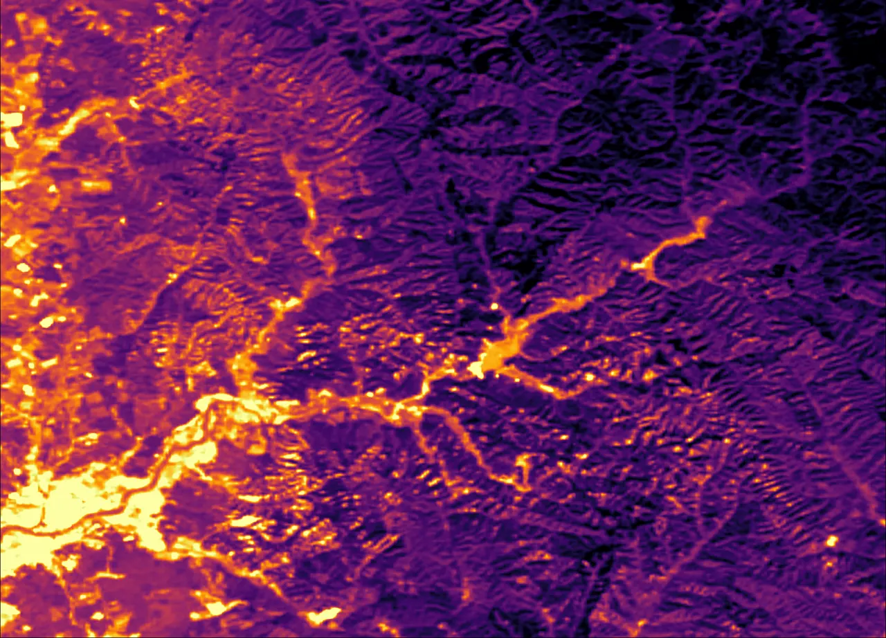

# `ras.focal_stats`

> 热点检测、平滑、DEM 局部粗糙度

| | |
|---|---|
| 模块 | `analysis` · `src/dora/tools/analysis.py:3779`（87 行） |
| 相关性 | ★★★ |
| 可迁移性 | A |
| 依赖 | rasterio |
| 异常处理 | 函数内 `try/except`：异常转成 `{"error": ...}` 返回 |

## 源码中的原话

> Compute focal (moving-window) statistics over a raster. For each pixel, aggregate the values inside a square window of side `window_size` centred on the pixel (odd window sizes recommended). Typical uses: smooth a damage density map, detect local hotspots, extract local roughness from a DEM, or pre-process a change map before thresholding. This is the local counterpart of global zonal statistics and is orthogonal to `vec.raster_stats` (which aggregates by vector zones).

## 这个工具做什么

对每个像素看它周围一圈邻居，算平均、最大或波动有多大。用来平滑噪点，或找出「比周围明显异常」的点。

## 输入

| 参数 | 类型 | 必填 | 默认 | 说明 |
|---|---|:-:|---|---|
| `raster_path` | str | 是 | — | 栅格路径 |
| `statistic` | str | 否 | `'mean'` | 统计量：mean / max / min / std / median |
| `window_size` | int | 否 | `5` | 邻域窗口边长（像元） |
| `nodata` | float? | 否 | `None` | Value to treat as nodata. Defaults to the |
| `out_path` | str? | 否 | `None` | 输出文件路径 |

## 输出

| 字段 | 类型 | 说明 |
|---|---|---|
| `output_path` | str | 产物路径 |

## 依赖与运行

- 依赖：rasterio
- 硬件：纯算法，CPU 毫秒级；无需 GPU
- 输入：栅格 GeoTIFF/PNG；矢量 GeoJSON

## 调用

```python
from dora.tools.analysis import ras_focal_stats
import json

res = json.loads(ras_focal_stats(raster_path="input.tif"))
print(res)
```

```json
{
  "name": "ras.focal_stats",
  "arguments": {
    "raster_path": "input.tif"
  }
}
```

## 示例

> 下面这组是**真跑出来的**：输入取自 DORA 数据根里的真实影像，输出是工具原样返回。路径用 `<DORA_DATA>` / `<temp_dir>` 占位，换机器照抄即可。

### 示例输入

数据：images/landslide4sense/Japan_all_14_sentinel.tif（12 波段，EPSG:4326）

```json
{
  "raster_path": "<DORA_DATA>/images/landslide4sense/Japan_all_14_sentinel.tif"
}
```

### 示例输出

```json
{
  "tool": "ras.focal_stats",
  "output_path": "<temp_dir>/Japan_all_14_sentinel_focal_mean_5.tif",
  "statistic": "mean",
  "window_size": 5,
  "shape": [
    1384,
    1922
  ]
}
```

[](../../examples/40-栅格分析/ras.focal_stats/out.webp)

*示例输出*（点击图片看原图）

耗时 0.19 s（本机 8 核 CPU，无 GPU）。

## 适用边界

- **相关性**：★★★ —— 热点检测、平滑、DEM 局部粗糙度
- **可迁移性**：A
- 纯算法，无权重；换数据直接可用，结果只取决于输入数值本身。

---

[← 返回 40-栅格分析](README.md)　·　[工具总表](../../index/INDEX.md)
