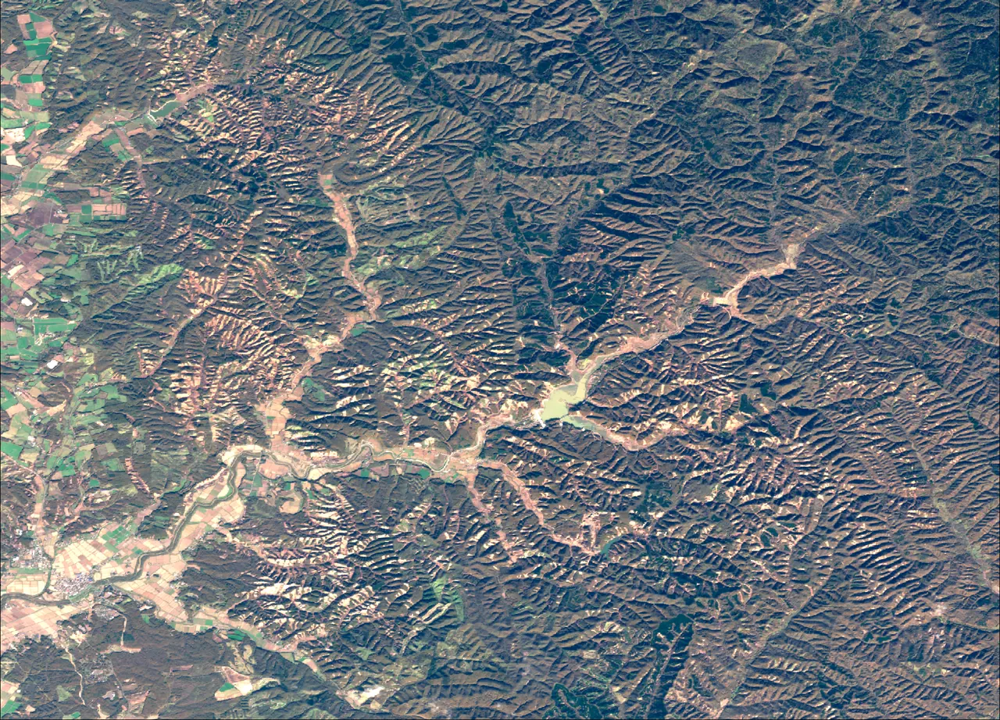
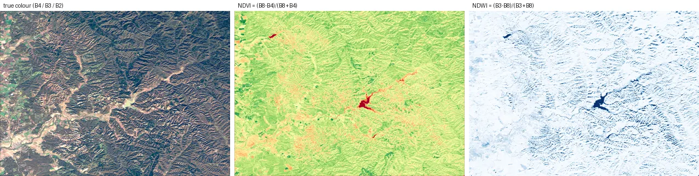

# `ras.index`

> ★ **本地扩展**：本件不在上游 DORA 的 108 件之内，由本仓库新增（`src/dora/tools/terrain.py`），实现依据见页末「已知坑」。

> 任意两波段的归一化差值指数（NDVI/NDWI/NDMI/NBR），干旱监测的基础算子

| | |
|---|---|
| 模块 | `terrain` · `src/dora/tools/terrain.py:231`（62 行） |
| 相关性 | ★★★ |
| 可迁移性 | A |
| 依赖 | numpy / rasterio |
| 异常处理 | 函数内 `try/except`：异常转成 `{"error": ...}` 返回 |

## 源码中的原话

> Normalised-difference index from any two bands of a multi-band raster: (A - B) / (A + B). One operator covers NDVI (NIR, red), NDWI (green, NIR or NIR, SWIR), NDMI (NIR, SWIR1), NBR (NIR, SWIR2) and NDBI (SWIR1, NIR) - the drought-side backbone the library otherwise lacks. The ratio is scale invariant, so digital numbers and reflectance give the same values, and no threshold has to be calibrated per scene.

## 这个工具做什么

把两个波段相减再相除，得到一个 −1 到 1 的比值。植物在近红外特别亮，所以（近红外 − 红）/（近红外 + 红）就是「这里有多少绿色植物」，这就是 NDVI。换成别的波段对，就变成水体指数、含水量指数。好处是不怕单位、不怕逐景定标，同一套阈值能换着影像用。

## 输入

| 参数 | 类型 | 必填 | 默认 | 说明 |
|---|---|:-:|---|---|
| `image_path` | str | 是 | — | 输入栅格路径（GeoTIFF / PNG；PNG 无地理参考） |
| `band_a` | int | 是 | — | A 使用的波段号 |
| `band_b` | int | 是 | — | B 使用的波段号 |
| `name` | str | 否 | `'index'` | 名称 |
| `out_path` | str? | 否 | `None` | 输出文件路径 |

## 输出

| 字段 | 类型 | 说明 |
|---|---|---|
| `stats` | dict | percentiles, share of valid pixels, share negative / positive |

## 依赖与运行

- 依赖：numpy / rasterio
- 硬件：纯算法，CPU 毫秒级；无需 GPU
- 输入：栅格 GeoTIFF/PNG；矢量 GeoJSON

## 调用

```python
from dora.tools.terrain import ras_index
import json

res = json.loads(ras_index(image_path="input.tif", band_a="1", band_b="1"))
print(res)
```

```json
{
  "name": "ras.index",
  "arguments": {
    "image_path": "input.tif",
    "band_a": "1",
    "band_b": "1"
  }
}
```

## 示例

> 下面这组是**真跑出来的**：输入取自 DORA 数据根里的真实影像，输出是工具原样返回。路径用 `<DORA_DATA>` / `<temp_dir>` 占位，换机器照抄即可。

### 示例输入

数据：同一景 12 波段 Sentinel-2（EPSG:4326，1384×1922）；波段按 B1..B12 排列

```json
{
  "image_path": "<DORA_DATA>/images/landslide4sense/Japan_all_14_sentinel.tif",
  "band_a": 8,
  "band_b": 4,
  "name": "ndvi",
  "out_path": "<temp_dir>/ndvi.tif"
}
```

[](../../examples/40-栅格分析/ras.index/in.webp)

### 示例输出

```json
{
  "tool": "ras.index",
  "out_path": "<temp_dir>/ndvi.tif",
  "name": "ndvi",
  "bands": [
    8,
    4
  ],
  "formula": "(band8 - band4) / (band8 + band4)",
  "stats": {
    "min": -0.4945,
    "p5": 0.1429,
    "p50": 0.4568,
    "p95": 0.6134,
    "max": 0.8364,
    "mean": 0.4244,
    "valid_ratio": 0.9982,
    "share_negative": 0.0043,
    "share_positive": 0.9956
  },
  "shape": [
    1384,
    1922
  ],
  "warnings": []
}
```

[](../../examples/40-栅格分析/ras.index/out.webp)

*NDVI 中位 +0.46（p5 +0.14 ~ p95 +0.61），NDWI 中位 -0.39；负 NDVI 只占 0.4% 的像元*（点击图片看原图）

> 归一化差值只做一件事：`(A−B)/(A+B)`，所以它**对量纲免疫**——数字量（DN）和反射率算出来完全一样，不需要逐景定标。这也是它比阈值法稳的原因。换指数就是换波段号：NDVI 用 (NIR, 红)，NDWI 用 (绿, NIR)，NDMI 用 (NIR, SWIR1)，NBR 用 (NIR, SWIR2)。请注意波段号是**按数据源的排法**给的，不是按卫星波段名——这块数据是 B1..B12 顺序，所以 B8 是第 8 个。算出来负 NDVI 的那 0.4% 像元是水面、阴影和云，正好可以和淹没范围对照。

耗时 0.46 s（本机 8 核 CPU，无 GPU）。

## 适用边界

- **相关性**：★★★ —— 任意两波段的归一化差值指数（NDVI/NDWI/NDMI/NBR），干旱监测的基础算子
- **可迁移性**：A
- 指数只比两个波段，**波段号要按数据源的排列给**，不是卫星的波段名：这块数据是 B1..B12 顺序，所以近红外是第 8 个。分母为 0（两波段同时为 0）的地方输出 NoData。实测这块景 NDVI 中位 +0.46、负值只占 0.4% 的像元（水面、阴影、云）。

## 已知坑与建议

- **坑**：归一化差值**不能跨传感器直接比大小**：Sentinel-2 与 Landsat 8 的 NDVI 量级接近但不相等，做时序要先确认同源。也不要把它当物理量——它是比值，不是反射率，更不是覆盖率。
- **建议**：常用波段对：NDVI (NIR, 红)、NDWI (绿, NIR)、NDMI (NIR, SWIR1)、NBR (NIR, SWIR2)、NDBI (SWIR1, NIR)。干旱监测要看 NDVI 与多年同期的**距平**，不是绝对值——单期 0.4 在南方是稀疏植被、在北方是茂密植被。

## 相关工具

- [`ras.threshold`](ras.threshold.md)
- [`ras.stats`](ras.stats.md)
- [`seg.vegetation`](../30-地形与地表变化/seg.vegetation.md)
- [`ras.clip`](ras.clip.md)

---

[← 返回 40-栅格分析](README.md)　·　[工具总表](../../index/INDEX.md)
