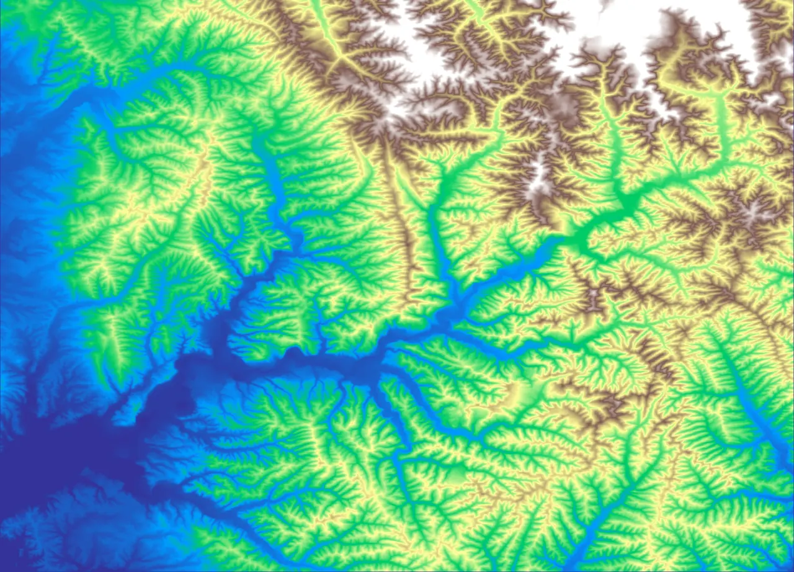
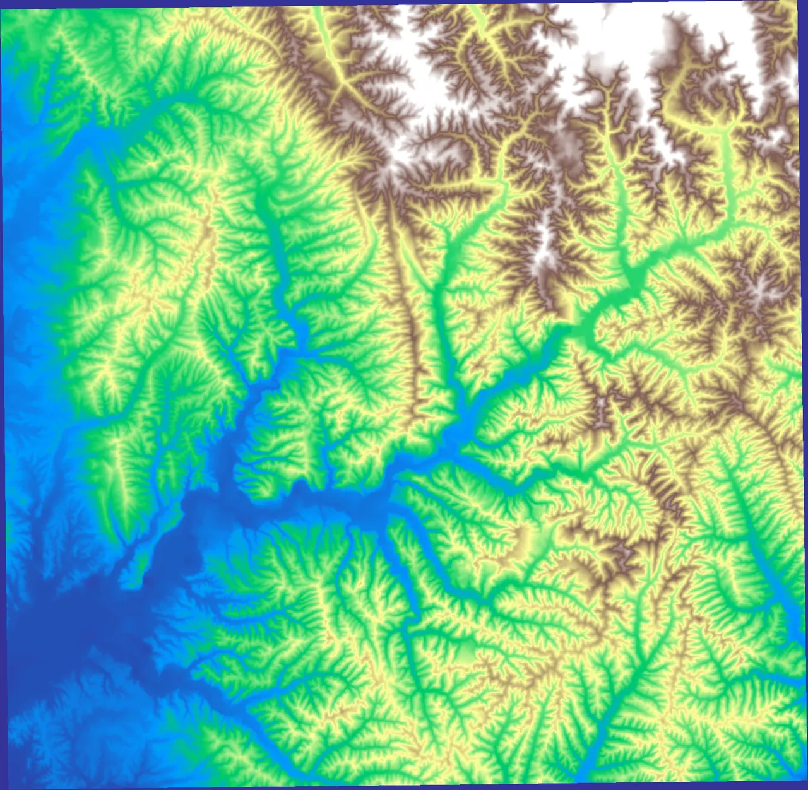

# `ras.reproject`

> 多源数据统一坐标系（国产影像常为 CGCS2000）

| | |
|---|---|
| 模块 | `analysis` · `src/dora/tools/analysis.py:3619`（55 行） |
| 相关性 | ★★★ |
| 可迁移性 | A |
| 依赖 | rasterio |
| 异常处理 | 函数内 `try/except`：异常转成 `{"error": ...}` 返回 |

## 源码中的原话

> Reproject a raster from its current CRS to a target CRS. Useful for aligning multi-source data (e.g., optical + SAR, DEM + damage mask) so downstream operations can be performed in a common coordinate system.

## 这个工具做什么

把影像换到统一的坐标系。国产数据常是 CGCS2000、国际数据多是 WGS84，不统一就没法叠在一张图上。

## 输入

| 参数 | 类型 | 必填 | 默认 | 说明 |
|---|---|:-:|---|---|
| `raster_path` | str | 是 | — | 栅格路径 |
| `dst_crs` | str | 是 | — | Target CRS as an EPSG code (e.g., "EPSG:32636") |
| `resampling` | str | 否 | `'bilinear'` | 重采样方法：nearest / bilinear / cubic |
| `out_path` | str? | 否 | `None` | 输出文件路径 |

## 输出

| 字段 | 类型 | 说明 |
|---|---|---|
| `output_path` | str | Path to the reprojected raster |
| `src_crs` | str | Original CRS |
| `dst_crs` | str | New CRS |
| `shape` | list[int | [height, width] |

**落盘产物**：`output_path`（位于 `--temp_dir` 下，文件名带 6 位哈希）

## 依赖与运行

- 依赖：rasterio
- 硬件：纯算法，CPU 毫秒级；无需 GPU
- 输入：栅格 GeoTIFF/PNG；矢量 GeoJSON

## 调用

```python
from dora.tools.analysis import ras_reproject
import json

res = json.loads(ras_reproject(raster_path="input.tif", dst_crs=""input.tif""))
print(res)
```

```json
{
  "name": "ras.reproject",
  "arguments": {
    "raster_path": "input.tif",
    "dst_crs": "\"input.tif\""
  }
}
```

## 示例

> 下面这组是**真跑出来的**：输入取自 DORA 数据根里的真实影像，输出是工具原样返回。路径用 `<DORA_DATA>` / `<temp_dir>` 占位，换机器照抄即可。

### 示例输入

数据：images/landslide4sense/Japan_all_14_dem.tif（EPSG:4326，高程米）

```json
{
  "raster_path": "<DORA_DATA>/images/landslide4sense/Japan_all_14_dem.tif",
  "dst_crs": "EPSG:32654"
}
```

[](../../examples/40-栅格分析/ras.reproject/in.webp)

### 示例输出

```json
{
  "tool": "ras.reproject",
  "output_path": "<temp_dir>/reprojected.tif",
  "src_crs": "EPSG:4326",
  "dst_crs": "EPSG:32654",
  "shape": [
    1675,
    1713
  ]
}
```

[](../../examples/40-栅格分析/ras.reproject/out.webp)

*上：投影前（经纬度栅格）；下：投影后（UTM 54N，米制像元）*（点击图片看原图）

> 坡度、缓冲区、最短路这类按「米」算的步骤，都应先投影到米制坐标系。

耗时 0.45 s（本机 8 核 CPU，无 GPU）。

## 适用边界

- **相关性**：★★★ —— 多源数据统一坐标系（国产影像常为 CGCS2000）
- **可迁移性**：A
- 纯算法，无权重；换数据直接可用，结果只取决于输入数值本身。

---

[← 返回 40-栅格分析](README.md)　·　[工具总表](../../index/INDEX.md)
