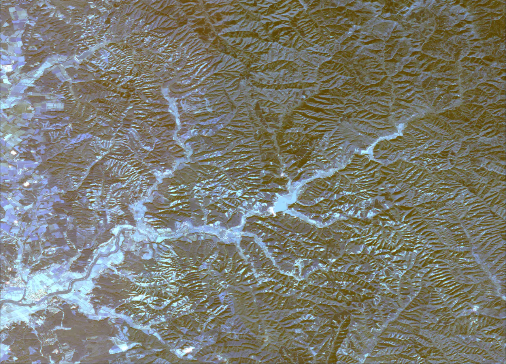
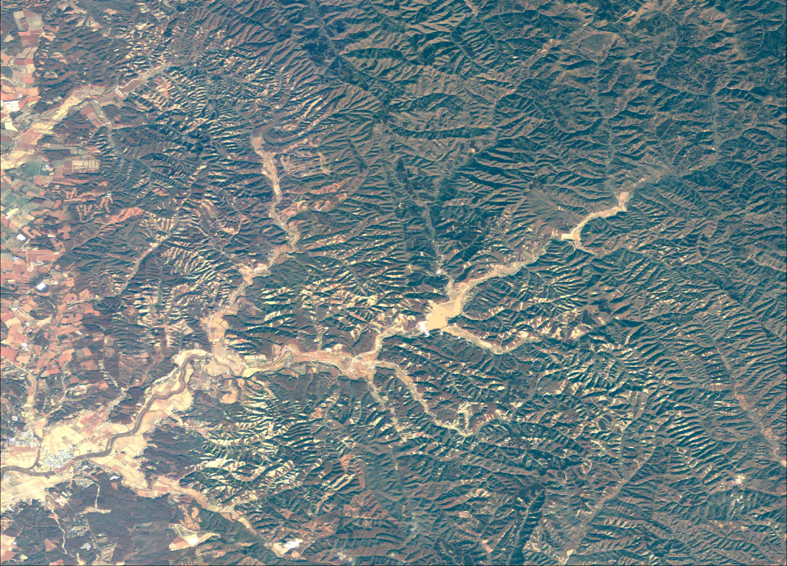

# `ras.sample_points`

> 水文站点批量采样

| | |
|---|---|
| 模块 | `analysis` · `src/dora/tools/analysis.py:1249`（5 行） |
| 相关性 | ★★ |
| 可迁移性 | A |
| 依赖 | rasterio |
| 异常处理 | 有 `_tool_guard`：输入文件缺失时返回空结果，其他异常转成 `{"error": ...}` 返回 |

## 源码中的原话

> Sample pixel values at multiple locations in a raster image.

## 这个工具做什么

一次查很多个点，返回一张表。适合把几十上百个站点的值一次取出来。

## 输入

| 参数 | 类型 | 必填 | 默认 | 说明 |
|---|---|:-:|---|---|
| `image_path` | str | 是 | — | 输入栅格路径（GeoTIFF / PNG；PNG 无地理参考） |
| `points` | list[dict] | 是 | — | 点要素列表 |

## 输出

| 字段 | 类型 | 说明 |
|---|---|---|
| `total_points` | int | Number of input points |
| `results` | list | List of {row, col, pixel_values, is_inside} for each point |

## 依赖与运行

- 依赖：rasterio
- 硬件：纯算法，CPU 毫秒级；无需 GPU
- 输入：栅格 GeoTIFF/PNG；矢量 GeoJSON

## 调用

```python
from dora.tools.analysis import ras_sample_points_tool
import json

res = json.loads(ras_sample_points_tool(image_path="input.tif", points="input.tif"))
print(res)
```

```json
{
  "name": "ras.sample_points",
  "arguments": {
    "image_path": "input.tif",
    "points": "input.tif"
  }
}
```

## 示例

> 下面这组是**真跑出来的**：输入取自 DORA 数据根里的真实影像，输出是工具原样返回。路径用 `<DORA_DATA>` / `<temp_dir>` 占位，换机器照抄即可。

### 示例输入

数据：images/landslide4sense/Japan_all_14_sentinel.tif（12 波段，EPSG:4326）

```json
{
  "image_path": "<DORA_DATA>/images/landslide4sense/Japan_all_14_sentinel.tif",
  "points": [
    {
      "row": 100,
      "col": 120
    },
    {
      "row": 300,
      "col": 400
    }
  ]
}
```

[](../../examples/40-栅格分析/ras.sample_points/in.webp)

### 示例输出

```json
{
  "tool": "ras.sample_points",
  "image_path": "<DORA_DATA>/images/landslide4sense/Japan_all_14_sentinel.tif",
  "total_points": 2,
  "results": [
    {
      "row": 100,
      "col": 120,
      "pixel_values": {
        "1": 1292,
        "2": 900,
        "3": 692,
        "4": 517,
        "5": 738,
        "6": 1186,
        "7": 1401,
        "8": 1354,
        "9": 865,
        "10": 17,
        "11": 1411,
        "12": 756
      },
      "is_inside": true
    },
    {
      "row": 300,
      "col": 400,
      "pixel_values": {
        "1": 1353,
        "2": 1028,
        "3": 939,
        "4": 999,
        "5": 1528,
        "6": 2332,
        "7": 2732,
        "8": 2624,
        "9": 1026,
        "10": 16,
        "11": 2744,
        "12": 1474
      },
      "is_inside": true
    }
  ]
}
```

[](../../examples/40-栅格分析/ras.sample_points/out.webp)

*示例输出*（点击图片看原图）

耗时 0.07 s（本机 8 核 CPU，无 GPU）。

## 适用边界

- **相关性**：★★ —— 水文站点批量采样
- **可迁移性**：A
- 纯算法，无权重；换数据直接可用，结果只取决于输入数值本身。

---

[← 返回 40-栅格分析](README.md)　·　[工具总表](../../index/INDEX.md)
