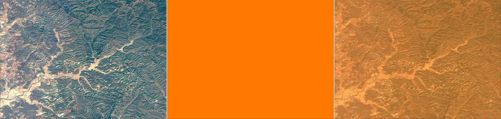

# `ras.threshold`

> 最通用的一招：LST/NDVI/水深/降水栅格都能阈值化

| | |
|---|---|
| 模块 | `analysis` · `src/dora/tools/analysis.py:1336`（66 行） |
| 相关性 | ★★★ |
| 可迁移性 | A |
| 依赖 | rasterio |
| 异常处理 | 有 `_tool_guard`：输入文件缺失时返回空结果，其他异常转成 `{"error": ...}` 返回 |

## 源码中的原话

> Create a binary mask by thresholding one raster band.

## 这个工具做什么

把一张图里符合某个数值条件的区域涂白、其余涂黑。比如只保留温度高于 35 度的地方，或者只保留水深超过 0.5 米的地方——一次就能圈出范围，不用另训模型。

## 输入

| 参数 | 类型 | 必填 | 默认 | 说明 |
|---|---|:-:|---|---|
| `image_path` | str | 是 | — | 输入栅格路径（GeoTIFF / PNG；PNG 无地理参考） |
| `threshold` | float | 是 | — | 阈值 |
| `op` | str | 否 | `'>='` | 比较运算符：`>=` `>` `<=` `<` `==` |
| `band` | int | 否 | `1` | 波段号，从 1 开始 |
| `true_value` | int | 否 | `255` | 命中像元写入的值 |
| `false_value` | int | 否 | `0` | 未命中像元写入的值 |

## 输出

| 字段 | 类型 | 说明 |
|---|---|---|
| `mask_path` | str | Path to threshold mask in TEMP_DIR |
| `selected_pixels` | int | Number of pixels passing the threshold |
| `threshold` | float | Input threshold |
| `op` | str | Comparison operator used |

**落盘产物**：`mask_path`（位于 `--temp_dir` 下，文件名带 6 位哈希）

## 依赖与运行

- 依赖：rasterio
- 硬件：纯算法，CPU 毫秒级；无需 GPU
- 输入：栅格 GeoTIFF/PNG；矢量 GeoJSON

## 调用

```python
from dora.tools.analysis import ras_threshold
import json

res = json.loads(ras_threshold(image_path="input.tif", threshold="0.0"))
print(res)
```

```json
{
  "name": "ras.threshold",
  "arguments": {
    "image_path": "input.tif",
    "threshold": "0.0"
  }
}
```

## 示例

> 下面这组是**真跑出来的**：输入取自 DORA 数据根里的真实影像，输出是工具原样返回。路径用 `<DORA_DATA>` / `<temp_dir>` 占位，换机器照抄即可。

### 示例输入

数据：Japan_all_14_sentinel.tif 第 7 波段（近红外）

```json
{
  "image_path": "<DORA_DATA>/images/landslide4sense/Japan_all_14_sentinel.tif",
  "threshold": 1200.0,
  "op": ">",
  "band": 7
}
```

### 示例输出

```json
{
  "tool": "ras.threshold",
  "image_path": "<DORA_DATA>/images/landslide4sense/Japan_all_14_sentinel.tif",
  "mask_path": "<temp_dir>/Japan_all_14_sentinel_thr_gt_1200.0_7ede90.tif",
  "threshold": 1200.0,
  "op": ">",
  "band": 7,
  "selected_pixels": 2010844,
  "true_value": 255,
  "false_value": 0
}
```

[](../../examples/40-栅格分析/ras.threshold/out.webp)

*影像｜阈值掩膜｜叠加（亮像元 > 1200）*（点击图片看原图）

> 阈值法零成本、可解释，但没有语义；找水体/裸土够用，找「滑坡」不行。

耗时 0.11 s（本机 8 核 CPU，无 GPU）。

## 适用边界

- **相关性**：★★★ —— 最通用的一招：LST/NDVI/水深/降水栅格都能阈值化
- **可迁移性**：A
- 只做单波段二值化，不能做波段比值（算不了 NDVI/NDWI，那是缺口）。

## 已知坑与建议

- **建议**：SAR 水体最实用的下限基线：VV < −16 dB 得 IoU 0.267，零权重、801 次调用零报错。任何新模型要先超过它。

## 相关工具

- [`ras.area`](ras.area.md)
- [`ras.vectorize`](ras.vectorize.md)

---

[← 返回 40-栅格分析](README.md)　·　[工具总表](../../index/INDEX.md)
