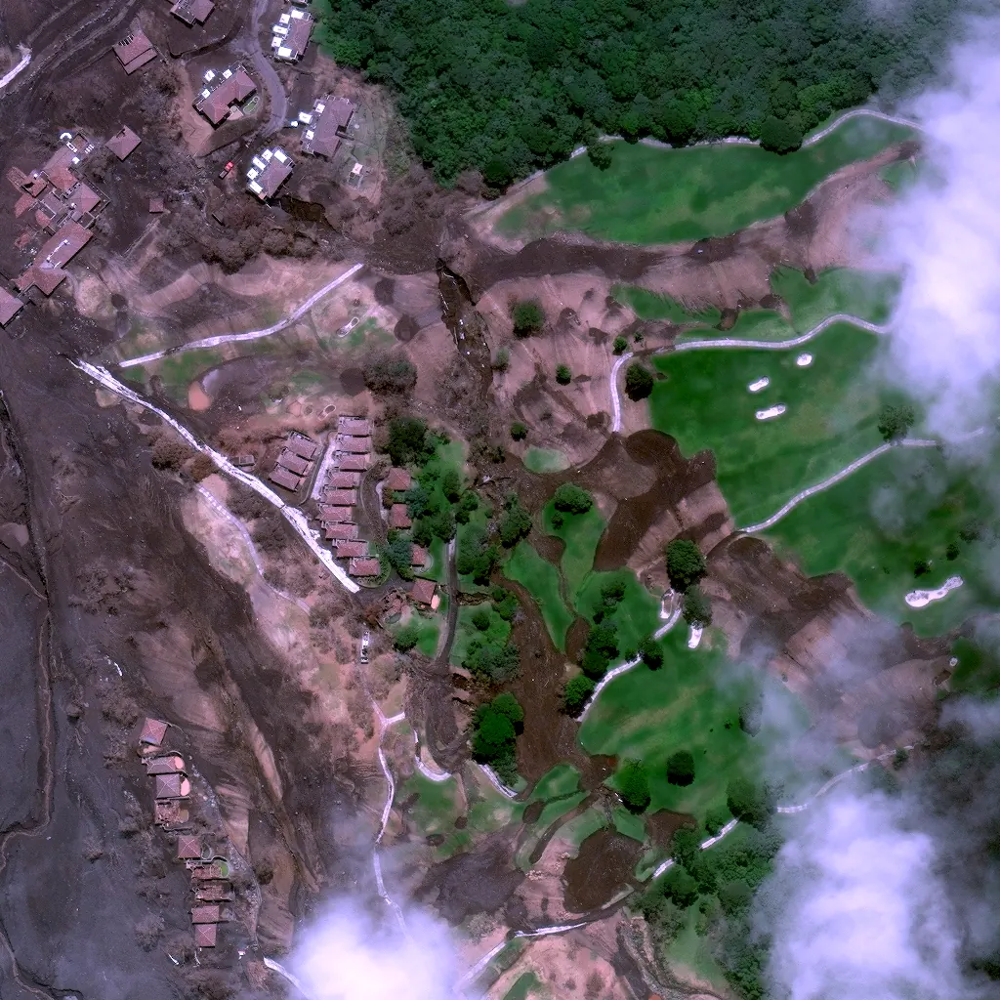
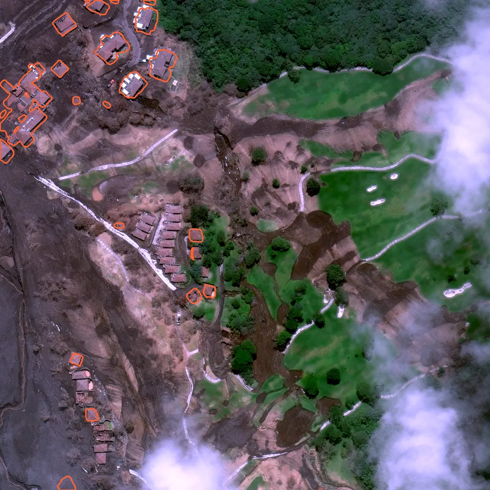

# `ras.vectorize`

> 淹没范围出图、与行政区叠加的前提

| | |
|---|---|
| 模块 | `analysis` · `src/dora/tools/analysis.py:1588`（66 行） |
| 相关性 | ★★★ |
| 可迁移性 | A |
| 依赖 | rasterio+geo |
| 异常处理 | 有 `_tool_guard`：输入文件缺失时返回空结果，其他异常转成 `{"error": ...}` 返回 |

## 源码中的原话

> Vectorize a raster mask to extract polygons for specified classes. Converts pixel-based mask to vector polygons with area statistics and saves GeoJSON. This tool facilitates the later vector-based processing.

## 这个工具做什么

把黑白的范围图转成 GIS 里能编辑、能叠加的面数据，每一块还自带面积。要在行政区上算数、要出彩色范围图，都得先走这一步。

## 输入

| 参数 | 类型 | 必填 | 默认 | 说明 |
|---|---|:-:|---|---|
| `mask_path` | str | 是 | — | 掩膜路径（二值或多类） |
| `classes` | list[int] | 是 | — | 要保留的类别值列表 |
| `pixel_size_m` | float | 否 | `None` | 像元边长（米）。掩膜无地理参考时必须显式给出 |

## 输出

| 字段 | 类型 | 说明 |
|---|---|---|
| `vector_path` | str | Path to the saved vector GeoJSON |
| `polygons` | list | List of polygon properties (id/class/pixel_count/area_m2) |
| `count` | int | Number of polygons extracted |
| `total_pixels` | int | Total pixel count for the classes |
| `total_area_m2` | float|None | Total area in m2 if pixel_size_m provided |

**落盘产物**：`vector_path`（位于 `--temp_dir` 下，文件名带 6 位哈希）

## 依赖与运行

- 依赖：rasterio+geo
- 硬件：纯算法，CPU 毫秒级；无需 GPU
- 输入：栅格 GeoTIFF/PNG；矢量 GeoJSON

## 调用

```python
from dora.tools.analysis import ras_vectorize
import json

res = json.loads(ras_vectorize(mask_path="mask.png", classes="input.tif"))
print(res)
```

```json
{
  "name": "ras.vectorize",
  "arguments": {
    "mask_path": "mask.png",
    "classes": "input.tif"
  }
}
```

## 示例

> 下面这组是**真跑出来的**：输入取自 DORA 数据根里的真实影像，输出是工具原样返回。路径用 `<DORA_DATA>` / `<temp_dir>` 占位，换机器照抄即可。

### 示例输入

数据：seg.building_damage 掩膜（类别 2、3）

```json
{
  "mask_path": "<work>/fixtures/mask_damage.tif",
  "classes": [
    2,
    3
  ],
  "pixel_size_m": 0.8
}
```

[](../../examples/40-栅格分析/ras.vectorize/in.webp)

### 示例输出

```json
{
  "tool": "ras.vectorize",
  "vector_path": "<temp_dir>/mask_damage_class_2_3_609f5c.geojson",
  "count": 26,
  "total_pixels": 27959,
  "total_area_m2": 17893.76
}
```

[](../../examples/40-栅格分析/ras.vectorize/out.webp)

*上：灾后影像；下：矢量化后的建筑轮廓（橙线，26 个面）*（点击图片看原图）

> 相邻像元会合并成一个面；细碎图斑建议接 `vec.filter_by_area` 清理。

耗时 0.08 s（本机 8 核 CPU，无 GPU）。

## 适用边界

- **相关性**：★★★ —— 淹没范围出图、与行政区叠加的前提
- **可迁移性**：A
- 纯算法，无权重；换数据直接可用，结果只取决于输入数值本身。

## 已知坑与建议

- **建议**：输出多边形自带 `area_m2`；碎斑用 `vec.filter_by_area` 清，再 `vec.intersect` 叠行政区。

## 相关工具

- [`vec.filter_by_area`](../50-矢量与空间关系/vec.filter_by_area.md)
- [`vec.intersect`](../50-矢量与空间关系/vec.intersect.md)

---

[← 返回 40-栅格分析](README.md)　·　[工具总表](../../index/INDEX.md)
