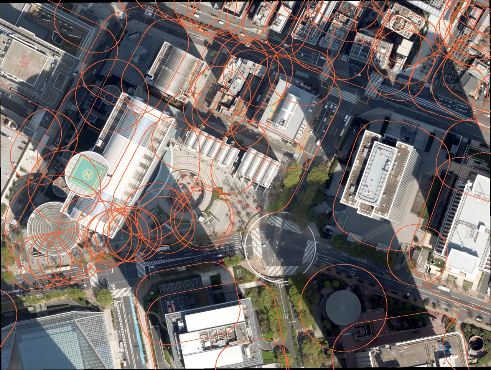

# `vec.buffer`

> 河道缓冲带、溃堤影响带、河岸带

| | |
|---|---|
| 模块 | `analysis` · `src/dora/tools/analysis.py:2360`（37 行） |
| 相关性 | ★★★ |
| 可迁移性 | A |
| 依赖 | geo |
| 异常处理 | 有 `_tool_guard`：输入文件缺失时返回空结果，其他异常转成 `{"error": ...}` 返回 |

## 源码中的原话

> Create a buffer around all geometries in a vector file. The distance is interpreted in the CRS units (meters if CRS is metric).

## 这个工具做什么

沿着一条线或一个点，向外画出一圈指定宽度的影响带。溃堤口 500 米内、河道两侧 100 米，都是这么圈出来的。

## 输入

| 参数 | 类型 | 必填 | 默认 | 说明 |
|---|---|:-:|---|---|
| `vector_path` | str | 是 | — | 矢量路径（GeoJSON） |
| `meter` | float | 是 | — | Buffer distance |

## 输出

| 字段 | 类型 | 说明 |
|---|---|---|
| `buffer_path` | str | Path to buffered GeoJSON |

**落盘产物**：`buffer_path`（位于 `--temp_dir` 下，文件名带 6 位哈希）

## 依赖与运行

- 依赖：geo
- 硬件：纯算法，CPU 毫秒级；无需 GPU
- 输入：栅格 GeoTIFF/PNG；矢量 GeoJSON

## 调用

```python
from dora.tools.analysis import vec_buffer
import json

res = json.loads(vec_buffer(vector_path="admin.geojson", meter="0.0"))
print(res)
```

```json
{
  "name": "vec.buffer",
  "arguments": {
    "vector_path": "admin.geojson",
    "meter": "0.0"
  }
}
```

## 示例

> 下面这组是**真跑出来的**：输入取自 DORA 数据根里的真实影像，输出是工具原样返回。路径用 `<DORA_DATA>` / `<temp_dir>` 占位，换机器照抄即可。

### 示例输入

数据：images/heatisland/09LD1638/osm/buildings.geojson（79 个建筑面，已转 EPSG:6677）

```json
{
  "vector_path": "<work>/fixtures/buildings.geojson",
  "meter": 20.0
}
```

[](../../examples/50-矢量与空间关系/vec.buffer/in.webp)

### 示例输出

```json
{
  "tool": "vec.buffer",
  "buffer_path": "<temp_dir>/buildings_buffer_20.0m_2fbb69.geojson",
  "distance_input_m": 20.0,
  "distance_used_units": 20.0,
  "input_vector": "<work>/fixtures/buildings.geojson"
}
```

[](../../examples/50-矢量与空间关系/vec.buffer/out.webp)

*示例输出*（点击图片看原图）

耗时 0.04 s（本机 8 核 CPU，无 GPU）。

## 适用边界

- **相关性**：★★★ —— 河道缓冲带、溃堤影响带、河岸带
- **可迁移性**：A
- 纯算法，无权重；换数据直接可用，结果只取决于输入数值本身。

---

[← 返回 50-矢量与空间关系](README.md)　·　[工具总表](../../index/INDEX.md)
