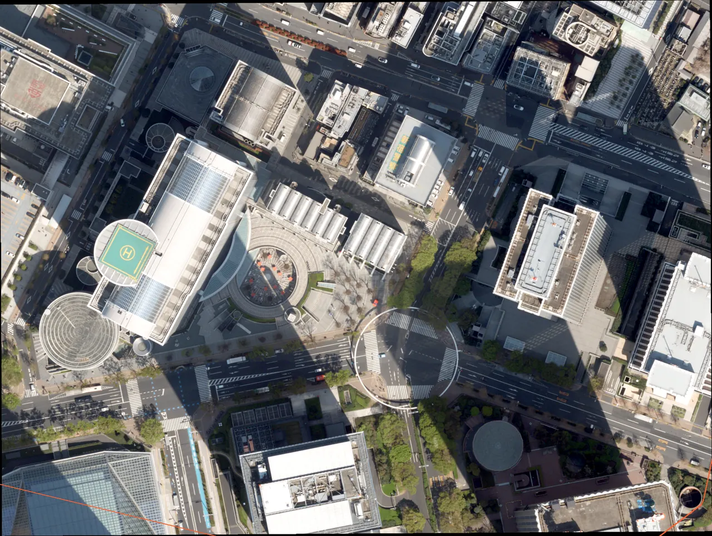

# `vec.convex_hull`

> 灾害影响范围包络

| | |
|---|---|
| 模块 | `analysis` · `src/dora/tools/analysis.py:3887`（30 行） |
| 相关性 | ★★ |
| 可迁移性 | A |
| 依赖 | geo |
| 异常处理 | 函数内 `try/except`：异常转成 `{"error": ...}` 返回 |

## 源码中的原话

> Compute the convex hull of a set of polygons or points in a GeoJSON file. Useful for estimating the spatial envelope of a damage cluster or hazard spread footprint.

## 这个工具做什么

把一堆点或面用最小的凸多边形包起来，快速得到「大致影响范围」。

## 输入

| 参数 | 类型 | 必填 | 默认 | 说明 |
|---|---|:-:|---|---|
| `vector_path` | str | 是 | — | 矢量路径（GeoJSON） |
| `out_path` | str? | 否 | `None` | 输出文件路径 |

## 输出

| 字段 | 类型 | 说明 |
|---|---|---|
| `output_path` | str | Path to convex hull GeoJSON |
| `area_m2` | float | Area of the hull (if CRS is projected) |
| `vertex_count` | int | Number of vertices in the hull |

**落盘产物**：`output_path`（位于 `--temp_dir` 下，文件名带 6 位哈希）

## 依赖与运行

- 依赖：geo
- 硬件：纯算法，CPU 毫秒级；无需 GPU
- 输入：栅格 GeoTIFF/PNG；矢量 GeoJSON

## 调用

```python
from dora.tools.analysis import vec_convex_hull
import json

res = json.loads(vec_convex_hull(vector_path="admin.geojson"))
print(res)
```

```json
{
  "name": "vec.convex_hull",
  "arguments": {
    "vector_path": "admin.geojson"
  }
}
```

## 示例

> 下面这组是**真跑出来的**：输入取自 DORA 数据根里的真实影像，输出是工具原样返回。路径用 `<DORA_DATA>` / `<temp_dir>` 占位，换机器照抄即可。

### 示例输入

数据：images/heatisland/09LD1638/osm/buildings.geojson（79 个建筑面，已转 EPSG:6677）

```json
{
  "vector_path": "<work>/fixtures/buildings.geojson"
}
```

[](../../examples/50-矢量与空间关系/vec.convex_hull/in.webp)

### 示例输出

```json
{
  "tool": "vec.convex_hull",
  "output_path": "<temp_dir>/convex_hull.geojson",
  "area_m2": 115435.29787072193,
  "vertex_count": 19
}
```

[](../../examples/50-矢量与空间关系/vec.convex_hull/out.webp)

*示例输出*（点击图片看原图）

耗时 0.12 s（本机 8 核 CPU，无 GPU）。

## 适用边界

- **相关性**：★★ —— 灾害影响范围包络
- **可迁移性**：A
- 纯算法，无权重；换数据直接可用，结果只取决于输入数值本身。

---

[← 返回 50-矢量与空间关系](README.md)　·　[工具总表](../../index/INDEX.md)
