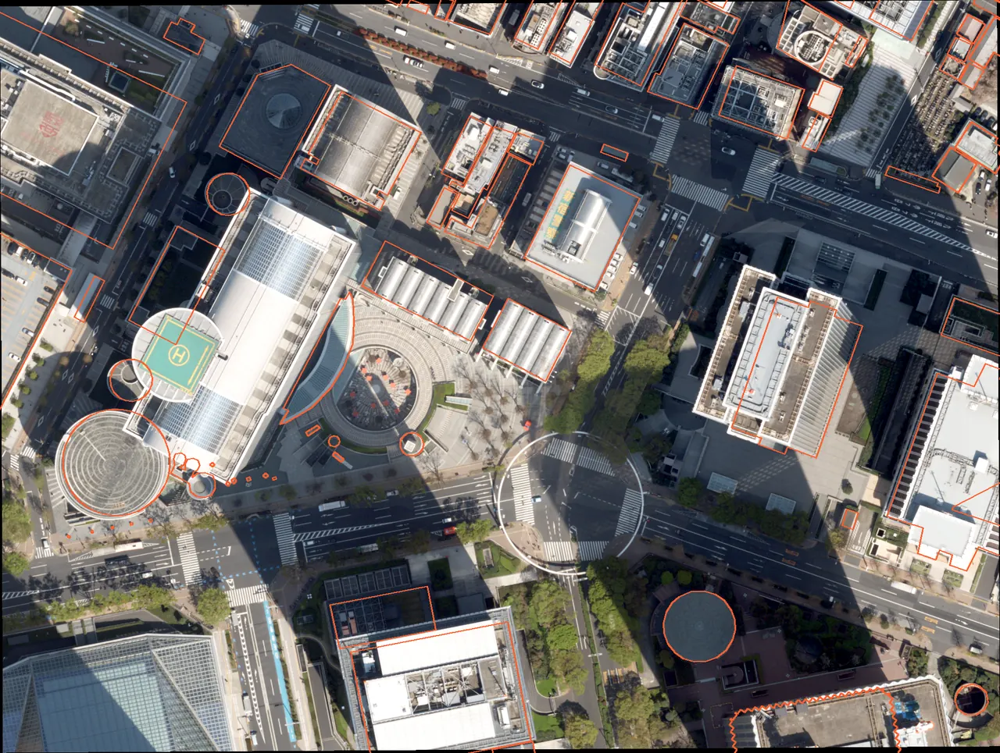

# `vec.intersect`

> 淹没范围 ∩ 耕地/居民地/行政区

| | |
|---|---|
| 模块 | `analysis` · `src/dora/tools/analysis.py:2014`（120 行） |
| 相关性 | ★★★ |
| 可迁移性 | A |
| 依赖 | geo |
| 异常处理 | 有 `_tool_guard`：输入文件缺失时返回空结果，其他异常转成 `{"error": ...}` 返回 |

## 源码中的原话

> Find intersection between two vector datasets (GeoJSON) using vector overlay. Features of one layer that overlap each other (e.g. per-feature buffers) are merged first, so nothing is counted or measured twice.

## 这个工具做什么

两层范围求重叠。淹没范围叠到行政区上，就知道每个县淹了多少；叠到耕地上，就知道多少亩农田受影响。

## 输入

| 参数 | 类型 | 必填 | 默认 | 说明 |
|---|---|:-:|---|---|
| `vector_a_path` | str | 是 | — | 矢量层 A（GeoJSON） |
| `vector_b_path` | str | 是 | — | 矢量层 B（GeoJSON） |
| `pixel_size_m` | float | 否 | `None` | 像元边长（米）。掩膜无地理参考时必须显式给出 |

## 输出

| 字段 | 类型 | 说明 |
|---|---|---|
| `intersection_count` | int | Number of intersection pieces (one per pair of intersecting features) |
| `intersecting_a_count` | int | Number of features of the first dataset that intersect the second |
| `intersecting_b_count` | int | Number of features of the second dataset that intersect the first |
| `intersection_area_m2` | float | Total intersection area in square meters |
| `intersection_path` | str | Path to intersection GeoJSON |

**落盘产物**：`intersection_path`（位于 `--temp_dir` 下，文件名带 6 位哈希）

## 依赖与运行

- 依赖：geo
- 硬件：纯算法，CPU 毫秒级；无需 GPU
- 输入：栅格 GeoTIFF/PNG；矢量 GeoJSON

## 调用

```python
from dora.tools.analysis import vec_intersect
import json

res = json.loads(vec_intersect(vector_a_path="admin.geojson", vector_b_path="admin.geojson"))
print(res)
```

```json
{
  "name": "vec.intersect",
  "arguments": {
    "vector_a_path": "admin.geojson",
    "vector_b_path": "admin.geojson"
  }
}
```

## 示例

> 下面这组是**真跑出来的**：输入取自 DORA 数据根里的真实影像，输出是工具原样返回。路径用 `<DORA_DATA>` / `<temp_dir>` 占位，换机器照抄即可。

### 示例输入

数据：images/heatisland/09LD1638/osm/buildings.geojson（79 个建筑面，已转 EPSG:6677）；roads 外扩 30 m 的缓冲区，用于演示矢量求交

```json
{
  "vector_a_path": "<work>/fixtures/buildings.geojson",
  "vector_b_path": "<work>/fixtures/roads_buffer.geojson"
}
```

[](../../examples/50-矢量与空间关系/vec.intersect/in.webp)

### 示例输出

```json
{
  "tool": "vec.intersect",
  "intersection_count": 78,
  "intersecting_a_count": 78,
  "intersecting_b_count": 1,
  "intersection_area_px2": null,
  "intersection_area_m2": 32167.350345048166,
  "pixel_size_m": null,
  "intersection_path": "<temp_dir>/buildings_roads_buffer_intersection_dd3949_873e48.geojson"
}
```

[](../../examples/50-矢量与空间关系/vec.intersect/out.webp)

*示例输出*（点击图片看原图）

耗时 0.4 s（本机 8 核 CPU，无 GPU）。

## 适用边界

- **相关性**：★★★ —— 淹没范围 ∩ 耕地/居民地/行政区
- **可迁移性**：A
- 纯算法，无权重；换数据直接可用，结果只取决于输入数值本身。

---

[← 返回 50-矢量与空间关系](README.md)　·　[工具总表](../../index/INDEX.md)
