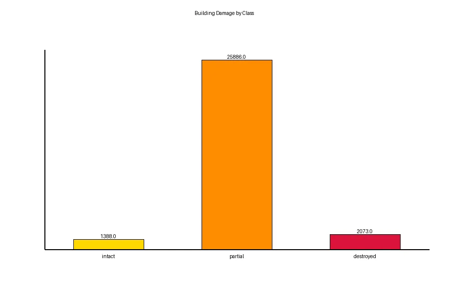

# `vis.bar_chart`

> 分区统计展示

| | |
|---|---|
| 模块 | `vis` · `src/dora/tools/vis.py:1014`（9 行） |
| 相关性 | ★★ |
| 可迁移性 | A |
| 依赖 | PIL |
| 异常处理 | **无统一包装**：异常会直接抛出（MCP 层表现为 tool error） |

## 源码中的原话

> Generate a bar chart from category statistics. Output file is written to a managed location; its path is returned in the result dict as output_path.

## 这个工具做什么

画柱状图，比较不同县、不同时段的数量。

## 输入

| 参数 | 类型 | 必填 | 默认 | 说明 |
|---|---|:-:|---|---|
| `data` | dict[str,float] | 是 | — | 输入数据（数组或字典，结构见源码） |
| `title` | str | 否 | `'Bar Chart'` | 图标题 |

## 输出

| 字段 | 类型 | 说明 |
|---|---|---|
| `output_path` | str | 生成的图片路径（由调用方通过 `output_path` 参数指定） |

## 依赖与运行

- 依赖：PIL
- 硬件：纯算法，CPU 毫秒级；无需 GPU
- 输入：栅格 GeoTIFF/PNG；矢量 GeoJSON

## 调用

```python
from dora.tools.vis import bar_chart_tool
import json

res = json.loads(bar_chart_tool(data="input.tif"))
print(res)
```

```json
{
  "name": "vis.bar_chart",
  "arguments": {
    "data": "input.tif"
  }
}
```

## 示例

> 下面这组是**真跑出来的**：输入取自 DORA 数据根里的真实影像，输出是工具原样返回。路径用 `<DORA_DATA>` / `<temp_dir>` 占位，换机器照抄即可。

### 示例输入

数据：seg.building_damage 掩膜的逐类像元计数

```json
{
  "data": {
    "intact": 1388,
    "partial": 25886,
    "destroyed": 2073
  },
  "output_path": "<work>/bar.png",
  "title": "Building Damage by Class"
}
```

### 示例输出

```json
{
  "tool": "vis.bar_chart",
  "output_path": "<work>/bar.png",
  "chart_type": "bar",
  "statistics": {
    "intact": 1388,
    "partial": 25886,
    "destroyed": 2073
  },
  "title": "Building Damage by Class"
}
```

[](../../examples/70-制图与报告/vis.bar_chart/out.webp)

*按损毁等级统计的像元数（数据来自上一件工具的掩膜）*（点击图片看原图）

> 图表工具只负责画，不做统计；数据要自己先算好。

耗时 0.04 s（本机 8 核 CPU，无 GPU）。

## 适用边界

- **相关性**：★★ —— 分区统计展示
- **可迁移性**：A
- 纯算法，无权重；换数据直接可用，结果只取决于输入数值本身。

---

[← 返回 70-制图与报告](README.md)　·　[工具总表](../../index/INDEX.md)
