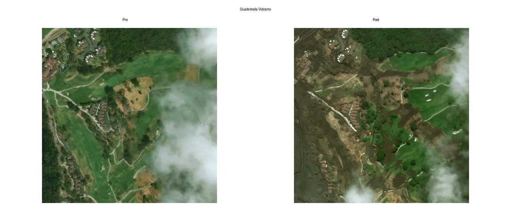

# `vis.before_after_panel`

> 汛前汛后对比

| | |
|---|---|
| 模块 | `vis` · `src/dora/tools/vis.py:1044`（10 行） |
| 相关性 | ★★★ |
| 可迁移性 | A |
| 依赖 | PIL |
| 异常处理 | **无统一包装**：异常会直接抛出（MCP 层表现为 tool error） |

## 源码中的原话

> Generate a before/after comparison panel. Output file is written to a managed location; its path is returned in the result dict as output_path.

## 这个工具做什么

把灾前灾后两张图并排摆好，做成一张对比图。

## 输入

| 参数 | 类型 | 必填 | 默认 | 说明 |
|---|---|:-:|---|---|
| `pre_image_path` | str | 是 | — | 灾前影像路径 |
| `post_image_path` | str | 是 | — | 灾后影像路径 |
| `title` | str | 否 | `'Before / After Comparison'` | 图标题 |

## 输出

| 字段 | 类型 | 说明 |
|---|---|---|
| `output_path` | str | 生成的图片路径（由调用方通过 `output_path` 参数指定） |

## 依赖与运行

- 依赖：PIL
- 硬件：纯算法，CPU 毫秒级；无需 GPU
- 输入：栅格 GeoTIFF/PNG；矢量 GeoJSON

## 调用

```python
from dora.tools.vis import before_after_panel_tool
import json

res = json.loads(before_after_panel_tool(pre_image_path="pre.tif", post_image_path="post.tif"))
print(res)
```

```json
{
  "name": "vis.before_after_panel",
  "arguments": {
    "pre_image_path": "pre.tif",
    "post_image_path": "post.tif"
  }
}
```

## 示例

> 下面这组是**真跑出来的**：输入取自 DORA 数据根里的真实影像，输出是工具原样返回。路径用 `<DORA_DATA>` / `<temp_dir>` 占位，换机器照抄即可。

### 示例输入

数据：同一地点的灾前、灾后影像

```json
{
  "pre_image_path": "<DORA_DATA>/images/xbd_agent_benchv1/pre/guatemala_volcano_00000004_pre.png",
  "post_image_path": "<DORA_DATA>/images/xbd_agent_benchv1/post/guatemala_volcano_00000004_post.png",
  "output_path": "<work>/before_after.png",
  "title": "Guatemala Volcano"
}
```

### 示例输出

```json
{
  "tool": "vis.before_after_panel",
  "output_path": "<work>/before_after.png",
  "title": "Guatemala Volcano"
}
```

[](../../examples/70-制图与报告/vis.before_after_panel/out.webp)

*左右对照图，用于人工核对变化*（点击图片看原图）

> 工具不做配准，错位会直接体现在图面上。

耗时 0.15 s（本机 8 核 CPU，无 GPU）。

## 适用边界

- **相关性**：★★★ —— 汛前汛后对比
- **可迁移性**：A
- 纯算法，无权重；换数据直接可用，结果只取决于输入数值本身。

---

[← 返回 70-制图与报告](README.md)　·　[工具总表](../../index/INDEX.md)
