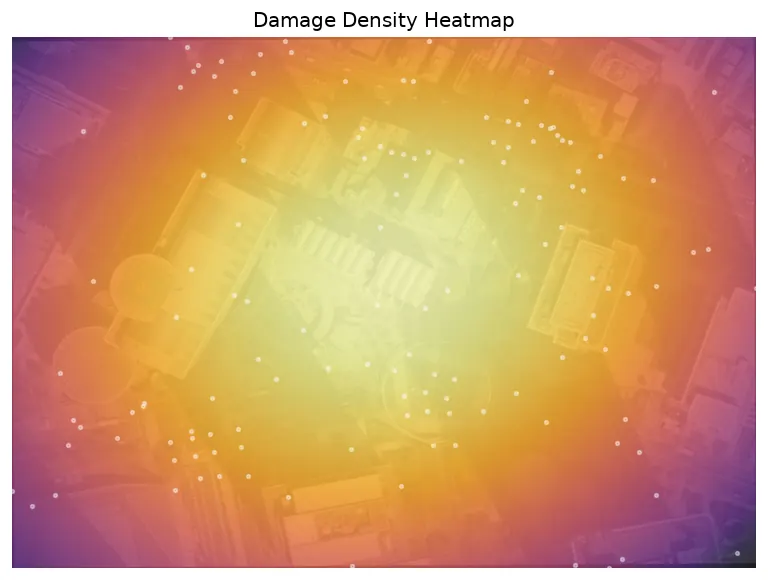

# `vis.heatmap`

> 隐患点、报汛站、受灾点密度

| | |
|---|---|
| 模块 | `vis` · `src/dora/tools/vis.py:1117`（82 行） |
| 相关性 | ★★ |
| 可迁移性 | A |
| 依赖 | PIL+scipy |
| 异常处理 | 函数内 `try/except`：异常转成 `{"error": ...}` 返回 |

## 源码中的原话

> Render a 2D heatmap visualizing the spatial density of input points or polygon centroids. Uses Gaussian kernel density estimation and a color-mapped overlay. If the input vector contains polygons (e.g., building damage outlines), their centroids are computed automatically.

## 这个工具做什么

把点的密集程度画成热力图，一眼看出隐患点、报汛站哪里最集中。

## 输入

| 参数 | 类型 | 必填 | 默认 | 说明 |
|---|---|:-:|---|---|
| `points_path` | str | 是 | — | 点要素文件（GeoJSON） |
| `base_image_path` | str? | 否 | `None` | 底图影像路径 |
| `bandwidth` | float? | 否 | `None` | 核密度带宽 |
| `colormap` | str | 否 | `'hot'` | 色带名称 |

## 输出

| 字段 | 类型 | 说明 |
|---|---|---|
| `heatmap_path` | str | Path to rendered heatmap image |
| `point_count` | int | Number of points used (polygon centroids count as points) |

**落盘产物**：`heatmap_path`（位于 `--temp_dir` 下，文件名带 6 位哈希）

## 依赖与运行

- 依赖：PIL+scipy
- 硬件：纯算法，CPU 毫秒级；无需 GPU
- 输入：栅格 GeoTIFF/PNG；矢量 GeoJSON

## 调用

```python
from dora.tools.vis import vis_heatmap
import json

res = json.loads(vis_heatmap(points_path="input.tif"))
print(res)
```

```json
{
  "name": "vis.heatmap",
  "arguments": {
    "points_path": "input.tif"
  }
}
```

## 示例

> 下面这组是**真跑出来的**：输入取自 DORA 数据根里的真实影像，输出是工具原样返回。路径用 `<DORA_DATA>` / `<temp_dir>` 占位，换机器照抄即可。

### 示例输入

数据：Tokyo OSM 点要素（EPSG:6677）；同区域影像

```json
{
  "points_path": "<work>/fixtures/points.geojson",
  "base_image_path": "<DORA_DATA>/images/heatisland/09LD1638/image_opt.tif",
  "bandwidth": 12,
  "colormap": "inferno"
}
```

### 示例输出

```json
{
  "tool": "vis.heatmap",
  "heatmap_path": "<temp_dir>/heatmap_0da43dc4.png",
  "point_count": 139,
  "stats": {
    "kde_max": 1.426805204275755e-07,
    "kde_mean": 1.4143904836861091e-07,
    "extent": [
      -12798.547402281212,
      -34183.793230866126,
      -12401.227792120913,
      "…（共 4 条，此处省略）"
    ]
  }
}
```

[](../../examples/70-制图与报告/vis.heatmap/out.webp)

*点密度热力图（核密度）*（点击图片看原图）

> 带宽 `bandwidth` 决定平滑程度；点与底图必须同坐标系、同上限范围。

耗时 5.41 s（本机 8 核 CPU，无 GPU）。

## 适用边界

- **相关性**：★★ —— 隐患点、报汛站、受灾点密度
- **可迁移性**：A
- 纯算法，无权重；换数据直接可用，结果只取决于输入数值本身。

---

[← 返回 70-制图与报告](README.md)　·　[工具总表](../../index/INDEX.md)
