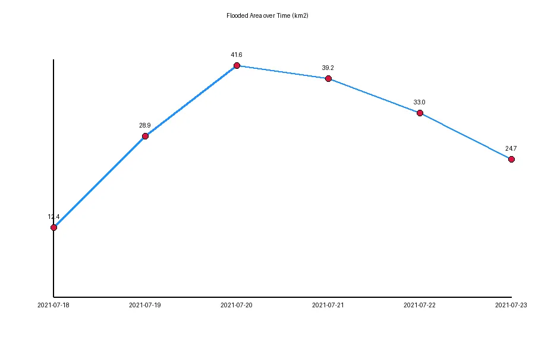

# `vis.line_chart`

> 水位/面积过程线

| | |
|---|---|
| 模块 | `vis` · `src/dora/tools/vis.py:1029`（9 行） |
| 相关性 | ★★ |
| 可迁移性 | A |
| 依赖 | PIL |
| 异常处理 | **无统一包装**：异常会直接抛出（MCP 层表现为 tool error） |

## 源码中的原话

> Generate a line chart from ordered statistics. Output file is written to a managed location; its path is returned in the result dict as output_path.

## 这个工具做什么

画折线图，看水位、面积随时间怎么变。

## 输入

| 参数 | 类型 | 必填 | 默认 | 说明 |
|---|---|:-:|---|---|
| `data` | dict[str,float] | 是 | — | 输入数据（数组或字典，结构见源码） |
| `title` | str | 否 | `'Line Chart'` | 图标题 |

## 输出

| 字段 | 类型 | 说明 |
|---|---|---|
| `output_path` | str | 生成的图片路径（由调用方通过 `output_path` 参数指定） |

## 依赖与运行

- 依赖：PIL
- 硬件：纯算法，CPU 毫秒级；无需 GPU
- 输入：栅格 GeoTIFF/PNG；矢量 GeoJSON

## 调用

```python
from dora.tools.vis import line_chart_tool
import json

res = json.loads(line_chart_tool(data="input.tif"))
print(res)
```

```json
{
  "name": "vis.line_chart",
  "arguments": {
    "data": "input.tif"
  }
}
```

## 示例

> ⚠️ **示意输入**：工具确实运行了，但输入与本工具的适用场景不完全对应（如用建筑影像演示滑坡双时相模型），结果只说明「接口怎么用」，不代表精度。

### 示例输入

数据：一组「日期 → 数值」点（示意数据，用于展示折线图能力）

```json
{
  "data": {
    "2021-07-18": 12.4,
    "2021-07-19": 28.9,
    "2021-07-20": 41.6,
    "2021-07-21": 39.2,
    "2021-07-22": 33.0,
    "2021-07-23": 24.7
  },
  "output_path": "<work>/line.png",
  "title": "Flooded Area over Time (km2)"
}
```

### 示例输出

```json
{
  "tool": "vis.line_chart",
  "output_path": "<work>/line.png",
  "chart_type": "line",
  "statistics": {
    "2021-07-18": 12.4,
    "2021-07-19": 28.9,
    "2021-07-20": 41.6,
    "2021-07-21": 39.2,
    "2021-07-22": 33.0,
    "2021-07-23": 24.7
  },
  "title": "Flooded Area over Time (km2)"
}
```

[](../../examples/70-制图与报告/vis.line_chart/out.webp)

*折线图输出（数据为示意）*（点击图片看原图）

> 图表工具与数据来源无关；换成真实的逐日淹没面积即可直接出图。

耗时 0.04 s（本机 8 核 CPU，无 GPU）。

## 适用边界

- **相关性**：★★ —— 水位/面积过程线
- **可迁移性**：A
- 纯算法，无权重；换数据直接可用，结果只取决于输入数值本身。

---

[← 返回 70-制图与报告](README.md)　·　[工具总表](../../index/INDEX.md)
