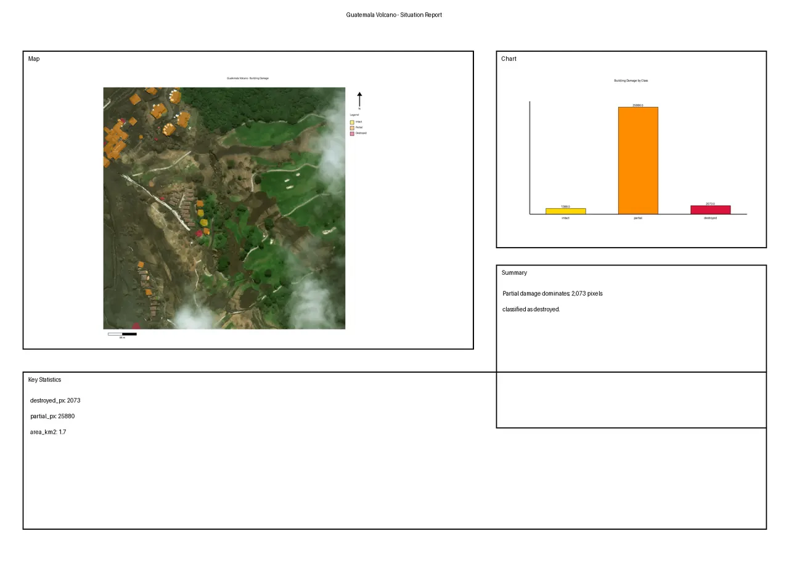

# `vis.report_page`

> 值班简报

| | |
|---|---|
| 模块 | `vis` · `src/dora/tools/vis.py:1077`（15 行） |
| 相关性 | ★★★ |
| 可迁移性 | A |
| 依赖 | PIL |
| 异常处理 | **无统一包装**：异常会直接抛出（MCP 层表现为 tool error） |

## 源码中的原话

> Compose a one-page disaster report from map, chart, summary, and statistics. Output file is written to a managed location; its path is returned in the result dict as output_path.

## 这个工具做什么

把图、表、文字排成一页简报，值班时直接发。

## 输入

| 参数 | 类型 | 必填 | 默认 | 说明 |
|---|---|:-:|---|---|
| `map_image_path` | str? | 是 | — | 地图影像路径 |
| `chart_image_path` | str? | 是 | — | 图表影像路径 |
| `summary_text` | str | 否 | `''` | 摘要文字 |
| `key_statistics` | dict? | 否 | `None` | 关键统计（字典） |
| `title` | str | 否 | `'Disaster Situation Report'` | 图标题 |

## 输出

| 字段 | 类型 | 说明 |
|---|---|---|
| `output_path` | str | 生成的图片路径（由调用方通过 `output_path` 参数指定） |

## 依赖与运行

- 依赖：PIL
- 硬件：纯算法，CPU 毫秒级；无需 GPU
- 输入：栅格 GeoTIFF/PNG；矢量 GeoJSON

## 调用

```python
from dora.tools.vis import report_page_tool
import json

res = json.loads(report_page_tool(map_image_path="input.tif", chart_image_path="input.tif"))
print(res)
```

```json
{
  "name": "vis.report_page",
  "arguments": {
    "map_image_path": "input.tif",
    "chart_image_path": "input.tif"
  }
}
```

## 示例

> 下面这组是**真跑出来的**：输入取自 DORA 数据根里的真实影像，输出是工具原样返回。路径用 `<DORA_DATA>` / `<temp_dir>` 占位，换机器照抄即可。

### 示例输入

数据：上一件工具出的专题图 + 统计柱状图

```json
{
  "map_image_path": "<work>/damage_map.png",
  "chart_image_path": "<work>/bar.png",
  "output_path": "<work>/report.png",
  "title": "Guatemala Volcano - Situation Report",
  "summary_text": "Partial damage dominates; 2,073 pixels classified as destroyed.",
  "key_statistics": {
    "destroyed_px": 2073,
    "partial_px": 25880,
    "area_km2": 1.7
  }
}
```

### 示例输出

```json
{
  "tool": "vis.report_page",
  "output_path": "<work>/report.png",
  "title": "Guatemala Volcano - Situation Report",
  "components": {
    "map": true,
    "chart": true,
    "summary_text": true,
    "key_statistics": true
  }
}
```

[](../../examples/70-制图与报告/vis.report_page/out.webp)

*一页式报告：地图 + 图表 + 关键数字*（点击图片看原图）

> 它是排版工具，不做分析；数字与图都要先前算好。

耗时 0.09 s（本机 8 核 CPU，无 GPU）。

## 适用边界

- **相关性**：★★★ —— 值班简报
- **可迁移性**：A
- 纯算法，无权重；换数据直接可用，结果只取决于输入数值本身。

---

[← 返回 70-制图与报告](README.md)　·　[工具总表](../../index/INDEX.md)
