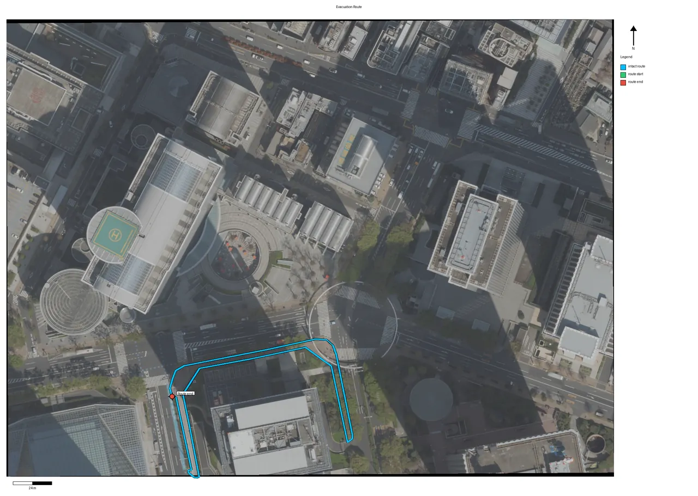

# `vis.route_map`

> 抢险路线图

| | |
|---|---|
| 模块 | `vis` · `src/dora/tools/vis.py:971`（37 行） |
| 相关性 | ★★ |
| 可迁移性 | A |
| 依赖 | PIL |
| 异常处理 | **无统一包装**：异常会直接抛出（MCP 层表现为 tool error） |

## 源码中的原话

> Render a shortest-path route on a base image, optionally with a damage-mask overlay. Output file is written to a managed location; its path is returned in the result dict as output_path.

## 这个工具做什么

在底图上画出抢险或撤离的路线。

## 输入

| 参数 | 类型 | 必填 | 默认 | 说明 |
|---|---|:-:|---|---|
| `base_image_path` | str | 是 | — | 底图影像路径 |
| `path_pixels` | list[list[int]] | 是 | — | 路径的像素坐标列表 |
| `title` | str | 否 | `'Intact Route Map'` | 图标题 |
| `pixel_size_m` | float? | 否 | `None` | 像元边长（米）。掩膜无地理参考时必须显式给出 |
| `start_point` | list[int]? | 否 | `None` | 起点 |
| `end_point` | list[int]? | 否 | `None` | 终点 |
| `overlay_mask_path` | str? | 否 | `None` | 叠加掩膜路径 |
| `class_labels` | dict[str,str]? | 否 | `None` | 类别值到名称的映射，用于图例 |
| `alpha` | float | 否 | `0.35` | 叠加透明度（0–1） |
| `route_color` | list[int]? | 否 | `None` | 路径颜色 |
| `route_width` | int | 否 | `5` | 路径线宽 |

## 输出

| 字段 | 类型 | 说明 |
|---|---|---|
| `output_path` | str | 生成的图片路径（由调用方通过 `output_path` 参数指定） |

## 依赖与运行

- 依赖：PIL
- 硬件：纯算法，CPU 毫秒级；无需 GPU
- 输入：栅格 GeoTIFF/PNG；矢量 GeoJSON

## 调用

```python
from dora.tools.vis import route_map_tool
import json

res = json.loads(route_map_tool(base_image_path="input.tif", path_pixels="input.tif"))
print(res)
```

```json
{
  "name": "vis.route_map",
  "arguments": {
    "base_image_path": "input.tif",
    "path_pixels": "input.tif"
  }
}
```

## 示例

> ⚠️ **示意输入**：工具确实运行了，但输入与本工具的适用场景不完全对应（如用建筑影像演示滑坡双时相模型），结果只说明「接口怎么用」，不代表精度。

### 示例输入

数据：Tokyo OSM 最长一条道路中心线（换算成像素折线）+ 同区域影像

```json
{
  "base_image_path": "<DORA_DATA>/images/heatisland/09LD1638/image_opt.tif",
  "path_pixels": [
    [
      1168,
      512
    ],
    [
      1143,
      505
    ],
    [
      1112,
      514
    ],
    [
      1088,
      523
    ],
    [
      1073,
      549
    ],
    [
      1022,
      810
    ],
    [
      990,
      957
    ],
    [
      993,
      991
    ],
    [
      1010,
      1010
    ],
    [
      1038,
      1020
    ],
    [
      1287,
      1070
    ],
    [
      1299,
      1070
    ],
    [
      1305,
      1062
    ],
    [
      1310,
      1055
    ],
    [
      1074,
      1005
    ],
    [
      1070,
      1000
    ],
    [
      1057,
      981
    ],
    [
      1016,
      925
    ],
    [
      1052,
      754
    ],
    [
      1081,
      597
    ],
    [
      1159,
      547
    ],
    [
      1163,
      546
    ],
    [
      1265,
      567
    ],
    [
      1417,
      596
    ],
    [
      1419,
      589
    ],
    [
      1418,
      580
    ],
    [
      1405,
      563
    ],
    [
      1397,
      562
    ],
    [
      1396,
      572
    ],
    [
      1169,
      524
    ],
    [
      1168,
      512
    ]
  ],
  "pixel_size_m": 0.2,
  "title": "Evacuation Route"
}
```

### 示例输出

```json
{
  "tool": "vis.route_map",
  "output_path": "<temp_dir>/route_map_dd53fcd9.png",
  "path_point_count": 31,
  "start_point": [
    1168,
    512
  ],
  "end_point": [
    1168,
    512
  ],
  "point_marker_labels": [
    "Route start",
    "Route end"
  ],
  "has_overlay": false,
  "legend_items": [
    "intact route",
    "route start",
    "route end"
  ]
}
```

[](../../examples/70-制图与报告/vis.route_map/out.webp)

*把一条路径画在底图上（红线）；本例用道路中心线代替最短路*（点击图片看原图）

> **示意**：`vec.build_graph` 建出的图被切得很碎（300 个节点、最大连通分量只有 44），最短路只有几十像素，画出来没意义，所以这里用真实道路几何代替。`path_pixels` 是像素坐标，可直接叠到同尺寸底图上。

耗时 0.43 s（本机 8 核 CPU，无 GPU）。

## 适用边界

- **相关性**：★★ —— 抢险路线图
- **可迁移性**：A
- 纯算法，无权重；换数据直接可用，结果只取决于输入数值本身。

---

[← 返回 70-制图与报告](README.md)　·　[工具总表](../../index/INDEX.md)
